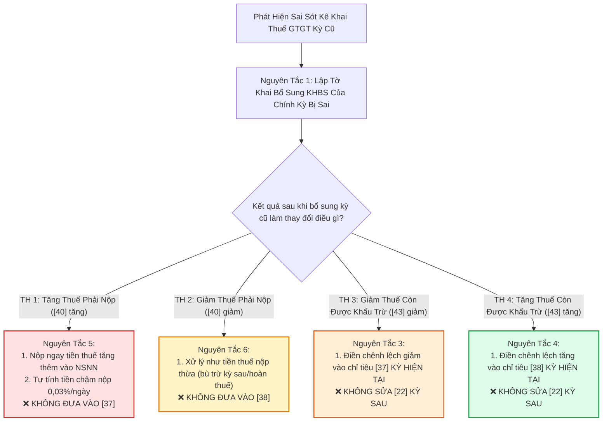

# 📜 10 NGUYÊN TẮC QUAN TRỌNG KHI KÊ KHAI ĐIỀU CHỈNH, BỔ SUNG THUẾ GTGT NĂM 2026

> **CÔNG TY TNHH THƯƠNG MẠI ĐẤT PHÚ (MST: 4401020233)**  
> *Sổ tay Hướng dẫn Kê khai Thuế & Quyết toán Thuế Chuẩn Luật Quản lý thuế 38/2019/QH14 & Thông tư 80/2021/TT-BTC*  
> *Áp dụng cho: Bộ phận Kế toán Thuế Đất Phú OneBase, Chuỗi Siêu thị Sữa Tã Năm Tiền & Đại lý Bán lẻ Toàn Tỉnh Phú Yên*

---

## 1. MA TRẬN 5 CHỈ TIÊU CỐT TỬ TRÊN TỜ KHAI 01/GTGT

Trước khi đi vào 10 nguyên tắc, kế toán phải nắm như in trong lòng bàn tay bản chất của 5 chỉ tiêu huyết mạch:

| Mã Chỉ Tiêu | Tên Chỉ Tiêu Trên Tờ Khai 01/GTGT | Ý Nghĩa Pháp Lý & Dòng Chảy Số Liệu |
| :---: | :--- | :--- |
| **[22]** | **Thuế GTGT còn được khấu trừ kỳ trước chuyển sang** | **BẤT BIẾN:** Bằng đúng chỉ tiêu **[43]** trên tờ khai *chính thức lần đầu* của kỳ trước liền kề. Tuyệt đối không tự ý sửa đổi khi khai bổ sung kỳ trước. |
| **[37]** | **Điều chỉnh GIẢM thuế GTGT còn được khấu trừ của các kỳ trước** | Kê khai tại **kỳ hiện tại** khi việc khai bổ sung kỳ trước làm số thuế còn được khấu trừ [43] bị giảm đi (nhưng chưa làm phát sinh thuế phải nộp). |
| **[38]** | **Điều chỉnh TĂNG thuế GTGT còn được khấu trừ của các kỳ trước** | Kê khai tại **kỳ hiện tại** khi việc khai bổ sung kỳ trước làm số thuế còn được khấu trừ [43] tăng lên. |
| **[40]** | **Thuế GTGT phải nộp của kỳ tính thuế** | Nếu phát sinh số dương ➔ Doanh nghiệp phải nộp tiền vào Ngân sách Nhà nước + tính tiền chậm nộp (Mẫu 01-1/KHBS). |
| **[43]** | **Thuế GTGT còn được khấu trừ chuyển kỳ sau** | Là số thuế đầu vào chưa khấu trừ hết trong kỳ, sẽ được chuyển sang chỉ tiêu **[22]** của kỳ kế tiếp. |

---

## 2. SƠ ĐỒ CÂY QUYẾT ĐỊNH (DECISION TREE) KHAI BỔ SUNG THUẾ GTGT



---

## 3. PHÂN TÍCH CHI TIẾT 10 NGUYÊN TẮC QUAN TRỌNG

### 🎯 Nguyên Tắc 1: Sai kỳ nào, khai bổ sung kỳ đó
- **Nguyên lý:** Sai sót doanh thu, thuế đầu ra, sai thuế suất thuộc kỳ tính thuế nào thì phải mở đúng kỳ tính thuế đó trên hệ thống HTKK/Thuedientu để nộp tờ khai bổ sung (Mẫu 01/KHBS + Tờ khai điều chỉnh 01/GTGT).
- **Tuyệt đối cấm:** Phát hiện Quý 1/2026 thiếu hóa đơn đầu ra mà lại tiện tay gộp doanh thu đó vào tờ khai Quý 4/2026. Làm như vậy là làm sai lệch doanh thu của cả hai kỳ tính thuế.
- **Lưu ý hóa đơn đầu vào:** Riêng hóa đơn GTGT đầu vào bỏ sót trước đây được phép kê khai vào kỳ phát hiện bỏ sót trước khi cơ quan thuế công bố quyết định thanh tra, kiểm tra.

---

### 🎯 Nguyên Tắc 2: Chỉ tiêu [22] không bao giờ được tự ý sửa đổi
- **Nguyên lý chuyển số:** Chỉ tiêu [22] (Thuế còn được khấu trừ kỳ trước chuyển sang) của Quý 2 phải lấy y nguyên từ chỉ tiêu [43] trên **tờ khai lần đầu (chính thức)** của Quý 1.
- **Tình huống:** Quý 1 lần đầu có $[43] = 150\text{ tr}$. Sang Quý 2 đã chuyển vào $[22] = 150\text{ tr}$. Sau đó khai bổ sung Quý 1 làm $[43] = 180\text{ tr}$ (tăng thêm $30\text{ tr}$).
- **Cách làm đúng:** Giữ nguyên $[22]$ của Quý 2 là $150\text{ tr}$. Khoản tăng $30\text{ tr}$ sẽ được đưa vào chỉ tiêu **[38] của kỳ hiện tại đang kê khai**.
- **Ngoại lệ duy nhất:** Chỉ được sửa [22] nếu lúc nộp tờ khai chính thức, kế toán gõ nhầm số liệu khác với [43] kỳ trước (lỗi đánh máy).

---

### 🎯 Nguyên Tắc 3: Giảm thuế GTGT còn được khấu trừ ➔ Điều chỉnh chỉ tiêu [37]
- **Điều kiện áp dụng:** Khai bổ sung kỳ cũ làm chỉ tiêu [43] giảm xuống, nhưng **kỳ cũ đó vẫn còn được khấu trừ (chưa phát sinh số thuế phải nộp [40] > 0)**.
- **Thao tác:** Lấy số chênh lệch giảm đưa vào **chỉ tiêu [37] trên tờ khai của kỳ hiện tại (kỳ đang lập)**.
- ⚠️ **Cảnh báo sai lầm:** Không được vừa sửa giảm [22] của kỳ liền sau, vừa gõ số tiền đó vào [37], vì hệ thống sẽ hiểu là bạn giảm trừ **2 lần** (bị mất oan số thuế được khấu trừ).

---

### 🎯 Nguyên Tắc 4: Tăng thuế GTGT còn được khấu trừ ➔ Điều chỉnh chỉ tiêu [38]
- **Điều kiện áp dụng:** Khai bổ sung kỳ cũ làm chỉ tiêu [43] tăng lên.
- **Thao tác:** Lấy số chênh lệch tăng đưa vào **chỉ tiêu [38] trên tờ khai của kỳ hiện tại**.
- **Hiệu quả:** Số thuế khấu trừ tăng thêm sẽ được cộng dồn vào số thuế được khấu trừ của kỳ này để bù trừ với thuế đầu ra phát sinh mới.

---

### 🎯 Nguyên Tắc 5: Khai bổ sung làm tăng thuế GTGT phải nộp ➔ Nộp tiền + Phạt chậm nộp
- **Nguyên lý:** Nếu tờ khai bổ sung làm phát sinh chỉ tiêu [40] > 0 (hoặc làm [40] tăng thêm so với lần nộp trước):
  1. Doanh nghiệp phải lập tức nộp số thuế tăng thêm vào tài khoản của Kho bạc Nhà nước.
  2. Tự tính tiền chậm nộp theo công thức:
     $$\text{Tiền chậm nộp} = \text{Số thuế tăng thêm} \times 0,03\%/\text{ngày} \times \text{Số ngày chậm nộp}$$
- ⚠️ **Tuyệt đối cấm:** Đưa số thuế phải nộp tăng thêm này vào chỉ tiêu [37]. Chỉ tiêu [37] chỉ dành cho số thuế *còn được khấu trừ giảm*, không phải là nơi nộp thay số thuế phải nộp!

---

### 🎯 Nguyên Tắc 6: Khai bổ sung làm giảm thuế GTGT phải nộp ➔ Xử lý tiền thuế nộp thừa
- **Nguyên lý:** Nếu kỳ cũ đã nộp thừa tiền thuế vào ngân sách do kê khai sai (ví dụ đã nộp $100\text{ tr}$, khai bổ sung đúng chỉ còn $85\text{ tr}$, thừa $15\text{ tr}$):
  - Khoản $15\text{ tr}$ này được quản lý trên hệ thống quản lý thuế tập trung (TMS) như một khoản **tiền thuế nộp thừa**.
  - Doanh nghiệp dùng để bù trừ vào số thuế phải nộp của các kỳ tiếp theo hoặc làm thủ tục hoàn trả nộp thừa theo Điều 60 Luật Quản lý thuế.
- ⚠️ **Sai lầm kinh điển:** Nhiều kế toán tự ý lấy $15\text{ tr}$ nộp thừa này gõ vào chỉ tiêu [38] (Tăng thuế khấu trừ). Làm như vậy là hoàn toàn sai bản chất kế toán thuế!

---

### 🎯 Nguyên Tắc 7: Khai bổ sung lần 2, lần 3 ➔ So sánh với lần bổ sung liền kề trước đó
- Một kỳ tính thuế có thể khai bổ sung vô số lần trước khi có quyết định thanh tra.
- **Nguyên tắc so sánh lũy kế:** Khi khai bổ sung lần $N$, luôn luôn so sánh số liệu mới với **Tờ khai bổ sung lần $N-1$ gần nhất**, không so sánh với tờ khai lần đầu đã bị điều chỉnh.
- **Ví dụ minh họa:**
  - Lần đầu: $[43] = 100\text{ tr}$.
  - Bổ sung Lần 1: $[43] = 120\text{ tr}$ ➔ Đã đưa chênh lệch tăng $20\text{ tr}$ vào chỉ tiêu [38].
  - Bổ sung Lần 2: $[43] = 135\text{ tr}$.
  - ➔ Số tiền đưa vào [38] kỳ này chỉ là: $135 - 120 = \mathbf{15\text{ tr}}$ (Tuyệt đối không lấy $135 - 100 = 35\text{ tr}$ vì sẽ bị tăng trùng $20\text{ tr}$ đã nhận trước đó).

---

### 🎯 Nguyên Tắc 8: Không phải mọi sai sót đều xử lý qua [37], [38]
- Chỉ tiêu [37] và [38] chỉ phục vụ duy nhất một mục đích: **Điều chỉnh tăng/giảm số thuế GTGT còn được khấu trừ chuyển kỳ sau của các kỳ trước**.
- Nếu sai sót dẫn đến tăng/giảm thuế phải nộp [40], tiền thuế vãng lai ngoại tỉnh, hoặc số thuế đề nghị hoàn [42], kế toán phải dùng đúng quy trình xử lý chuyên biệt, không được "lạm dụng" [37], [38].

---

### 🎯 Nguyên Tắc 9: Kiểm tra tính dây chuyền của các kỳ liên quan
- Khi nộp một tờ khai bổ sung cho một kỳ xa trong quá khứ (ví dụ tháng 10/2026 khai bổ sung cho Quý 1/2026), kế toán bắt buộc phải mở lại:
  - Tờ khai Quý 2/2026, Quý 3/2026 xem việc giảm [43] ở Quý 1 có làm Quý 2 hoặc Quý 3 bị biến từ "còn được khấu trừ" sang "phải nộp thuế" hay không.
  - Nếu làm phát sinh nghĩa vụ nộp thuế ở các kỳ trung gian, doanh nghiệp phải nộp bổ sung cho các kỳ đó để tránh bị phạt trốn thuế.

---

### 🎯 Nguyên Tắc 10: Lập Sổ theo dõi lịch sử khai bổ sung & Hồ sơ giải trình
Kế toán chuyên nghiệp của Đất Phú luôn lập một file theo dõi lịch sử kê khai (Audit Trail Table):

| Kỳ Tính Thuế | Ngày Nộp Bổ Sung | Lần BS | [43] Trước BS | [43] Sau BS | Chênh Lệch Điều Chỉnh | Đã Đưa Vào [37]/[38] Kỳ Nào? | Ghi Chú Hồ Sơ Kèm Theo |
| :---: | :---: | :---: | :---: | :---: | :---: | :---: | :--- |
| **Quý 1/2026** | 15/10/2026 | Lần 1 | 150.000.000 | 180.000.000 | Tăng 30.000.000 | [38] Quý 3/2026 | Bỏ sót HĐ mua vào NCC Sữa Meiji |
| **Quý 2/2026** | 20/10/2026 | Lần 1 | 85.000.000 | 65.000.000 | Giảm 20.000.000 | [37] Quý 3/2026 | Loại HĐ không đủ điều kiện thanh toán NH |

Hồ sơ lưu trữ bắt buộc bao gồm:
1. Bản in Tờ khai bổ sung Mẫu 01/KHBS.
2. Bản giải trình khai bổ sung Mẫu 01-1/KHBS.
3. Thông báo chấp nhận hồ sơ khai thuế điện tử của Tổng cục Thuế.
4. Chứng từ nộp tiền vào NSNN và giấy nộp tiền chậm nộp (nếu có).

---

## 4. THẦN CHÚ "3 KHÔNG - 3 ĐÚNG" DÀNH CHO KẾ TOÁN THUẾ ĐẤT PHÚ

```
┌────────────────────────────────────────────────────────────────────────┐
│                        THẦN CHÚ KÊ KHAI BỔ SUNG                        │
├───────────────────────────────────┬────────────────────────────────────┤
│             3 KHÔNG               │               3 ĐÚNG               │
├───────────────────────────────────┼────────────────────────────────────┤
│ 1. KHÔNG tự ý sửa chỉ tiêu [22].  │ 1. ĐÚNG kỳ nào khai bổ sung kỳ đó. │
│ 2. KHÔNG đưa thuế phải nộp vào    │ 2. ĐÚNG chênh lệch [43] đưa vào    │
│    chỉ tiêu [37], [38].           │    [37] (giảm) hoặc [38] (tăng).   │
│ 3. KHÔNG so sánh chênh lệch về    │ 3. ĐÚNG lần bổ sung liền kề trước  │
│    tờ khai lần đầu khi đã có lần  │    để tính phần chênh lệch phát    │
│    bổ sung trước đó.              │    sinh mới.                       │
└───────────────────────────────────┴────────────────────────────────────┘
```
