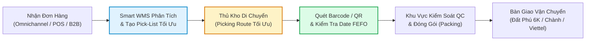
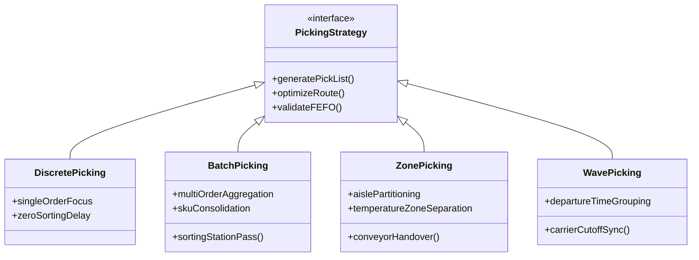

# 📦 PICKING LÀ GÌ? SO SÁNH 4 PHƯƠNG PHÁP LẤY HÀNG HIỆN ĐẠI & CHIẾN LƯỢC TỐI ƯU KHO VỚI ĐẤT PHÚ SMART WMS 6K

> **CÔNG TY TNHH THƯƠNG MẠI ĐẤT PHÚ**  
> *Hệ thống Quản trị Chuỗi Cung ứng & Kho Vận Bán Lẻ Đất Phú OneBase*  
> *Đơn vị vận hành: Chuỗi Siêu thị Sữa Tã Mẹ & Bé Năm Tiền, Tổng Kho Trung Tâm Tuy Hòa & Kho Lạnh Hải Sản Sông Cầu*

---

## 1. TỔNG QUAN: PICKING LÀ GÌ & TẠI SAO PICKING QUYẾT ĐỊNH 55% CHI PHÍ VẬN HÀNH KHO?

### 1.1. Định nghĩa chuẩn ngành Logistics & WMS
**Order Picking (Lấy hàng / Nhặt hàng)** là quá trình định vị, trích xuất và gom các mặt hàng (SKU) với số lượng chính xác từ các vị trí lưu trữ (kệ selective, pallet rack, thùng bin, kho mát, kho lạnh) theo danh sách đơn đặt hàng (Pick-List) để chuyển sang khu vực kiểm tra (QC), đóng gói (Packing) và xuất hàng (Dispatching).



### 1.2. Con số thống kê thực tế trong vận hành kho hàng
Theo các nghiên cứu chuẩn hóa kho vận toàn cầu và khảo sát tại các trung tâm phân phối Việt Nam:
- ⏱️ **55% tổng thời gian vận hành kho** bị tiêu tốn vào công đoạn Picking.
- 🚶 **Gần 50% thời gian lấy hàng thực chất là thời gian đi bộ / di chuyển vô ích (Dead Travel Time)** của nhân viên giữa các lối đi nếu không có quy hoạch tuyến đường.
- ❌ **Hơn 60% các sai sót giao hàng** (giao sai phân loại hàng, sai size bỉm, nhầm lon sữa cho bé dưới 1 tuổi sang trên 1 tuổi, lấy nhầm lô hàng cận hạn sử dụng) đều xuất phát từ khâu Picking thủ công dùng giấy hoặc nhớ miệng.

---

## 2. SO SÁNH TOÀN DIỆN 4 PHƯƠNG PHÁP PICKING HIỆN ĐẠI

| Tiêu chí | 1. Discrete Picking (Đơn lẻ) | 2. Batch Picking (Gộp mẻ) | 3. Zone Picking (Theo vùng) | 4. Wave Picking (Theo đợt sóng) |
| :--- | :--- | :--- | :--- | :--- |
| **Bản chất cốt lõi** | Nhặt từng đơn hàng một từ đầu đến cuối trước khi sang đơn tiếp theo. | Gộp nhiều đơn hàng lại thành 1 mẻ để lấy cùng lúc các SKU trùng nhau. | Chia kho thành các phân khu chuyên biệt; mỗi nhân sự phụ trách 1 khu vực. | Gom đơn theo từng khung giờ xuất bến, ca xe tải hoặc hãng vận chuyển. |
| **Độ chính xác** | ⭐⭐⭐⭐⭐ Cực cao (gần như 99.9% vì chỉ tập trung vào 1 đơn). | ⭐⭐⭐ Khá (dễ nhầm nếu khâu phân loại Sorting sau khi gom làm ẩu). | ⭐⭐⭐⭐ Cao (mỗi người là chuyên gia am hiểu khu vực của mình). | ⭐⭐⭐⭐ Rất cao (kết hợp đồng bộ với lịch trình xe điều phối). |
| **Tốc độ & Năng suất** | ⚠️ Thấp khi lượng đơn tăng (nhân viên đi lại liên tục cho từng đơn). | 🚀 Tăng 40% - 65% năng suất so với Discrete. | 🚀 Giảm 50% quãng đường di chuyển giữa các phân khu kho. | ⏱️ Tối ưu hóa tuyệt đối thời gian cắt xe (Cut-off Time) và hạn chót giao hàng. |
| **Phù hợp nhất với** | Đơn B2B số lượng lớn cồng kềnh; đơn sửa chữa máy móc khẩn cấp. | Bán lẻ TMĐT (Shopee/TikTok/OneBase), cửa hàng tạp hóa, sữa tã mẹ & bé. | Kho quy mô lớn, nhiều tầng, hoặc kho hỗn hợp (nhiệt độ thường + kho lạnh). | Trung tâm Logistics 3PL, kho tổng phân phối có nhiều tuyến xe tải cố định. |
| **Thiết bị hỗ trợ** | Bảng kẹp giấy hoặc Máy quét mã vạch cầm tay (PDA). | Xe đẩy chia ngăn đa tầng (Multi-tier Trolley) có đèn chỉ dẫn Pick-to-Light. | Băng chuyền chuyển thùng (Tote Conveyor) hoặc trạm bàn giao trung gian. | Phần mềm WMS thông minh lên lịch tự động theo Dispatch Schedule. |

---

## 3. PHÂN TÍCH CHI TIẾT TỪNG PHƯƠNG PHÁP & ỨNG DỤNG THỰC TẾ TẠI ĐẤT PHÚ ONEBASE



### 3.1. Phương Pháp 1: Discrete Picking (Lấy hàng từng đơn lẻ)
- **Cơ chế hoạt động:** Nhân viên kho nhận 1 đơn hàng độc lập, đi qua các kệ lấy đủ tất cả các mặt hàng của đơn đó rồi đưa thẳng về bàn đóng gói.
- **Ưu điểm:** Cực kỳ đơn giản, không cần phân loại lại sau khi nhặt, nhân viên mới làm được ngay, không phát sinh chi phí thiết bị đắt tiền.
- **Nhược điểm:** Tốn quá nhiều bước chân di chuyển. Nếu có 100 đơn hàng, mỗi đơn đều có 1 hộp Sữa Meiji 800g, nhân viên phải đi đến kệ sữa 100 lần!
- **Ứng dụng Đất Phú:**  
  - Dành cho các đơn **Cứu hộ khẩn cấp Thợ 6K** (ví dụ: Anh Vinh cần gấp 2 thùng sơn Kova chống thấm và 1 cuộn băng keo).
  - Dành cho đơn xuất buôn nguyên kiện (B2B) của Đại lý chuyển thẳng lên xe bán tải của đối tác.

---

### 3.2. Phương Pháp 2: Batch Picking (Lấy hàng theo mẻ gộp)
- **Cơ chế hoạt động:** Hệ thống Smart WMS phân tích 30 - 50 đơn hàng đang chờ xử lý trên sàn Đất Phú OneBase, gom tổng số lượng của từng SKU cần lấy. Ví dụ: Cần lấy tổng cộng 45 hộp Sữa Nan Optipro số 1, 30 bịch Tã Moony size L, 15 hũ Nấm rơm ngâm chua Bác Ba Chay. Nhân viên kho chỉ cần đẩy xe chuyên dụng đi qua kệ đúng 1 lần duy nhất để lấy đủ số lượng trên, sau đó chuyển về bàn Phân loại (Sorting / Put-wall).
- **Ưu điểm:** Cắt giảm đến **65% quãng đường di chuyển** trong nhà kho; tăng gấp đôi sản lượng đóng gói trong giờ cao điểm.
- **Nhược điểm:** Đòi hỏi khâu kiểm soát phân loại (Sorting) phải có mã vạch hoặc xe phân chia ngăn rõ ràng, tránh để nhầm đồ của khách này sang thùng của khách khác.
- **Ứng dụng Đất Phú:**  
  - Áp dụng triệt để cho chuỗi **10 Siêu thị Sữa Tã Mẹ & Bé Năm Tiền** trong các đợt flash sale ngày lễ và sàn TMĐT Đất Phú OneBase.

---

### 3.3. Phương Pháp 3: Zone Picking (Lấy hàng theo phân khu)
- **Cơ chế hoạt động:** Nhà kho được chia thành các phân khu vật lý (Zones). Nhân viên chỉ phụ trách lấy hàng trong đúng khu vực được phân công:
  - **Zone A:** Sữa bột, Bỉm tã, Đồ chơi trẻ em (Khu khô ráo, kệ cao selective).
  - **Zone B:** Nông sản đóng hộp, Mật ong rừng, Bò một nắng Krông Pa muối kiến vàng (Nhiệt độ phòng thoáng mát 22 - 25°C).
  - **Zone C (Kho Lạnh Sông Cầu):** Mắt cá ngừ đại dương Bà Tám, Tôm sú đầm Cù Mông, Cá ngừ phi lê (Âm sâu -18°C đến -22°C).
  - **Zone D:** Thiết bị kim khí, Dụng cụ cơ khí, Sơn Kova, Dây cáp điện thợ 6K.
- Khi có đơn hàng kết hợp, nhân viên Zone A nhặt phần sữa tã bỏ vào thùng trung chuyển (Tote), thùng được chuyển qua Zone B để nhặt thêm đặc sản, rồi chuyển ra bàn đóng gói.
- **Ưu điểm:** Nhân viên trở thành chuyên gia am hiểu chính xác từng vị trí trong Zone của mình; không phải di chuyển xa; đáp ứng tuyệt đối các yêu cầu bảo quản khắt khe (người làm kho đông lạnh không cần chạy sang kho bỉm sữa).
- **Ứng dụng Đất Phú:** Áp dụng tại **Tổng Kho Trung Tâm Tuy Hòa (Đường Nguyễn Tất Thành)** và hệ thống phân nhánh kho lạnh hải sản Sông Cầu.

---

### 3.4. Phương Pháp 4: Wave Picking (Lấy hàng theo đợt sóng tuyến xe)
- **Cơ chế hoạt động:** Đơn hàng được gom lại và phát lệnh nhặt theo các "đợt sóng" (Waves) phụ thuộc vào:
  1. *Lịch trình xuất bến của xe tải vận chuyển.*
  2. *Hạn chót lấy hàng của các đơn vị chuyển phát (Viettel Post, GHTK).*
  3. *Mức độ ưu tiên của khách VIP.*
- **Lịch trình Đợt Sóng (Waves) mẫu tại Đất Phú:**
  - 🌊 **Wave 1 (08h00 - 08h30):** Gom tất cả đơn giao Hỏa Tốc nội thành Tuy Hòa bằng Đội xe máy & xe lôi 6K.
  - 🌊 **Wave 2 (10h00 - 10h45):** Gom các đơn sỉ gửi chành xe khách Cúc Tư / Thuận Thảo đi Sông Hinh, Sơn Hòa và Buôn Ma Thuột (Đắk Lắk).
  - 🌊 **Wave 3 (14h30 - 15h15):** Gom hàng bưu kiện liên tỉnh bàn giao cho xe tải Viettel Post lấy hàng lúc 15h30.
- **Ưu điểm:** Kho hàng vận hành nhịp nhàng như một cỗ máy, không bao giờ bị trễ giờ xuất bến của các chuyến xe, không có hiện tượng hàng đã đóng gói chất đống nghẽn lối đi.

---

## 4. CHIẾN LƯỢC KẾT HỢP HYBRID: ZONE-BATCH-WAVE TẠI ĐẤT PHÚ SMART WMS 6K

Đối với doanh nghiệp thương mại phân phối thực phẩm & bán lẻ đa kênh như Đất Phú, việc áp dụng đơn thuần một phương pháp là chưa đủ. **Đất Phú Smart WMS 6K** triển khai mô hình lai ghép thông minh (Hybrid Picking):

```
[Hàng trăm đơn từ POS, Sàn TMĐT, Đại lý Zalo]
                    │
                    ▼
       ┌─────────────────────────┐
       │   WAVE PICKING ENGINE   │ ── Phân loại theo khung giờ xe tải
       └─────────────────────────┘
                    │
                    ▼
       ┌─────────────────────────┐
       │   ZONE PICKING DIVIDER  │ ── Phân chia lệnh xuống từng Zone (Khô, Lạnh, Kim khí)
       └─────────────────────────┘
                    │
                    ▼
       ┌─────────────────────────┐
       │   BATCH PICKING ROUTE   │ ── Gộp mẻ SKU & tính toán lộ trình bước chân ngắn nhất
       └─────────────────────────┘
                    │
                    ▼
[Nhân viên quét Barcode FEFO ➔ Bàn QC Đóng Gói ➔ Xe Tải Lăn Bánh Đúng Giờ]
```

---

## 5. CÔNG NGHỆ TỐI ƯU QUY TRÌNH PICKING TRONG HỆ THỐNG WMS HIỆN ĐẠI

### 5.1. Tự động hóa tạo Danh sách Nhặt hàng (Pick-List) thông minh
Hệ thống WMS tự động sắp xếp danh sách các mặt hàng theo tọa độ ô kệ (`Dãy - Kệ - Tầng - Ô`, ví dụ `A-02-03-01`) sao cho người nhặt chỉ cần đi **1 vòng chữ S (S-Shape Routing)** từ đầu dãy kệ đến cuối dãy mà không bao giờ phải quay đầu lại (Backtracking).

### 5.2. Quét mã Barcode / QR Code xác thực 100%
Khi lấy hàng, nhân viên dùng camera điện thoại hoặc máy quét cầm tay quét mã QR trên bao bì:
- Nếu đúng sản phẩm & đúng số lượng: Màn hình hiển thị màu xanh lá kèm âm thanh xác nhận (*Beep*).
- Nếu lấy nhầm mã hoặc nhầm dung tích: Hệ thống lập tức rung chuông báo động đỏ (*Error: Sai phân loại sản phẩm!*).

### 5.3. Bắt buộc kiểm soát Date theo nguyên tắc FEFO (First Expired, First Out)
Đối với chuỗi mẹ & bé (Sữa, Bột ăn dặm) và đặc sản thực phẩm (Bò một nắng, Cá ngừ Bà Tám):
- Smart WMS tự động chỉ định chính xác **Số Lô (Lot Number)** và vị trí pallet có hạn dùng ngắn nhất cần xuất trước.
- Nhân viên quét trúng lô hàng có hạn xa hơn sẽ bị hệ thống từ chối cho nhặt, ngăn chặn triệt để rủi ro tồn ứ hàng cận date tại kho.

---

## 6. LỢI ÍCH ĐO LƯỜNG ĐƯỢC SAU KHI TRIỂN KHAI TẠI ĐẤT PHÚ
- 📉 **Giảm 65% quãng đường di chuyển** của nhân viên kho hàng ngày.
- ⚡ **Tốc độ xử lý đơn hàng tăng gấp 2.8 lần** (từ trung bình 12 phút/đơn xuống còn 4.2 phút/đơn).
- 🎯 **Tỷ lệ chính xác đơn hàng đạt 99.8%**, gần như triệt tiêu hoàn toàn khiếu nại giao sai hàng từ khách hàng.
- 💰 **Tiết kiệm hàng trăm triệu đồng mỗi năm** từ việc không còn thất thoát hay phải hủy hàng do quá hạn sử dụng.
- 🚚 **Đảm bảo 100% đơn hàng xuất bến đúng lịch trình**, củng cố vững chắc niềm tin của đối tác và khách hàng toàn tỉnh Phú Yên.
