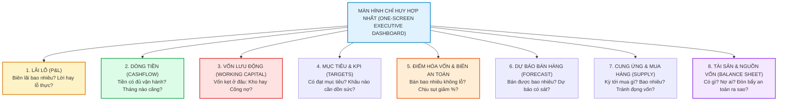

# 🧩 8 MẢNH GHÉP MÀ MỌI CHỦ DOANH NGHIỆP ĐỀU CẦN ĐỂ QUẢN TRỊ TÀI CHÍNH VÀ KINH DOANH HIỆU QUẢ

> *"Quản trị một doanh nghiệp không phải nhìn vào một con số, mà là ghép đủ một bức tranh. Thiếu một mảnh, bạn sẽ ra quyết định trong khi còn mù một góc. Tám mảnh ghép này trả lời tám câu hỏi sống còn của một doanh nghiệp. Khi chúng nằm trên một màn hình duy nhất, bạn không còn phải mở mười file để ghép lại — bạn quản trị bằng dữ liệu, trên một bức tranh hoàn chỉnh, thay vì bằng cảm tính."*  
> — **Hệ Thống Chỉ Huy Hợp Nhất Đất Phú Omni-ERP 6K (Cockpit Executive Dashboard)**

---



---

## 1. PHÂN TÍCH TOÀN DIỆN 8 MẢNH GHÉP SỐNG CÒN

### 🧩 MẢNH GHÉP 1: LÃI LỖ (PROFIT & LOSS - P&L)
- **Câu hỏi sống còn:** *Doanh nghiệp đang thực sự lãi hay lỗ? Biên lợi nhuận gộp và biên lợi nhuận ròng là bao nhiêu? Thực tế có bám sát kế hoạch đầu năm không?*
- **Chỉ số đo lường:**
  - **Doanh thu thuần (Net Revenue):** Trừ các khoản chiết khấu, giảm giá, hàng bán trả lại.
  - **Lợi nhuận gộp (Gross Profit) & Biên lãi gộp (Gross Margin %):** Đánh giá sức mạnh cạnh tranh của sản phẩm (ví dụ Sữa Meiji biên 18%, Cá ngừ Bà Tám biên 35%).
  - **Lợi nhuận ròng (Net Profit):** Sau khi trừ toàn bộ chi phí vận hành, chi phí bán hàng, chi phí quản lý và thuế TNDN.
- **Bẫy thường gặp:** "Lãi trên giấy nhưng không thấy tiền đâu" do không trừ hết chi phí ẩn và khấu hao.

---

### 🧩 MẢNH GHÉP 2: DÒNG TIỀN (CASH FLOW ENGINE)
- **Câu hỏi sống còn:** *Tiền mặt và tiền gửi ngân hàng có đủ để vận hành 3 - 6 tháng tới không? Tháng nào dòng tiền bị căng thẳng để chủ động chuẩn bị vốn trước?*
- **Chỉ số đo lường:**
  - **Dòng tiền từ HĐKD (Operating Cash Flow - OCF):** Dòng máu chính của công ty.
  - **Tốc độ đốt tiền (Burn Rate) & Thời gian sống sót (Runway):** Biết chính xác doanh nghiệp chịu được bao nhiêu tháng nếu không có doanh thu mới.
  - **Dự báo dòng tiền 13 tuần (13-Week Cash Flow Forecast):** Nhìn thấy trước điểm trũng dòng tiền để đàm phán giãn nợ nhà cung cấp hoặc mở hạn mức tín dụng ngân hàng trước 30 ngày.

---

### 🧩 MẢNH GHÉP 3: VỐN LƯU ĐỘNG (WORKING CAPITAL & CCC)
- **Câu hỏi sống còn:** *Tiền của doanh nghiệp đang bị kẹt ở đâu: Nằm chết ở Hàng tồn kho hay nằm trong túi Khách hàng (Công nợ)? Làm sao rút ngắn vòng quay để giải phóng tiền?*
- **Chỉ số đo lường:**
  $$\mathbf{\text{Vốn lưu động ròng (NWC)}} = \text{Tài sản ngắn hạn} - \text{Nợ ngắn hạn}$$
  $$\mathbf{\text{Chu kỳ chuyển đổi tiền mặt (CCC)}} = \text{DIO (Số ngày tồn kho)} + \text{DSO (Số ngày thu nợ)} - \text{DPO (Số ngày trả nợ NCC)}$$
- **Hành động thực chiến:** Rút ngắn CCC từ 65 ngày xuống 35 ngày đồng nghĩa với việc giải phóng hàng tỷ đồng vốn lưu động mà không cần đi vay ngân hàng chịu lãi suất.

---

### 🧩 MẢNH GHÉP 4: MỤC TIÊU & KPI (TARGETS & OKRs)
- **Câu hỏi sống còn:** *Toàn công ty và từng chi nhánh có đang đạt mục tiêu không? Chỉ tiêu nào đang báo động đỏ để lãnh đạo kịp thời dồn lực cứu vãn?*
- **Chỉ số đo lường:**
  - Tỷ lệ hoàn thành doanh số tháng/quý theo từng kênh (POS Năm Tiền, Sàn OneBase, Đại lý B2B).
  - Năng suất nhân sự: Doanh thu trung bình / nhân viên / tháng.
  - Tỷ lệ giữ chân khách hàng (Retention Rate) và giá trị trung bình đơn hàng (AOV).

---

### 🧩 MẢNH GHÉP 5: ĐIỂM HÒA VỐN & BIÊN AN TOÀN (BREAK-EVEN & MARGIN OF SAFETY)
- **Câu hỏi sống còn:** *Mỗi tháng phải bán được tối thiểu bao nhiêu tỷ thì mới đủ trả tiền mặt bằng, tiền lương, điện nước (hòa vốn)? Doanh nghiệp chịu đựng được mức sụt giảm doanh thu bao nhiêu % trước khi bắt đầu lỗ?*
- **Công thức cốt tử:**
  $$\mathbf{\text{Doanh thu hòa vốn (BEP)}} = \frac{\text{Tổng định phí (Fixed Costs)}}{\text{Tỷ lệ số dư đảm phí (Contribution Margin Ratio)}}$$
  $$\mathbf{\text{Biên an toàn (Margin of Safety \%)}} = \frac{\text{Doanh thu thực tế} - \text{Doanh thu hòa vốn}}{\text{Doanh thu thực tế}} \times 100\%$$
- **Ý nghĩa:** Nếu Biên an toàn là 25%, nghĩa là thị trường có biến động giảm 20% doanh thu thì công ty vẫn sống sót và không bị âm vốn.

---

### 🧩 MẢNH GHÉP 6: DỰ BÁO BÁN HÀNG (SALES FORECASTING)
- **Câu hỏi sống còn:** *Tháng tới dự kiến bán được bao nhiêu đơn? Dự báo của phòng kinh doanh có bám sát thực tế hay chỉ là số ảo "vẽ cho sếp vui"?*
- **Chỉ số đo lường:**
  - Độ chính xác dự báo (Forecast Accuracy %): So sánh giữa `Số dự báo` và `Số thực đạt`.
  - Phân tích mùa vụ (Seasonality): Nhu cầu sữa tã ngày lễ Tết, nhu cầu hải sản cá ngừ mùa du lịch hè Phú Yên.

---

### 🧩 MẢNH GHÉP 7: CUNG ỨNG & MUA HÀNG (PROCUREMENT & REORDER POINT)
- **Câu hỏi sống còn:** *Kỳ tới cần mua mặt hàng nào, số lượng bao nhiêu, cần chuẩn bị bao nhiêu tiền thanh toán? Làm sao nhập đủ hàng bán mà không bị đọng vốn tồn kho?*
- **Chỉ số đo lường:**
  - Điểm đặt hàng lại tự động (Reorder Point - ROP): Khi tồn kho bỉm Moony chạm mốc 15 bịch ➔ Hệ thống tự động phát đề nghị mua hàng PO.
  - Vòng quay hàng tồn kho (Inventory Turnover): Đảm bảo hàng nhóm A luân chuyển nhanh, không để hàng cận date nằm đáy kệ.

---

### 🧩 MẢNH GHÉP 8: TÀI SẢN & NGUỒN VỐN (BALANCE SHEET HEALTH)
- **Câu hỏi sống còn:** *Doanh nghiệp hiện đang có những tài sản gì? Nợ ai bao nhiêu tiền? Mức độ an toàn tài chính và đòn bẩy nợ có đang ở ngưỡng báo động không?*
- **Chỉ số đo lường:**
  - Tỷ lệ Nợ trên Vốn chủ sở hữu (D/E Ratio): Kiểm soát dưới 1.5 để bảo đảm sức khỏe tài chính bền vững.
  - Khả năng thanh toán hiện hành (Current Ratio) và thanh toán nhanh (Quick Ratio).

---

## 2. HIỆN THỰC HÓA 8 MẢNH GHÉP TRÊN HỆ THỐNG ĐẤT PHÚ ONEBASE COCKPIT

Tại **Công ty TNHH Thương mại Đất Phú (OneBase)**, chúng tôi không để 8 mảnh ghép này nằm rải rác trên 10 file Excel của các phòng ban. Toàn bộ đã được hợp nhất thời gian thực trên **Omni-ERP 6K Executive Cockpit**:

```
┌────────────────────────────────────────────────────────────────────────┐
│              OMNI-ERP 6K: BẢNG CHỈ HUY 8 MẢNH GHÉP HỢP NHẤT            │
├───────────────────┬───────────────────┬────────────────────────────────┤
│ 1. LÃI LỖ REALTIME│ 2. DÒNG TIỀN DỰ BÁO│ 3. VỐN LƯU ĐỘNG (NWC)          │
│ Lãi ròng: 1.36 Tỷ │ Số dư: 4.82 Tỷ    │ Tồn kho: 3.42 Tỷ (Quay 18 ngày)│
│ Biên ròng: 15.3%  │ Runway: 7.2 tháng │ Nợ phải thu 131: 640 Tr        │
├───────────────────┼───────────────────┼────────────────────────────────┤
│ 4. MỤC TIÊU & KPI │ 5. ĐIỂM HÒA VỐN   │ 6. DỰ BÁO BÁN HÀNG             │
│ Đạt 104.2% Tháng  │ BEP: 5.2 Tỷ/tháng │ Tháng 11: 9.4 Tỷ (+12%)        │
│ Top 1: Sữa Mẹ & Bé│ Biên an toàn: 41% │ Độ chính xác dự báo: 94.6%     │
├───────────────────┴───────────────────┴────────────────────────────────┤
│ 7. CUNG ỨNG SMART PO                 │ 8. TÀI SẢN & ĐÒN BẨY NỢ         │
│ Cần nhập: 1.8 Tỷ (Meiji, Moony, Cá Ngừ)│ Tổng TS: 18.5 Tỷ • Nợ/Vốn: 0.62│
│ Hạn thanh toán NCC: 30 ngày (DPO: 38) │ Đòn bẩy an toàn tuyệt đối      │
└───────────────────────────────────────┴────────────────────────────────┘
```
