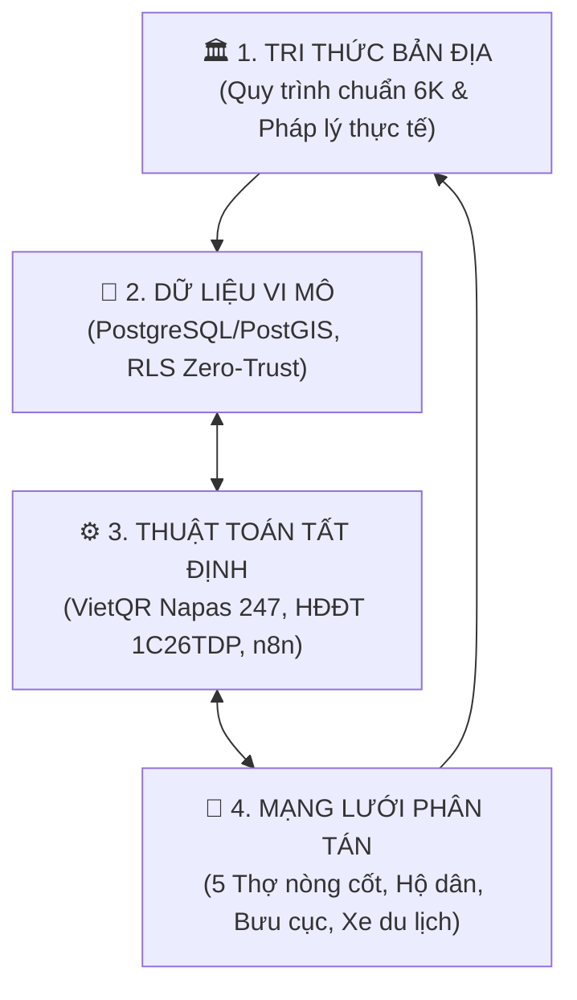
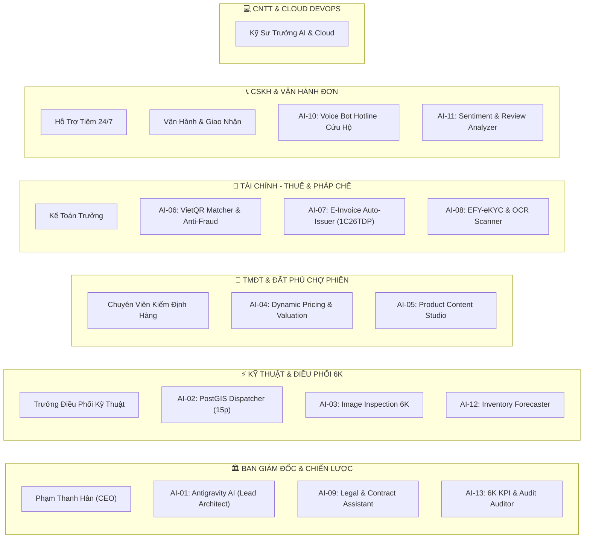

# BẢN KẾ HOẠCH NỀN KINH TẾ KIỂU MỚI THỜI ĐẠI SỐ
## HỆ ĐIỀU HÀNH KÍN KẼ OS™ – ĐIỀU PHỐI MẠNG LƯỚI TÀI SẢN NHẸ
### ĐƠN VỊ HẠT NHÂN: CÔNG TY TNHH THƯƠNG MẠI ĐẤT PHÚ (MST: 4401020233)
*Địa bàn trọng điểm: Tuy Hòa – Phú Yên & Đắk Lắk | Triết lý: "Làm vương không xưng đế" • "Biết co biết duỗi"*

---

## I. BỐI CẢNH LỊCH SỬ & ĐIỂM GÃY THỜI ĐẠI

Thế giới và Việt Nam đang bước qua khúc ngoặt lịch sử: sự thoái trào của tư duy công nghiệp hóa kiểu cũ (sở hữu nặng, đòn bẩy nợ, chi phí cố định khổng lồ) và sự trỗi dậy của **Kinh tế điều phối số – Tài sản nhẹ (Asset-Light Orchestration)**.

```
THẾ KỶ 19 - 20 (200 NĂM CŨ)                   KỶ NGUYÊN SỐ (THỜI ĐẠI MỚI)
┌─────────────────────────────────┐           ┌─────────────────────────────────┐
│     TÀI SẢN NẶNG (HEAVY)        │           │      TÀI SẢN NHẸ (LIGHT)        │
│ • Sở hữu tư liệu sản xuất       │   DỊCH    │ • Điều phối mạng lưới nhàn rỗi  │
│ • Nhà xưởng, kho bãi, showroom  │  CHUYỂN   │ • Kho bãi phân tán, thợ lưu động│
│ • Đòn bẩy nợ ngân hàng gồng lỗ  │──────────►│ • Dòng tiền dương tự thân ngày 1│
│ • Phô trương quy mô vỏ bọc      │           │ • "Kín kẽ", bảo mật Zero-Trust  │
│ • Nguy cơ đứt gãy, phá sản cao  │           │ • "Biết co biết duỗi", linh hoạt│
└─────────────────────────────────┘           └─────────────────────────────────┘
```

* **Điểm yếu mô hình cũ:** Chi phí cố định lớn đè bẹp dòng tiền; khi khủng hoảng xảy ra thì phá sản vì nợ vay và khấu hao.
* **Sức mạnh mô hình Đất Phú:** Không sở hữu xe, không ôm kho, không mở chuỗi mặt bằng đắt đỏ; sử dụng công nghệ tinh gọn, dữ liệu vi mô và thuật toán tất định để tổ chức lại các nguồn lực nhàn rỗi trong xã hội.

---

## II. 4 TRỤ CỘT NỀN TẢNG CỦA HỆ ĐIỀU HÀNH KÍN KẼ OS™



1. **Tri thức bản địa (Domain Knowledge):**
   * Quy chuẩn hóa kinh nghiệm thẩm định thành **Quy trình 6K**: *K1 Kết nối ➔ K2 Kiểm tra ➔ K3 Ký kết ➔ K4 Kích hoạt ➔ K5 Kiểm soát ➔ K6 Kế toán*.
   * Nắm chắc nghiệp vụ kế toán, 10 hành vi rủi ro về thuế và quy định thương mại điện tử, biến tính tuân thủ thành rào cản phòng thủ vững chắc.
2. **Dữ liệu vi mô (Proprietary Hyper-local Data):**
   * Lưu trữ phân tầng trên PostgreSQL/Supabase, bảo mật bằng Row Level Security (RLS).
   * Bản đồ hóa năng lực cung ứng theo từng đơn vị hành chính nhỏ nhất (Phường 7, Phú Lâm, Phường 9, Phường 2, Sông Hinh, Sông Cầu).
3. **Thuật toán tất định (Deterministic Logic):**
   * Không dùng AI phỏng đoán hay xác suất cho dòng tiền. 
   * Tính toán chính xác 100% bằng webhook, mã VietQR động đối soát số dư tự động và API hóa đơn điện tử máy tính tiền.
4. **Mạng lưới phân tán (Decentralized Network):**
   * Tận dụng nhà dân làm kho vệ tinh (không tốn tiền thuê kho).
   * Mạng lưới thợ tự do làm chuyên viên kiểm định lưu động (ăn chia theo ca, không gánh lương cứng).
   * Đòn bẩy hạ tầng ngân hàng (VietQR) và bưu chính quốc gia (ViettelPost/VNPost) làm đội xe giao vận.

---

## III. MA TRẬN MÔ HÌNH KINH DOANH: HAI ĐỘNG CƠ (DUAL-ENGINE)

```
┌────────────────────────────────────────────────────────────────────────┐
│                   HỆ SINH THÁI ĐẤT PHÚ (KÍN KẼ OS™)                    │
└──────────────────────────────────┬─────────────────────────────────────┘
                                   │
         ┌─────────────────────────┴─────────────────────────┐
         ▼                                                   ▼
┌─────────────────────────────────┐ ┌─────────────────────────────────┐
│     ĐỘNG CƠ 1: DỊCH VỤ SỐ       │ │     ĐỘNG CƠ 2: RE-MARKET        │
│       (Cash Flow B2B)           │ │       (Platform C2C)            │
├─────────────────────────────────┤ ├─────────────────────────────────┤
│ • Chữ ký số (Token / HSM EFY-CA)│ │ • Sách cũ, tư liệu văn hóa xứ Nẫu│
│ • Hóa đơn điện tử (1C26TDP)    │ │ • Thiết bị điện tử kiểm định 6K │
│ • Phần mềm kế toán & Pháp lý số │ │ • Đặc sản OCOP Biển - Nông - Lâm │
│ • Cứu hộ tiệm & Xe du lịch 6K   │ │ • Camera Imou/Ezviz thanh lý 6K │
├─────────────────────────────────┤ ├─────────────────────────────────┤
│ ➜ Tỷ suất chiết khấu cao        │ │ ➜ Tái sinh vòng đời sản phẩm    │
│ ➜ Dòng tiền tươi, quay vòng vốn │ │ ➜ Tạo sinh kế cho thợ địa phương│
│ ➜ Nuôi sống bộ máy hạ tầng tech │ │ ➜ Giữ gìn và lan tỏa bản sắc    │
└─────────────────────────────────┘ └─────────────────────────────────┘
```

---

## IV. MA TRẬN 13 CÔNG CỤ AI VẬN HÀNH & PHÂN BỔ 6 PHÒNG BAN



---

## V. KIẾN TRÚC KỸ THUẬT TINH GỌN (ASSET-LIGHT STACK)

1. **Giao diện đa kênh (Headless & PWA):**
   * **Một lõi – Hai cửa:** Mã nguồn viết chuẩn HTML5/JS/Tailwind/Vue gọn nhẹ, vừa chạy làm **Zalo Mini App**, vừa chạy làm **Web App PWA** độc lập trên tên miền riêng, tải trang dưới 1.2s trên mạng 4G.
2. **Cơ sở dữ liệu Supabase (PostgreSQL + PostGIS):**
   * Quản trị dữ liệu vi mô theo tọa độ không gian `ST_DWithin` tìm thợ và điểm dịch vụ trong bán kính 2.5km – 5km.
   * Kích hoạt `FORCE ROW LEVEL SECURITY (RLS)` phân tách dữ liệu đa khách thuê (`tenant_id`), ngăn chặn rò rỉ thông tin.
   * **Supabase Storage:** Phân tách bucket công khai (ảnh sản phẩm, ảnh thợ) và bucket bảo mật (hóa đơn, CCCD, hợp đồng số).
3. **Tự động hóa luồng nghiệp vụ (n8n Engine):**
   * Bắt Webhook biến động số dư VietQR ➔ Kích hoạt đơn hàng ➔ Bắn lệnh thợ 6K ➔ Gọi API ký số HĐĐT **1C26TDP**.
4. **Kỷ luật AI Bảo Mật (No Public AI Policy):**
   * Cấm tuyệt đối đưa mã nguồn, CCCD khách hàng, báo cáo tài chính hay bí mật kinh doanh lên các công cụ AI công cộng. Chỉ sử dụng môi trường API doanh nghiệp khép kín (Private Enterprise API).

---

## VI. MA TRẬN TÌM KIẾM BẢN ĐỊA 8 TRỤ CỘT – 28 NGÀNH NGHỀ TUY HÒA

Hệ thống tích hợp bảng ánh xạ từ khóa tự nhiên (tiếng Việt có dấu, không dấu, viết tắt, tiếng lóng bản địa) về các cơ sở thực tế tại TP. Tuy Hòa trong bán kính 2.5km:

| Trụ cột ngành | Ngành nghề hiển thị | Từ khóa tìm kiếm tự nhiên | Điểm dịch vụ tiêu biểu Tuy Hòa | Ưu tiên Radar |
| :--- | :--- | :--- | :--- | :--- |
| **1. Ẩm Thực** | Cà Phê, Bún Riêu, Cơm Gà, Hải Sản, Lò Bánh | `cafe, bun rieu, banh canh he, com ga, mat ca ngu, banh mi hoa da` | Bánh canh Bưu Điện, Bà Tám cá ngừ, Sala | Cao (Theo giờ ăn) |
| **2. Xây Dựng** | VLXD, Sơn Nước, Chống Thấm, Xưởng Mộc, May Rèm | `vlxd, son nuoc, chong tham, xuong moc, cat alu, rem cua` | Đại lý sơn Jotun Trần Hưng Đạo, Mộc Bình Kiến | Bình thường |
| **3. Lưu Trú & Xe**| Khách Sạn, Homestay, Thuê Xe Máy, Taxi Sân Bay | `khach san, homestay, thue xe may, taxi san bay, tour 7 cho` | Khách sạn Sala, May Homestay, Taxi TBB | **CỰC CAO (Du khách)** |
| **4. Cưới Hỏi** | Hoa Tươi, Studio Áo Cưới, Spa, Rạp Nấu Tiệc | `hoa tuoi, ao cuoi, chup hinh, spa, nail, cat toc, nau tiec` | Shop hoa Lê Lợi, Salon tóc Tuấn, Tiệm Nail Xinh | Cao (Ngày lễ/tiệc) |
| **5. Thợ 6K** | Điện Nước, Điện Lạnh, Khóa Cửa Cuốn, Cứu Hộ 24/7 | `tho dien, tho nuoc, may lanh, sua khoa, cuu ho xe, kich binh` | Đội thợ 6K P.7, KTV Trần Quốc Hưng, Cứu hộ P.2 | **CỰC CAO (Khẩn cấp 15p)** |
| **6. Y Tế** | Tiệm Thuốc Tây 24/7, Phòng Gym, Sân Pickleball | `nha thuoc, thuoc tay, truc dem, gym, pickleball, cau long` | Nhà thuốc Long Châu Tuy Hòa, Sân Pickleball | CỰC CAO (Đêm/Khẩn) |
| **7. Thương Mại**| Siêu Thị Vincom, Co.opmart, In Ấn, Giặt Sấy Lấy Liền | `sieu thi, in bat, photocopy, bien quang cao, giat say 2h` | Vincom Plaza Tuy Hòa, Tiệm giặt Hùng Vương | Thường / Du khách |
| **8. Tái Sinh 6K** | Bò Một Nắng Sông Hinh, Sách Cũ, Camera/Quạt Cũ 6K | `bo 1 nang, muoi kien, nuoc mam ganh do, sach cu, do cu 6k` | Lò bò Sông Hinh, Gian hàng Đất Phú Chợ Phiên | **Cao (Đặc sản/Quà biếu)** |

---

## VII. 6 HỆ THỐNG PHÁP LÝ THỰC CHIẾN BẢO VỆ DOANH NGHIỆP

1. **Pháp luật TMĐT (Nghị định 52/2013 & Nghị định 85/2021):**
   * Thông báo ứng dụng bán hàng và Đăng ký Sàn giao dịch TMĐT với Bộ Công Thương.
   * Thu thập định danh đầy đủ của người bán/thợ (CCCD, SĐT, địa chỉ) để bảo vệ quyền lợi người mua.
2. **Pháp luật Thuế & HĐĐT (Nghị định 123/2020 & Thông tư 78/2021):**
   * Tự động xuất HĐĐT có mã CQT ký hiệu **1C26TDP** cho mọi đơn hàng Chợ Phiên và dịch vụ thợ/xe.
   * Minh bạch dòng tiền VietQR qua tài khoản ngân hàng công ty (MST `4401020233`).
3. **Pháp luật Sở Hữu Trí Tuệ (Sách Cũ & Bản Quyền):**
   * Áp dụng nguyên tắc **"Hết quyền" (Exhaustion of Rights)**: Mua bán, trao đổi sách giấy cũ chính hãng đã lưu hành hợp pháp 100% đúng luật; tuyệt đối cấm sách photocopy, sách lậu.
   * Đăng ký bảo hộ nhãn hiệu độc quyền "Đất Phú", "Kín Kẽ OS" tại Cục Sở hữu trí tuệ.
4. **Pháp luật Bảo Vệ Dữ Liệu Cá Nhân (Nghị định 13/2023/NĐ-CP):**
   * Thiết lập quy chế bảo mật thông tin định danh, vị trí GPS và lịch sử giao dịch của khách hàng.
5. **Pháp luật Bất Động Sản & Nhượng Quyền (Luật Kinh doanh BĐS 2023 & NĐ 35/2006):**
   * Chuẩn hóa pháp lý trích lục bản đồ quy hoạch cho đất đai/mặt bằng cho thuê.
   * Đóng gói mô hình trạm **"Đất Phú Station / Kiosk"** nhượng quyền điểm dịch vụ số tại các quán cafe, homestay.
6. **Nguyên tắc Thanh tra, Kiểm tra Doanh nghiệp:**
   * Chuẩn bị sẵn kho lưu trữ chứng từ số hóa, hợp đồng CeCA và log giao dịch để sẵn sàng kiểm toán bất kỳ lúc nào theo nguyên tắc "không hình sự hóa các quan hệ kinh tế dân sự".

---

## VIII. KẾ HOẠCH PHÂN KỲ THỰC THI 3 GIAI ĐOẠN

```
GIAI ĐOẠN 1: TẠO CHÂN ĐẾ          GIAI ĐOẠN 2: KÍCH HOẠT MẠNG LƯỚI       GIAI ĐOẠN 3: TỰ TRƯỞNG THÀNH
(Vốn mồi 10 triệu VNĐ)            (Cụm Phường Xã Tuy Hòa)               (Toàn tỉnh & Mở rộng)
┌───────────────────────┐         ┌────────────────────────┐            ┌───────────────────────┐
│ • Hoàn thiện đại lý   │         │ • Chạy Chợ Phiên tại   │            │ • Đóng gói chuẩn SOP  │
│   dịch vụ số (B2B)    │         │   3 phường lõi Tuy Hòa │            │   nhượng quyền trạm   │
│ • Lấy B2B nuôi công   │────────►│ • 10 Thợ KTV 6K trực ca│───────────►│ • Tự động hóa 100%    │
│   nghệ, tích lũy vốn  │         │ • Ghép đơn đặc sản, đồ │            │   thuế và kế toán số  │
│ • Dựng lõi Kín Kẽ OS  │         │   cũ, xe máy & taxi    │            │ • Độc lập tài chính,  │
│   trên Supabase/Web   │         │ • VietQR tự động hóa   │            │   dòng tiền dương bền │
└───────────────────────┘         └────────────────────────┘            └───────────────────────┘
```

---

## IX. TRIẾT LÝ VẬN HÀNH: ĐẠO KINH DOANH MỚI

1. **"Làm vương không xưng đế":** Đứng vững chắc ở vị trí phục vụ thực chất, tạo ra dòng tiền thật và sinh kế thật cho thợ thuyền, bà con bản địa; không chạy theo hào nhoáng hay ảo ảnh định giá.
2. **"Biết co biết duỗi":** Khi giông bão kinh tế kéo đến thì co cụm bảo toàn vốn, đưa chi phí cố định về 0; khi thời cơ mở ra thì bung mạng lưới điều phối thần tốc.
3. **"Nghiêm túc với con số, dịu dàng với chính mình":** Kế toán, thuế và dữ liệu phải chuẩn mực đến từng đồng xu; nhưng tâm thế người làm chủ phải bình thản, trân trọng hiện tại, chuyển hóa các bài học thành sức mạnh trường tồn.

> [!TIP]
> **Nhẹ nhất để đi nhanh nhất – Kín kẽ nhất để tồn tại bền bỉ nhất.**
