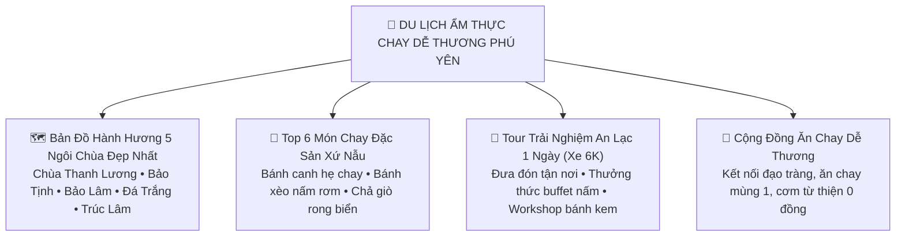

# ĐỀ ÁN & CẨM NANG: QUẢNG BÁ & PHÁT TRIỂN VĂN HÓA DU LỊCH ẨM THỰC CHO CỘNG ĐỒNG NGƯỜI ĂN CHAY DỄ THƯƠNG
**Công Ty TNHH Thương Mại Đất Phú • Đất Phú OneBase • Tuy Hòa - Phú Yên**

---

> *"Ăn chay không chỉ là một chế độ dinh dưỡng, mà là một lối sống dịu dàng với mẹ thiên nhiên, là sự tử tế với muôn loài, và là cách người dân xứ Nẫu đón chào du khách bằng tất cả sự chân thành, mộc mạc và dễ thương nhất."*

---

## I. TẦNG NHÌN & SỨ MỆNH: PHÚ YÊN — THỦ PHỦ ẨM THỰC CHAY AN LÀNH MIỀN TRUNG

Phú Yên được thiên nhiên ban tặng bờ biển dài tuyệt đẹp, những cánh đồng lúa Tuy Hòa bạt ngàn và những dãy núi Chóp Chài hùng vĩ. Nơi đây còn là miền đất cổ của Phật giáo với hơn 100 ngôi chùa lớn nhỏ, cái nôi của nguồn nguyên liệu nấm hữu cơ, rau củ VietGAP và đậu hạt truyền thống.

**Mục tiêu của Đất Phú OneBase:**
1. **Định Vị Thương Hiệu "Du Lịch Chay Dễ Thương":** Xây dựng Phú Yên thành điểm đến hàng đầu cả nước cho cộng đồng ăn chay, thuần chay (vegan), người theo lối sống xanh (green living) và du khách hành hương chữa lành (healing tourism).
2. **Bảo Tồn & Tôn Vinh Nghệ Nhân Bản Địa:** Giúp các cơ sở gia truyền như **Bếp Chay Tâm Đức (Bác Ba Thiện & Cô Tám Diệu Đức)**, **Quán Chay An Lạc (Chị Diệu Tâm)**, **Sữa Chua Cô Thủy**, **Bánh Kem Chay Bạn Châu** tiếp cận hàng triệu du khách.
3. **Mô Hình "Tour Chay 6K":** Du khách được đưa đón bằng xe đời mới sạch sẽ của **Đội Xe 6K Bác Tài Tấn Dũng**, ăn uống chuẩn an toàn thực phẩm 100%, giá cả niêm yết minh bạch, không chặt chém, trọn vẹn văn minh bản địa.

---

## II. BẢN ĐỒ HÀNH HƯƠNG & CỬA NGÕ ẨM THỰC THANH TỊNH

### 1. Chùa Thanh Lương (Xã An Chấn, Tuy An) — Ngôi Chùa San Hô & Gáo Dừa Độc Nhất Vô Nhị
- **Điểm độc đáo:** Ngôi chùa cổ được xây dựng bằng san hô tự nhiên và hàng vạn mảnh gáo dừa tinh xảo. Hồ nước trong veo với tượng Bồ Tát Quán Thế Âm ẩn hiện huyền diệu.
- **Ẩm thực chay gần đó:** Thưởng thức gỏi rong câu chân vịt tươi giòn và bánh xèo nấm rơm rau rừng ven biển An Chấn.

### 2. Chùa Bảo Tịnh (Đường Lê Trung Kiên, Phường 1, TP. Tuy Hòa)
- **Điểm độc đáo:** Tổ đình Phật giáo cổ kính giữa lòng thành phố, nơi khởi nguồn của nhiều phong trào thiện nguyện và đạo tràng Phật tử thuần thành.
- **Ẩm thực chay kết nối:** Ngay gần cổng chùa là **Bếp Chay Tâm Đức (Bác Ba Thiện)**, nơi phục vụ các mâm cỗ chay thanh khiết không mì chính hóa học.

### 3. Chùa Bảo Lâm (Dưới Chân Núi Chóp Chài, TP. Tuy Hòa)
- **Điểm độc đáo:** Không gian rừng cây cổ thụ thanh tịnh, tượng Phật Thích Ca tọa thiền lộ thiên cao 18m nhìn ra thung lũng Tuy Hòa.
- **Ẩm thực chay kết nối:** Thưởng thức hũ **Sữa Chua Nếp Cẩm & Phô Mai Dẻo Cô Thủy** thơm mát sau khi leo núi viếng Phật.

### 4. Chùa Từ Quang (Chùa Đá Trắng — Thôn Cần Lương, Xã An Dân, Tuy An)
- **Điểm độc đáo:** Di tích lịch sử danh thắng cấp quốc gia, tọa lạc trên đồi cao thanh tịnh, nổi tiếng với giống xoài tiến vua quý hiếm.
- **Ẩm thực chay kết nối:** Món xoài Đá Trắng sấy dẻo và chè hạt sen nhãn nhục thanh nhiệt.

### 5. Thiền Viện Trúc Lâm Phú Yên (Đập Đồng Cam)
- **Điểm độc đáo:** Khung cảnh sông nước hùng vĩ bên công trình thủy nông trăm năm Đồng Cam, điểm thiền định lý tưởng cho du khách.

---

## III. TOP 6 MÓN CHAY ĐẶC SẢN "DỄ THƯƠNG" NHẤT ĐỊNH PHẢI THỬ Ở PHÚ YÊN

| STT | Tên Món Ăn Đặc Sản | Nguyên Liệu Bản Địa Độc Đáo | Trải Nghiệm Hương Vị |
| :---: | :--- | :--- | :--- |
| **1** | **Bánh Canh Hẹ Bột Gạo Chay** | Bột gạo đúc tay Tuy Hòa, nấm rơm tươi, chả lụa chay, hẹ sẻ xanh mướt | Nước dùng hầm từ củ cải trắng và bắp ngọt thanh tao, hẹ sẻ cay nồng thơm lừng. |
| **2** | **Bánh Xèo Nấm Rơm Rau Rừng** | Bột gạo lúa mới đổ giòn rụm trong khuôn đất sét nung, nấm rơm, giá đỗ | Cuốn bánh tráng Hòa Đa với rau đọt xoài, lá lụa, chấm nước mắm chay chua ngọt. |
| **3** | **Chả Giò Rong Biển Tuy Hòa** | Rong biển Phú Yên sấy khô, khoai môn dẻo, hạt điều bùi béo | Vỏ ngoài giòn tan rôm rốp, bên trong thơm bùi đậm đà hương vị biển cả. |
| **4** | **Gỏi Rong Câu Chân Vịt Sông Cầu** | Rong chân vịt tự nhiên bám vách đá, đậu hũ chiên, rau răm, đậu phộng | Rong giòn sần sật mát lạnh, vị chua ngọt hài hòa giúp thanh lọc cơ thể. |
| **5** | **Bánh Kem Thuần Chay Bạn Châu** | Cốt bánh xốp mịn từ sữa hạt và bột hữu cơ (không trứng), kem tươi thực vật | Vị ngọt thanh tao, trang trí hoa sen vẽ tay tinh xảo, nhẹ bụng và thanh tịnh. |
| **6** | **Sữa Chua Men Tự Nhiên Cô Thủy** | Sữa tươi thanh trùng nông trường địa phương ủ men sống, nếp cẩm dẻo | Vị chua ngọt dịu mát, tốt cho tiêu hóa, đựng trong hũ sành mộc mạc. |

---

## IV. HAI GÓI TOUR "CHAY & DỄ THƯƠNG" ĐẶT 1 CHẠM TRÊN ĐẤT PHÚ ONEBASE

### Tour 1: "Một Ngày An Lạc — Nếm Trọn Vị Lành Xứ Nẫu"
- **Thời gian:** 07:30 – 17:00 hằng ngày.
- **Phương tiện:** Xe 7 chỗ Xpander đời mới của **Bác Tài Tấn Dũng (Đội Xe 6K)** đón tận khách sạn Tuy Hòa.
- **Lộ trình:**
  + 08:00: Viếng Chùa San Hô Thanh Lương — Chụp ảnh bờ biển An Chấn.
  + 10:30: Chiêm bái Chùa Bảo Lâm Chóp Chài — Nghe giảng thiền ngắn.
  + 11:45: Thưởng thức **Đại tiệc Buffet Chay 15 Món Nấm Sạch** tại Quán Chay An Lạc / Bếp Tâm Đức.
  + 14:00: Ghé tiệm Bạn Châu tham gia **Workshop Tự Tay Vẽ Bánh Kem Chay**.
  + 16:00: Thưởng thức sữa chua Cô Thủy và ngắm hoàng hôn Tháp Nhạn.
- **Giá trọn gói:** `380.000 đ / Khách` *(Bao xe, ăn uống, quà tặng sữa chua mang về)*.

### Tour 2: "Hành Hương Cổ Tự Đá Trắng & Trà Đạo Xứ Nẫu"
- **Thời gian:** Nửa ngày (Buổi sáng hoặc chiều).
- **Lộ trình:** Khám phá Chùa Cổ Đá Trắng — Thưởng thức lẩu nấm trường thọ hải vị chay bên bờ đầm Ô Loan — Thưởng trà sen Tây Hồ.
- **Giá trọn gói:** `290.000 đ / Khách`.

---

## V. CƠ CHẾ ĐẤT PHÚ ONEBASE TIẾP SỨC CỘNG ĐỒNG ĂN CHAY DỄ THƯƠNG

1. **Huy Hiệu "Điểm Đến Chay 6K Thân Thiện" (Cute Vegan Spot):**
   - Cấp tem kiểm định và ghim vị trí màu xanh lá nổi bật trên Bản đồ GPS Tuy Hòa cho mọi quán cơm chay, tiệm bánh chay, quầy nước mía organic đạt chuẩn an toàn vệ sinh thực phẩm.
2. **Quỹ "Bữa Cơm Thiện Lành Mùng 1 & Ngày Rằm":**
   - Đất Phú trích 5% doanh thu các gói tour chay để tài trợ nguyên liệu cho các bếp cơm 0 đồng tại Tuy Hòa phục vụ người bán vé số, người già neo đơn và học sinh nghèo.
3. **Mạng Lưới Shipper 6K Giữ Nhiệt:**
   - Trang bị thùng giữ nhiệt bảo đảm đồ ăn chay giao đến tay du khách và bà con luôn nóng sốt, thơm ngon như ăn tại quán.

---

**ĐẤT PHÚ CHỢ PHIÊN — ĐỒNG HÀNH CÙNG CỘNG ĐỒNG ĂN CHAY DỄ THƯƠNG XỨ NẪU!**
*(Tài liệu lưu hành nội bộ và phát hành số trên nền tảng Đất Phú OneBase)*
