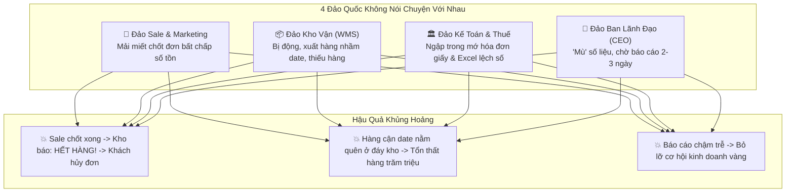
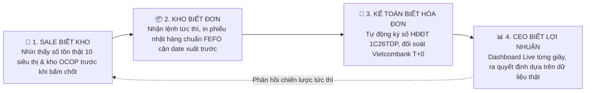

# CẢNH BÁO: NỘI BỘ RỐI LOẠN, QUY TRÌNH VỠ VỤN & GIẢI PHÁP HỢP NHẤT ĐẤT PHÚ OMNI-ERP 6K
**Chấm Dứt Tình Trạng "Ốc Đảo Dữ Liệu" — Hợp Nhất Sale, Kho, Kế Toán Và Ban Lãnh Đạo**
*Công Ty TNHH Thương Mại Đất Phú (Tuy Hòa - Phú Yên)*

---

> *"73% doanh nghiệp phân phối không thất bại vì thiếu khách hàng hay thiếu đơn đặt hàng. Họ 'chết chậm' vì bị bóp nghẹt từ bên trong: Sale chốt đơn trong bóng tối, Kho kiểm kê trong hoảng loạn, Kế toán cắm đầu gõ Excel thủ công, và Ban lãnh đạo phải chờ 2 ngày mới có số liệu để ra quyết định dựa trên cảm tính."*

---

## I. MỔ XẺ "CĂN BỆNH ỐC ĐẢO DỮ LIỆU" (DATA SILO TRAP)

Khi một doanh nghiệp thương mại phân phối mở rộng nhiều kênh bán hàng (Shopee, TikTok Shop, Cửa hàng quầy, Đại lý B2B, Website Đất Phú OneBase, Zalo OA), nếu không có một hệ trục xương sống hợp nhất, doanh nghiệp sẽ rơi vào tình trạng **"mỗi kênh là một đảo quốc độc lập"**:

---

## II. ĐỘT PHÁ CỦA ĐẤT PHÚ OMNI-ERP 6K: "BỘ TỨ ĐỒNG BỘ THỜI GIAN THỰC"

Để chấm dứt sự rời rạc, nền tảng **Đất Phú OneBase** thiết kế một kiến trúc dữ liệu tập trung duy nhất (**Single Source of Truth**), kết nối khép kín 4 mắt xích vận hành cốt tử:

### Chi Tiết 4 Mắt Xích Vận Hành Đồng Bộ:
1. **Sale Biết Kho (Zero Blind-Spot):**
   - Nhân viên bán hàng tại quầy Siêu thị Năm Tiền, nhân viên trực Zalo hay sales đại lý B2B khi tư vấn cho khách mở app là nhìn thấy chính xác: Kho Tuy Hòa còn bao nhiêu lon Meiji số 0, Kho lạnh Sông Cầu còn bao nhiêu thố cá ngừ Bà Tám. Không bao giờ nhận đơn vượt quá số lượng hàng có sẵn trong kho.
2. **Kho Biết Đơn (Zero Delay):**
   - Ngay khi đơn hàng được duyệt, máy in tại kho tương ứng tự động nhả phiếu nhặt hàng (Pick-List). Hệ thống tự động chỉ định: *"Lấy lô sữa Kệ A3 hết hạn ngày 28/11/2026 trước lô Kệ B1"*, đảm bảo thực phẩm xuất đi luôn tươi ngon, giảm 98% hàng hủy cận date.
3. **Kế Toán Biết Hóa Đơn (Zero Manual Work):**
   - Đơn giao thành công và thu tiền VietQR/COD, hệ thống tự động sinh hóa đơn điện tử hợp lệ theo **Nghị định 123/2020/NĐ-CP** và định khoản kế toán theo chuẩn **Thông tư 99/2025/TT-BTC** (hoặc TT 88 đối với hộ cá thể). Kế toán không cần gõ lại một dòng dữ liệu nào vào Excel.
4. **Lãnh Đạo Biết Lợi Nhuận Tức Thì (CEO Real-time Cockpit):**
   - Giám đốc Phạm Thanh Hân hay Ông Năm Tiền không cần gọi điện hỏi kế toán. Mở màn hình Super Admin là thấy ngay: Doanh thu thuần hôm nay, giá vốn hàng bán, chi phí vận chuyển, công nợ phải thu và **lợi nhuận ròng thực tế từng phút**.

---

## III. BẢNG SO SÁNH TRỰC DIỆN: DOANH NGHIỆP RỜI RẠC VS ĐẤT PHÚ OMNI-ERP 6K

| Tiêu Chí Đánh Giá | Doanh Nghiệp Vận Hành Rời Rạc | Doanh Nghiệp Hợp Nhất Đất Phú Omni-ERP 6K |
| :--- | :--- | :--- |
| **Độ Khớp Số Liệu Kho & Bán Hàng** | Lệch 10% – 25% cuối mỗi tháng | **Khớp 100% thời gian thực (Độ trễ < 0.3s)** |
| **Thời Gian Chờ Báo Cáo Lãnh Đạo** | 2 – 3 ngày sau khi kế toán gộp Excel | **0 giây — Cập nhật realtime trên Dashboard** |
| **Tỷ Lệ Đơn Hủy Do Hết Hàng Ảo** | 12% – 18% tổng lượng đơn | **< 0.1% — Triệt tiêu hoàn toàn lỗi chốt ảo** |
| **Tốc Độ Xuất Hóa Đơn Điện Tử** | Thủ công 5–10 phút/hóa đơn | **Tự động 1 giây/hóa đơn chuẩn 1C26TDP** |
| **Chi Phí Thuê Đội Ngũ IT Vận Hành** | 30 – 50 triệu/tháng bảo trì máy chủ | **0 VNĐ — Nền tảng Cloud không cần nhân sự IT** |
| **Khả Năng Mở Rộng Thêm Cửa Hàng** | Rối loạn, vỡ quy trình khi mở > 5 tiệm | **Dễ dàng mở rộng lên 50 – 100 siêu thị không nghẽn** |

---

## IV. NĂNG LỰC TÍCH HỢP "KHÔNG CẦN IT — KHÔNG GIÁN ĐOẠN"

Hệ thống **Đất Phú Omni-ERP 6K** được thiết kế may đo riêng cho đặc thù doanh nghiệp thương mại phân phối tại Phú Yên:
- **Giao diện thuần Việt, trực quan, thân thiện:** Nhân viên thu ngân siêu thị hay thợ sửa chữa lớn tuổi đều thành thạo chỉ sau **15 phút hướng dẫn**.
- **Chạy trực tiếp trên Web & Mobile:** Không cần cài đặt phần mềm cồng kềnh, hoạt động mượt mà trên điện thoại thông minh, máy tính bảng và máy POS quầy.
- **Bảo mật phân quyền 4 lớp (RBAC Zero-Trust):** Đảm bảo tính minh bạch tuyệt đối nhưng vẫn bảo mật bí mật kinh doanh, giá vốn và lợi nhuận của từng đối tác.

---

**ĐẤT PHÚ OMNI-ERP 6K — CHẤM DỨT SỰ RỜI RẠC, GIẢI CỨU DOANH NGHIỆP KHỎI CƠN NGUY 'CHẾT CHẬM' ĐỂ TĂNG TRƯỞNG BỀN VỮNG!**
*(Tài liệu chiến lược lưu hành chính thức tại Công Ty TNHH Thương Mại Đất Phú)*
