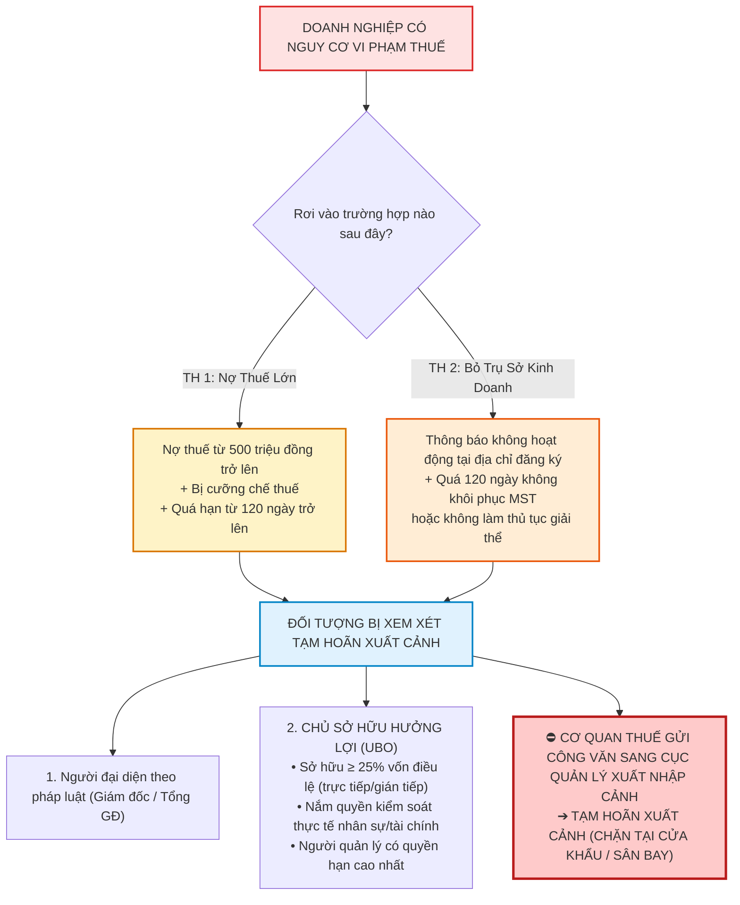

# ✈️ CẢNH BÁO PHÁP LÝ: NGUY CƠ TẠM HOÃN XUẤT CẢNH ĐỐI VỚI CHỦ SỞ HỮU HƯỞNG LỢI (BENEFICIAL OWNER) & BÍ QUYẾT BẢO VỆ DOANH NHÂN

> **Tài liệu Quản trị Rủi ro Pháp lý & Tuân thủ Nghĩa vụ Thuế**  
> *Áp dụng theo: Luật Quản lý thuế số 38/2019/QH14 (Điều 66), Luật Xuất cảnh, nhập cảnh số 49/2019/QH14 (Điều 36), Luật Phòng chống rửa tiền số 14/2022/QH15 & Nghị định 19/2023/NĐ-CP.*  
> *Áp dụng cho: Hội đồng thành viên, Ban Giám đốc Công ty TNHH Thương mại Đất Phú, Chuỗi Siêu thị Năm Tiền & Các nhà đầu tư.*

---



---

## 1. HAI TRƯỜNG HỢP KÍCH HOẠT QUY CHẾ TẠM HOÃN XUẤT CẢNH

Nhiều người lầm tưởng *"cứ nợ thuế là bị cấm bay"* hoặc *"chỉ người đứng tên Giám đốc mới chịu trách nhiệm"*. Quy định pháp luật mới nhất về quản trị rủi ro thuế đã phân định rất rõ ràng:

### ⚠️ Trường hợp 1: Doanh nghiệp nợ thuế từ 500 triệu đồng trở lên
Để bị xem xét tạm hoãn xuất cảnh, doanh nghiệp phải thỏa mãn **đồng thời 3 điều kiện**:
1. Số tiền thuế nợ, tiền phạt, tiền chậm nộp từ **500 triệu đồng trở lên**.
2. Đã bị cơ quan thuế ban hành **Quyết định cưỡng chế thi hành quyết định hành chính về quản lý thuế** (ví dụ: trích tiền từ tài khoản ngân hàng, phong tỏa tài khoản, ngừng sử dụng hóa đơn).
3. Khoản nợ thuế đã quá hạn nộp từ **120 ngày trở lên** mà người nộp thuế vẫn chưa hoàn thành nghĩa vụ.

### ⚠️ Trường hợp 2: Doanh nghiệp không hoạt động tại địa chỉ đã đăng ký
1. Cơ quan thuế kiểm tra thực địa và ban hành thông báo **"Người nộp thuế không hoạt động tại địa chỉ đã đăng ký"** (thuật ngữ kế toán hay gọi là *"Mã số thuế đóng băng / Bỏ trốn"*).
2. Sau **120 ngày** kể từ ngày cơ quan thuế ban hành thông báo, doanh nghiệp vẫn **không thực hiện thủ tục khôi phục mã số thuế** hoặc **không làm thủ tục chấm dứt hiệu lực mã số thuế (giải thể)** theo quy định.

---

## 2. CHỦ SỞ HỮU HƯỞNG LỢI (BENEFICIAL OWNER) LÀ AI?

Đây là bước chuyển dịch mang tính bước ngoặt của pháp luật Việt Nam nhằm ngăn chặn tình trạng **"thuê người đứng tên Giám đốc giùm"** (nhờ người thân, nhân viên, xe ôm đứng tên đại diện pháp luật còn ông chủ thực sự đứng sau giật dây).

Theo Luật Phòng chống rửa tiền và các quy định quản lý thuế, cá nhân bị xem là **Chủ sở hữu hưởng lợi** nếu thỏa mãn một trong các tiêu chí sau:

| Tiêu Chí Nhận Diện | Quy Định Chi Tiết Cụ Thể | Rủi Ro Thực Tế |
| :--- | :--- | :--- |
| **1. Tỷ lệ sở hữu vốn** | Cá nhân trực tiếp hoặc gián tiếp **sở hữu từ 25% vốn điều lệ** hoặc tổng số cổ phần có quyền biểu quyết trở lên (tính gộp cả tỷ lệ sở hữu thông qua người thân: vợ, chồng, cha mẹ, con cái, hoặc qua công ty mẹ/công ty liên kết). | Cổ đông lớn dù không giữ chức danh quản lý nào vẫn bị chặn xuất cảnh. |
| **2. Quyền kiểm soát thực tế** | Cá nhân có quyền chi phối, quyết định bổ nhiệm/miễn nhiệm nhân sự quản lý chủ chốt (HĐQT, Ban Giám đốc), quyết định sửa đổi điều lệ, chính sách tài chính, kế hoạch đầu tư hoặc việc tái cơ cấu, giải thể doanh nghiệp. | "Ông chủ thực sự" đứng sau điều hành không thể trốn tránh trách nhiệm. |
| **3. Quyền quản lý cao nhất** | Trường hợp công ty có cơ cấu phức tạp không xác định được theo 2 tiêu chí trên, cá nhân quản lý có quyền hạn cao nhất trong doanh nghiệp sẽ bị quy trách nhiệm. | Người giữ vai trò điều hành thực tế cao nhất bị đưa vào danh sách. |

---

## 3. "NỖI NIỀM MỘT CỔ MẤY TRÒNG" CỦA CHỦ DOANH NGHIỆP THỜI NAY

Làm chủ doanh nghiệp thời kỳ 2026 không đơn thuần là lo kinh doanh, kiếm lợi nhuận, mà là gánh trên vai hàng loạt trách nhiệm pháp lý đan cài:
- 🛒 **Chạy doanh thu & tìm khách hàng:** Thị trường cạnh tranh khốc liệt.
- 💰 **Quản trị dòng tiền & trả lương:** Đảm bảo đủ tiền nuôi bộ máy, chi trả chi phí cố định.
- 🧾 **Kê khai thuế & rà soát hóa đơn:** Đối chiếu 10 nguyên tắc GTGT, Thông tư 89, Thông tư 99, tránh hóa đơn của doanh nghiệp rủi ro cao.
- 🏢 **Duy trì trụ sở kinh doanh:** Treo biển hiệu đầy đủ, có người trực tiếp nhận thư từ của cơ quan thuế, tránh bị lập biên bản "bỏ địa chỉ".
- ✈️ **Hồi hộp mỗi lần đặt vé máy bay:** Phải tự kiểm tra xem doanh nghiệp mình có đang bị vướng trát nợ thuế hay không.

---

## 4. CHECKLIST 5 BƯỚC "AN TOÀN BAY" DÀNH CHO LÃNH ĐẠO ĐẤT PHÚ ONEBASE

Để đảm bảo Giám đốc Phạm Thanh Hân, Ông Năm Tiền và các thành viên góp vốn luôn thanh thản, tự tin trong mọi chuyến công tác trong và ngoài nước:

```
┌────────────────────────────────────────────────────────────────────────┐
│                   CHECKLIST 5 BƯỚC PHÒNG NGỪA RỦI RO                   │
├────────┬───────────────────────────────────────────────────────────────┤
│ BƯỚC 1 │ Cài đặt & Tra cứu eTax Mobile định kỳ mỗi tháng:              │
│        │ Kiểm tra mục "Nghĩa vụ thuế" xem có khoản nợ nào phát sinh    │
│        │ do phạt chậm nộp hay tiền thuế môn bài, vãng lai bị sót.      │
├────────┼───────────────────────────────────────────────────────────────┤
│ BƯỚC 2 │ Kiểm soát công nợ thuế dưới ngưỡng an toàn:                   │
│        │ Không bao giờ để nợ thuế chạm mốc 500 triệu và tuyệt đối không│
│        │ để nợ quá hạn 90 ngày (giải quyết dứt điểm trước 120 ngày).   │
├────────┼───────────────────────────────────────────────────────────────┤
│ BƯỚC 3 │ Chuẩn hóa địa chỉ kinh doanh & Biển hiệu thực tế:             │
│        │ Duy trì biển hiệu rõ ràng tại Trụ sở (289 Lê Duẩn, Tuy Hòa),  │
│        │ 10 Siêu thị Năm Tiền và Kho lạnh Sông Cầu; có nhân sự tiếp    │
│        │ đoàn kiểm tra công sở của Chi cục Thuế sở tại.                │
├────────┼───────────────────────────────────────────────────────────────┤
│ BƯỚC 4 │ Rà soát & Cập nhật thông tin Chủ sở hữu hưởng lợi:            │
│        │ Khai báo minh bạch cơ cấu cổ đông, tỷ lệ vốn góp chuẩn xác    │
│        │ trên cổng Đăng ký doanh nghiệp quốc gia.                      │
├────────┼───────────────────────────────────────────────────────────────┤
│ BƯỚC 5 │ Quy trình giải cứu khẩn cấp nếu có vướng mắc:                 │
│        │ Trường hợp phát hiện có thông báo nợ thuế oan hoặc nhầm lẫn,  │
│        │ lập tức liên hệ Phòng Quản lý Nợ Cục Thuế để nộp hồ sơ đối    │
│        │ soát, tránh bị chuyển danh sách sang Cục Quản lý Xuất nhập cảnh│
└────────┴───────────────────────────────────────────────────────────────┘
```
