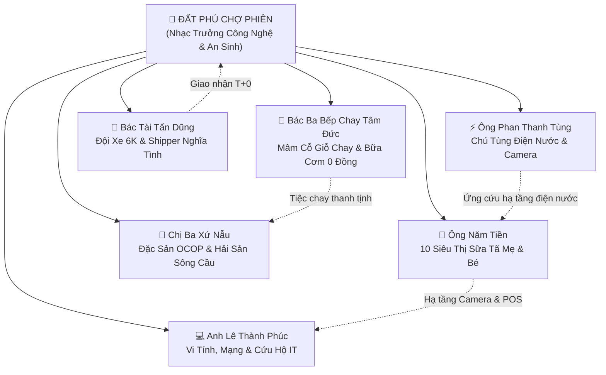
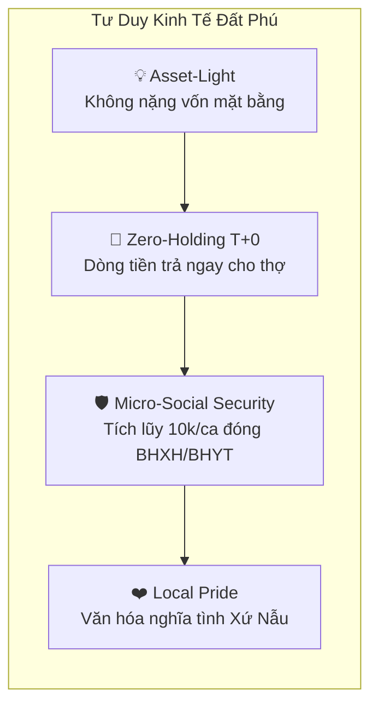

# ĐẤT PHÚ CHỢ PHIÊN: KHI CÔNG NGHỆ CHẠM VÀO NHỊP THỞ CUỘC SỐNG XỨ NẪU
**Phóng sự & Ký sự thực địa • Công ty TNHH Thương Mại Đất Phú (Tuy Hòa - Phú Yên)**

---

> *"Công nghệ chỉ thực sự có linh hồn khi nó cúi xuống mảnh đất cằn cỗi nhiều nắng gió, lau đi giọt mồ hôi trên trán người thợ điện già, nâng niu từng mớ rau nấm sạch của bà mẹ quê, và nhóm lên ngọn lửa an tâm cho những mái ấm bình dị ven biển Tuy Hòa."*

---

## I. NHỮNG MẢNH GHÉP ĐỜI THƯỜNG TRÊN ĐẤT TUY HÒA

Nếu ai từng ghé Phú Yên vào những ngày hè nắng chang chang, hay những chiều mùa mưa bão biển tạt hơi muối mặn chát vào từng ngõ phố, sẽ hiểu cuộc sống của những người lao động tự do nơi đây chông chênh đến nhường nào. 

Trước khi **Đất Phú Chợ Phiên** ra đời, một câu hỏi luôn treo lơ lửng trên đầu những người làm nghề:
- Làm sao người thợ sửa ống nước, sửa máy tính không bị "cò" trung gian bóp nghẹt 30–40% hoa hồng?
- Làm sao những hộ làm nước mắm Gành Đỏ, bò một nắng Krông Pa hay quán cơm chay bình dân không bị lép vế trước những tập đoàn bán lẻ đa quốc gia?
- Và làm sao khi tuổi xế chiều ập đến, người lao động tự do xứ Nẫu có được tấm thẻ bảo hiểm y tế phòng thân, có đồng lương hưu còm để không trở thành gánh nặng cho con cháu?

**Đất Phú OneBase** không bắt đầu bằng những thuật toán xa vời trong phòng máy lạnh. Nó bắt đầu từ chính nhịp sống của những con người bằng xương bằng thịt nơi đây.

---

## II. LÁT CẮT 1: CHUYỆN ÔNG NĂM TIỀN VÀ GIẢI BÀI TOÁN 10 SIÊU THỊ MẸ & BÉ

Ông Năm Tiền — cái tên quen thuộc với hầu hết các bà mẹ bỉm sữa từ thành phố Tuy Hòa xuôi về thị xã Đông Hòa hay ngược lên miệt núi Sông Hinh, Sơn Hòa. Mười cửa hàng siêu thị sữa tã của ông là điểm tựa của hàng vạn gia đình trẻ.

Thế nhưng, ít ai biết nỗi nhọc nhằn của người chủ chuỗi bán lẻ địa phương:
> *"Quản lý 10 cửa hàng bằng sổ sách và tin nhắn Zalo khiến tui nhiều đêm mất ngủ. Sữa bột Meiji, tã dán Moony chỗ thì thừa hạn sử dụng, chỗ thì đứt hàng khách hỏi không có. Thuê phần mềm ngoại bang thì đắt đỏ, nhân viên bán hàng ở quê không quen dùng giao diện phức tạp."*

Khi tích hợp vào Đất Phú OneBase:
- **Tích hợp ERP Mini 1 Chạm:** Cả 10 điểm bán của Ông Năm Tiền hiển thị đồng bộ trên Bản đồ GPS Tuy Hòa. Khách ở Phường 7 hay Phú Lâm chỉ cần mở app là thấy ngay cửa hàng Năm Tiền gần nhất cách mình vài trăm mét.
- **Dòng tiền T+1 & Hóa đơn TT 88:** Mọi đơn hàng bán lẻ được đối soát tự động, xuất hóa đơn điện tử chuẩn chỉnh, chiết khấu nền tảng ưu đãi hạng Kim Cương chỉ 1.5% - 2.5%.
- **Sự gắn kết cộng sinh:** Chính hệ thống máy tính POS và camera giám sát tại 10 siêu thị của ông nay được bảo trì trọn gói bởi hai người đồng đội kỹ thuật Đất Phú: **Anh Lê Thành Phúc** và **Ông Phan Thanh Tùng**.

---

## III. LÁT CẮT 2: NGƯỜI THỢ GIÀ VÀ TẤM THẺ BẢO HIỂM LẬP TẠI QUÁN CÀ PHÊ

Ở ngã tư Nguyễn Huệ - Hùng Vương, nhắc đến **Chú Tùng Điện Nước (Ông Phan Thanh Tùng)** thì từ tiệm tóc, quán ốc cho đến các homestay ven biển ai cũng biết. 18 năm trong nghề, chú thuộc từng đường dây điện ngầm, từng đoạn ống nước cũ kỹ của thành phố.

Nhưng chú Tùng từng tâm sự trong một buổi chiều mưa gió bên ly cà phê vỉa hè:
> *"Làm thợ tự do như tụi tui, ráo mồ hôi là ráo tiền. Nhiều bữa trèo thang leo trần nhà ẩm ướt, chân run run sợ sẩy tay một cái là vợ con ở nhà bơ vơ. Mua bảo hiểm xã hội thì thủ tục phức tạp, tiền đóng cả cục một lần lấy đâu ra!"*

Cơ chế **An Sinh Vi Mô 10.000 đ/ca** của Đất Phú đã thay đổi hoàn toàn cuộc đời người thợ già:
- Mỗi ca sửa chập điện hay bục đường nước 150.000 đ, hệ thống tự động trích 10.000 đ vào **Ví An Sinh Xã Hội**.
- Mỗi tháng tích lũy 40–50 ca, chú có ngay khoản tiền đều đặn để công ty nộp thay tiền **BHYT hộ gia đình** và **BHXH tự nguyện**.
- Khi chạy xe đi ứng cứu trong đêm mưa bão, chú được bảo vệ bởi gói **Bảo hiểm tai nạn nghề nghiệp 24/7 hạn mức 100 triệu đồng**.

Chú Tùng cười rạng rỡ: *"Bây giờ tui yên tâm gắn bó với nghề tới ngày già. Có Đất Phú bảo lãnh, khách gọi là 10 phút sau tui có mặt liền!"*

---

## IV. LÁT CẮT 3: CHUYÊN GIA IT ANH PHÚC VÀ CÂU CHUYỆN "CỨU HỘ MẠNG TRONG 15 PHÚT"

Tại số 156 Lê Lợi, trung tâm vi tính và camera của **Anh Lê Thành Phúc** sáng đèn từ sáng sớm đến tận đêm khuya.

Tuy Hòa mùa bão, mạng cáp quang bị đứt, camera ngoài trời bị hơi muối ăn mòn làm đoản mạch đầu ghi, máy in hóa đơn của các nhà hàng quán cà phê đột ngột treo cứng giữa giờ cao điểm. Trước đây, các chủ tiệm chỉ biết gọi tổng đài viễn thông và chờ đợi hàng ngày trời trong sốt ruột.

Nhờ nút bấm **"Cứu Hộ IT 15 Phút"** trên Đất Phú OneBase:
- Anh Phúc nhận tín hiệu định vị rung chuông trên điện thoại.
- Trong cốp xe máy của anh luôn sẵn sàng: kìm bấm mạng, đồng hồ đo sợi quang, nguồn camera chống nước, USB boot cứu hộ hệ điều hành và thiết bị phát WiFi Mesh xuyên tường.
- Các tiểu thương như Chị Lan (tiệm tạp hóa) hay Văn phòng công chứng Tuy Hòa coi anh như "bác sĩ cấp cứu công nghệ". 

Anh Phúc chia sẻ: *"Làm công nghệ ở quê hương Phú Yên vui nhất là khi giải quyết được sự cố ngay lập tức cho bà con, nhìn thấy khách hàng thở phào cười vui vẻ rồi gửi tặng quả dừa xiêm mát lạnh."*

---

## V. LÁT CẮT 4: MÂM CỖ GIỖ CHAY BÁC BA THIỆN VÀ HẠNH NGUYỆN BẾP TÂM ĐỨC

Gần Chùa cổ Bảo Tịnh, con hẻm nhỏ trên đường Lê Trung Kiên luôn thoang thoảng mùi nấm kho tiêu, mùi sen hầm và hương thơm thanh khiết của nếp mới. Đó là gian bếp của **Bác Ba Thiện & Cô Tám Diệu Đức (Bếp Chay Tâm Đức)**.

Đối với người dân Phú Yên, mâm cỗ cúng giỗ ông bà hay lễ tiệc chay không đơn thuần là bữa ăn, mà là tấm lòng hiếu thảo, là ước vọng cầu an cho cả gia tộc.

Trước kia, nhiều gia đình muốn nấu đám chay nhưng ngại việc nấu nướng lỉnh kỉnh, xoong nồi bát đĩa không đủ, lại sợ mua phải nguyên liệu làm sẵn có hàn the trôi nổi.

Đất Phú OneBase đã bắc nhịp cầu:
- **Mâm cỗ đám giỗ 8 món thanh tịnh tận nhà:** Đem đến tận nơi toàn bộ bàn ghế, bát đĩa sành sứ cổ truyền, phục vụ tận tâm và dọn dẹp sạch sẽ tinh tươm.
- **Chính sách Khuyến Thiện 0%:** Đất Phú không thu một đồng phí nào đối với các bữa cơm chay từ thiện 0 đồng của bếp, và chỉ thu mức tượng trưng 1.5% đối với mâm tiệc giỗ để tái đầu tư vào thùng giữ nhiệt cho shipper.
- Bác Ba Thiện bộc bạch: *"Bếp chay làm vì cái tâm. Thấy Đất Phú hỗ trợ trân quý người làm chay như vậy, chúng tôi càng dặn lòng phải nấu thật tinh khiết, thật ngon để gieo duyên lành cho xứ sở."*

---

---

## VI. LÁT CẮT 5: CUỘC SỐNG NHỮNG NGƯỜI PHẬT TỬ THIỆN LÀNH XỨ NẪU

Giữa nhịp sống thị trường xô bồ, Đất Phú Chợ Phiên còn là nơi hội tụ và nâng đỡ những người phật tử cư sĩ sống đời chân thật, lấy **Chánh Mạng** (nghề nghiệp chân chính) và **Chánh Nghiệp** làm lẽ sống:

### 1. Cô Thủy Sữa Chua — Men Ngọt Tự Nhiên Từ Đạo Tràng Bảo Lâm
Tại số 142 Nguyễn Huệ, hằng ngày Cô Thủy tỉ mẩn ủ từng hũ sữa chua nếp cẩm, sữa chua phô mai dẻo bằng sữa tươi thanh trùng từ nông trại địa phương và men sống tự nhiên. Cô tâm niệm: *"Người làm đồ ăn thức uống cho người khác là đang tạo phước hay tạo nghiệp tùy vào cái tâm mình. Tuyệt đối không vì vài đồng lời mà bỏ chất bảo quản hay hóa chất tạo đông độc hại."* Từng hũ sữa chua mát lành của cô không chỉ phục vụ các bạn trẻ, trường mầm non mà còn là món tráng miệng thanh tịnh cho các khóa tu tại chùa.

### 2. Bạn Minh Châu — Bánh Kem Vẽ Hoa Thủ Công & Bánh Kem Chay Thanh Khiết
Tại số 76 Trần Hưng Đạo, cô gái trẻ Minh Châu gửi gắm tình yêu cuộc sống vào từng chiếc bánh sinh nhật, bánh mừng thọ gia đình. Châu chọn cách làm bánh ít ngọt, kem béo thanh nhẹ và vẽ hoa sen, hoa cúc thủ công. Đặc biệt, Châu phát tâm nghiên cứu dòng **bánh kem thuần chay không trứng** (sử dụng sữa hạt tự nhiên) để phục vụ sinh nhật phật tử và các buổi lễ chùa, giúp ngày vui thêm trọn vẹn và an lạc.

### 3. Anh Vinh Thợ Sơn — Đo Đúng Từng Mét Vuông, Cam Kết Không Pha Nước
Cầm cây cọ sơn và con lăn suốt 12 năm, Anh Vinh ở Phường 9 là thợ sơn nước nổi tiếng thật thà. Ở miền Trung nắng gió, nhà cửa dễ nứt và thấm dột mùa mưa bão. Nhiều thợ khác thường pha loãng sơn hoặc ăn bớt công đoạn chống thấm để tăng lợi nhuận. Nhưng với Anh Vinh: *"Mình người Phật tử, nhận tiền của gia chủ thì phải làm bằng cái tâm. Đo đúng mét vuông, xử lý nứt kỹ lưỡng và sơn đủ lớp thì tường mới bền 5–10 năm."*

### 5. Chú Trúc Xe Mía Thạnh Phú — Giọt Mồ Hôi Trên Cánh Đồng Mía Xứ Nẫu
Ở ngã ba Thạnh Phú, gần đồn Công an, nơi bãi tập kết mía rẫy nhộn nhịp mùa thu hoạch, chiếc xe tải ben 3.5 tấn của **Chú Trúc** bền bỉ lăn bánh từ sáng tinh mơ. Giữa cái nắng rát bỏng của đất Phú Yên, chú cùng bà con nông dân vác từng bó mía tím mọng nước, siết chặt từng chiếc tăng đơ dây cáp an toàn để kịp chở mía về Nhà máy Đường KCP hay đưa từng bó mía ngọt mát về các tiệm giải khát Tuy Hòa. Có nền tảng Đất Phú OneBase, chiếc xe của Chú Trúc có thêm bảo hiểm tai nạn nghề nghiệp 24/7 và kết nối thẳng tới bà con trồng mía, xóa bỏ cảnh bị cò xe ép giá cước mùa rộ vụ.

### 4. Anh Hoàng Bất Động Sản — Giữ Tâm Sáng Giữa Cơn Sốt Đất
Làm nghề môi giới nhà đất tại Đại lộ Hùng Vương, Anh Hoàng luôn giữ vững đạo tâm: không bao giờ kê giá, không bắt tay thổi sóng ảo, kiểm tra pháp lý quy hoạch đến nơi đến chốn. Anh tận tâm tìm từng mặt bằng buôn bán vừa túi tiền cho tiểu thương nghèo và giúp bà con công nhân mua được mảnh đất cắm dùi an cư lạc nghiệp. Anh bảo: *"Nhà đất là tài sản cả đời tích cóp của người ta, mình làm sai nhân quả nặng lắm. Lấy thù lao dịch vụ tượng trưng 1% mà lòng thanh thản, đêm về ngủ ngon."*

## VII. BỨC TRANH KINH TẾ TƯ NHÂN KIỂU MỚI: TỪ LÝ THUYẾT ĐẾN BỮA CƠM ẤM CÚNG

Khác với các ứng dụng công nghệ gọi xe hay giao đồ ăn ngoại quốc thường xem người lao động là "đối tác độc lập" để phủi bỏ trách nhiệm an sinh, **Đất Phú Chợ Phiên kiến tạo một mô hình kinh tế hoàn toàn khác:**

1. **Không Bóc Lột Chiết Khấu:** Mức phí hoa hồng từ 1.5% đến 5% (thay vì 25% - 35% như các siêu ứng dụng), giúp người lao động giữ lại hơn 95% công sức mồ hôi của mình.
2. **Bảo Tồn Bản Sắc Xứ Nẫu:** Mỗi gói bò một nắng, chai nước mắm Gành Đỏ, chuyến xe taxi của Bác Tài Tấn Dũng hay ca sửa điện của Chú Tùng đều thấm đượm tính cách người miền Trung: **Thật thà, trách nhiệm, trọng nghĩa tình.**
3. **Mỗi Điện Thoại Là Một Trạm Cứu Hộ:** Mạng lưới hàng trăm thợ 6K và cửa hàng liên kết tạo thành chiếc lưới an sinh cơ động, che chắn cho từng hộ dân trước những biến cố đời thường.

---

## VIII. LỜI KẾT: CON ĐƯỜNG ĐI VÀO CUỘC SỐNG

Một ứng dụng công nghệ có thể được viết bằng hàng triệu dòng mã nguồn tinh vi, nhưng đích đến cuối cùng của nó không nằm trên máy chủ đám mây, mà nằm trong **nụ cười an tâm của người dân Phú Yên**.

- Đó là tiếng chuông điện thoại reo giòn giã của Chú Tùng khi nhận được ca cứu hộ.
- Đó là ánh mắt nhẹ nhõm của Ông Năm Tiền khi xem báo cáo doanh thu 10 siêu thị trên chiếc điện thoại nhỏ.
- Đó là mâm cơm chay thơm lành của Bác Ba Thiện đặt trang nghiêm trên bàn thờ gia tiên của một mái ấm nghèo.
- Và đó là niềm tự hào của từng người con đất Tuy Hòa khi thấy quê hương mình có một nền tảng công nghệ tử tế, vì con người và do con người tạo nên.

**Đất Phú Chợ Phiên — Câu chuyện bắt đầu từ những điều bình dị, và sẽ mãi đồng hành cùng nhịp thở cuộc sống của mảnh đất Phú Yên trù phú, nghĩa tình!**

---
*(Tư liệu lưu trữ chính thức tại Trung Tâm Văn Hóa & Truyền Thông Công Ty TNHH Thương Mại Đất Phú)*
