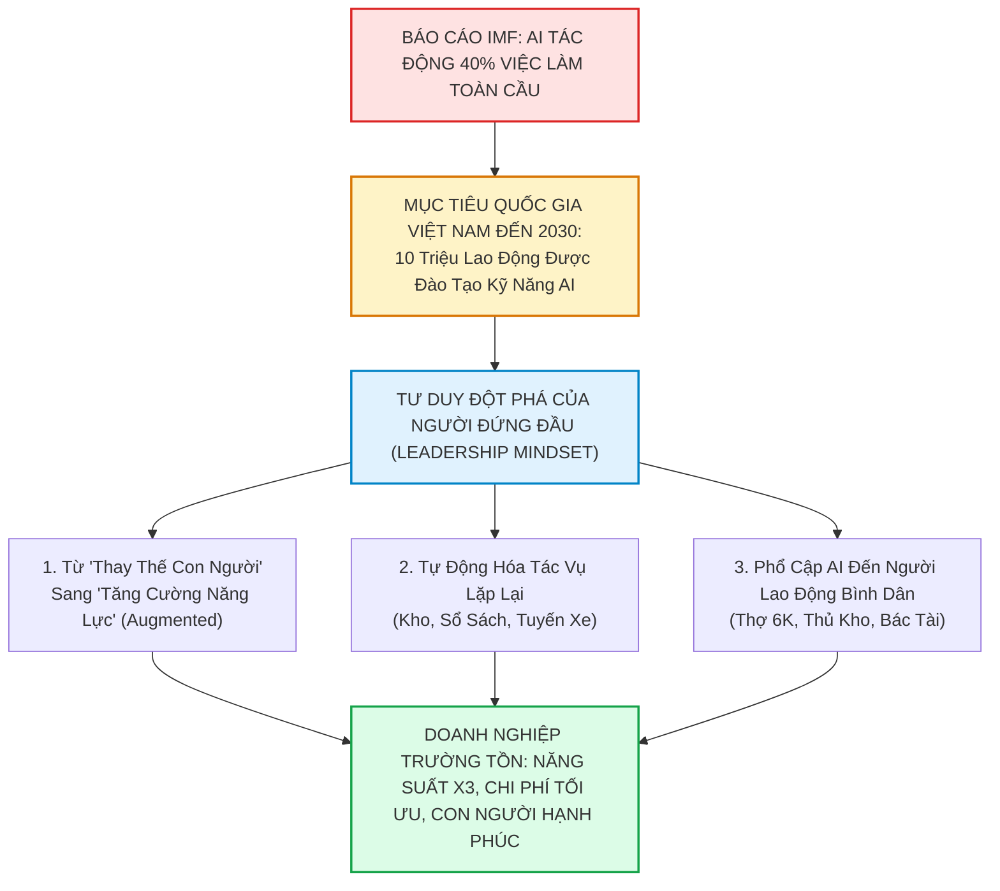

# 🤖 CHIẾN LƯỢC TRÍ TUỆ NHÂN TẠO 2030: TỪ BÁO CÁO IMF, MỤC TIÊU 10 TRIỆU LAO ĐỘNG ĐẾN ĐỔI MỚI TƯ DUY NGƯỜI ĐỨNG ĐẦU

> *"Theo Quỹ Tiền tệ Quốc tế (IMF), trí tuệ nhân tạo đang tác động tới 40% việc làm toàn cầu. Thích ứng với làn sóng này, Việt Nam đặt mục tiêu đến năm 2030 đào tạo kỹ năng A.I. cho 10 triệu lao động. Với mỗi tổ chức doanh nghiệp, bài toán đặt ra không chỉ dừng lại ở việc ứng dụng công nghệ mà là năng lực đổi mới tư duy của người đứng đầu."*  
> — **Bản Tuyên Ngôn Chuyển Đổi Số & AI Doanh Nghiệp Đất Phú OneBase**

---



---

## 1. THỰC TẠI TOÀN CẦU & BƯỚC ĐI CỦA VIỆT NAM ĐẾN 2030

### 1.1. Con số cảnh báo từ Quỹ Tiền tệ Quốc tế (IMF)
- **40% việc làm toàn cầu bị tác động:** Tại các nền kinh tế phát triển, tỷ lệ này lên tới **60%**, trong khi ở các nền kinh tế mới nổi như Việt Nam là khoảng **40%**.
- **Hai kịch bản của AI đối với lao động:**
  1. *Thay thế hoàn toàn (Replacement):* Đối với các công việc mang tính lặp đi lặp lại, nhập liệu thủ công, hành chính giấy tờ giản đơn.
  2. *Bổ trợ và khuếch đại (Complementarity / Augmentation):* Đối với những người lao động biết sử dụng AI để nhân bản năng suất, đưa ra quyết định dựa trên dữ liệu thời gian thực.
- **Quy luật mới:** *"AI không thay thế con người, nhưng người biết sử dụng AI sẽ thay thế người không biết sử dụng AI."*

### 1.2. Quyết sách quốc gia: Đào tạo kỹ năng AI cho 10 triệu lao động
Chiến lược quốc gia về nghiên cứu, phát triển và ứng dụng Trí tuệ nhân tạo của Chính phủ đặt mục tiêu đào tạo **10 triệu lao động có kỹ năng AI thực chiến** đến năm 2030. Đây không phải là biến 10 triệu người thành kỹ sư viết code, mà là giúp:
- Bác tài xế xe tải biết dùng AI tối ưu lộ trình và kiểm soát nhiên liệu.
- Nhân viên kho hàng biết dùng AI để lấy hàng theo lộ trình chữ S (S-Shape Picking) và cất hàng chuẩn slotting (Put Away).
- Người làm kế toán biết dùng AI để soát xét hóa đơn bất thường, bẫy rủi ro thuế và lập báo cáo tài chính trong 5 phút thay vì 2 tuần.

---

## 2. NĂNG LỰC ĐỔI MỚI TƯ DUY CỦA NGƯỜI ĐỨNG ĐẦU: CHÌA KHÓA QUYẾT ĐỊNH

Công nghệ mua được bằng tiền, nhưng **tư duy ứng dụng AI** thì không thể mua được bằng tiền nếu người lãnh đạo đứng ngoài cuộc.

```
┌────────────────────────────────────────────────────────────────────────┐
│             SO SÁNH HAI TRƯỜNG PHÁI LÃNH ĐẠO TRONG LÀN SÓNG AI        │
├───────────────────────────────────┬────────────────────────────────────┤
│   LÃNH ĐẠO TRUYỀN THỐNG (BỊ ĐỘNG) │    LÃNH ĐẠO KIẾN TẠO AI (CHỦ ĐỘNG) │
├───────────────────────────────────┼────────────────────────────────────┤
│ • Xem AI là việc riêng của phòng  │ • Coi AI là đòn bẩy chiến lược gắn │
│   IT hoặc mua phần mềm là xong.   │   chặt với từng hơi thở vận hành.  │
│ • Lo sợ nhân viên mất việc hoặc   │ • Tái đào tạo (Reskilling) nhân sự,│
│   ngại thay đổi quy trình cũ.     │   biến mỗi nhân viên thành "Super".│
│ • Quản lý dựa trên cảm tính và    │ • Quản trị bằng dữ liệu thời gian  │
│   kinh nghiệm cá nhân.            │   thực (Real-time AI Dashboard).   │
│ • Đợi thị trường ép mới thay đổi  │ • Chủ động học hỏi AI để dẫn dắt,  │
│   ➔ Dễ bị rơi vào nhóm "chết chậm"│   bẻ khóa điểm nghẽn cho đội ngũ.  │
└───────────────────────────────────┴────────────────────────────────────┘
```

Khi người quản lý chủ động nâng cao trình độ AI:
1. **Họ nhìn thấu điểm nghẽn:** Biết khâu nào đang ngốn thời gian vô ích (thời gian đi bộ trong kho, thời gian gõ hóa đơn Excel, thời gian chờ ký duyệt hợp đồng).
2. **Họ định hướng đúng công cụ:** Giao đúng việc cho AI làm trợ thủ, để con người tập trung vào chăm sóc khách hàng, sáng tạo và thấu cảm.
3. **Họ truyền cảm hứng không sợ hãi:** Giúp nhân viên tự tin rằng công nghệ đến để giải phóng sức lao động, nâng cao thu nhập và đời sống.

---

## 3. THỰC THI THỰC CHIẾN TẠI ĐẤT PHÚ ONEBASE: "AI VÌ CON NGƯỜI THIỆN LÀNH"

Tại **Công ty TNHH Thương mại Đất Phú**, tinh thần này đã được hiện thực hóa sâu sắc vào từng hơi thở cuộc sống Phú Yên:

### 3.1. Phổ cập AI giải phóng thủ kho Chuỗi Năm Tiền
- Thay vì để thủ kho đi bộ 10km mỗi ngày tìm lon sữa, bỉm tã bằng trí nhớ:
- Hệ thống **Smart WMS & Slotting Engine** tự động tính toán lộ trình Picking ngắn nhất (tiết kiệm 65% quãng đường), tự động cảnh báo hạn dùng FEFO trước 60 ngày để không bao giờ bị hủy hàng.

### 3.2. AI làm áo giáp bảo vệ người kế toán
- Thay vì cắm đầu gõ từng con số và lo sợ mùa thanh tra thuế 5 năm sau:
- Hệ thống tự động kiểm tra đối chiếu chéo 4 bên (`Doanh thu ⇄ Hóa đơn ⇄ Tờ khai GTGT ⇄ Tiền về`), tự động mapping sang **Thông tư 99/2025/TT-BTC** và khóa cứng quy tắc 3-Way Matching để kế toán không bao giờ bị ép "ký giúp".

### 3.3. AI phục vụ mạng lưới người lao động tự do (Thợ 6K & Bác Tài)
- **Chú Trúc xe tải Thạnh Phú:** AI gợi ý tuyến đường chở mía bó và điều chuyển sữa tã không bị rỗng chuyến chiều về.
- **Anh Vinh thợ sơn, Anh Hoàng bất động sản, Bác Ba Chay:** Nhận đơn việc làm cứu hộ trong bán kính 3km qua định vị GPS Leaflet, tự động xuất định mức vật tư tiêu hao, minh bạch thu nhập và hỗ trợ gói BHYT vi mô.

---

## 4. BỨC TRANH NĂM 2030: MỖI NGƯỜI LAO ĐỘNG LÀ MỘT "LAO ĐỘNG TĂNG CƯỜNG"

Mục tiêu 10 triệu lao động Việt Nam thành thạo AI vào năm 2030 sẽ không còn là khẩu hiệu xa vời, nếu bắt đầu từ hành động nhỏ của từng doanh nghiệp:
- Người nông dân Phú Yên biết dùng AI dự báo giá nông sản.
- Cô bán sữa chua Thủy, bạn làm bánh kem Châu biết dùng AI sáng tạo nội dung bán hàng trên mạng xã hội.
- Người làm chủ doanh nghiệp như Đất Phú OneBase tiên phong trang bị công nghệ để người lao động được làm việc nhẹ nhàng hơn, an toàn hơn và có thu nhập cao hơn.

> **Thông điệp kết luận:**  
> *"Đỉnh cao của Trí tuệ Nhân tạo không phải là những cỗ máy vô cảm thay thế con người, mà là công nghệ thắp sáng tiềm năng, nâng đỡ phẩm giá và sự tử tế của từng người lao động bình dị trong cuộc sống thường nhật."*
