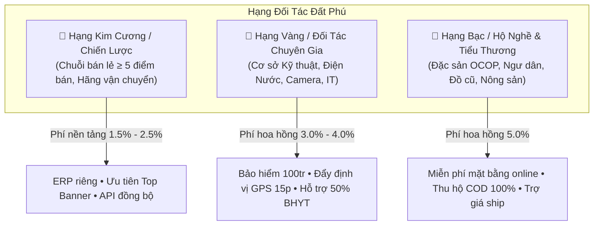
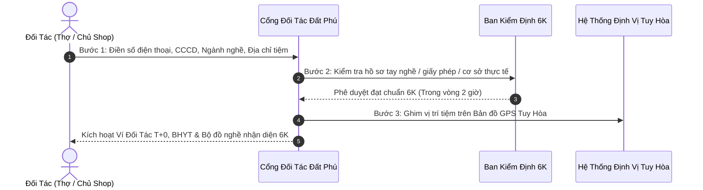

# CÔNG TY TNHH THƯƠNG MẠI ĐẤT PHÚ
**Số: 08/2026/QC-DP • Ban hành ngày 27/10/2026**
**QUY CHẾ & CHÍNH SÁCH HỢP TÁC ĐỐI TÁC CHIẾN LƯỢC (PARTNER POLICY FRAMEWORK)**

---

## I. TẦNG NHÌN & NGUYÊN TẮC HỢP TÁC BỀN VỮNG

Nền tảng **Đất Phú OneBase** vận hành theo triết lý kinh tế tư nhân kiểu mới:
> *"Lấy người lao động bản địa và tiểu thương làm gốc rễ — Nền tảng chỉ đóng vai trò nhạc trưởng công nghệ, điều phối dòng tiền minh bạch và bảo trợ an sinh xã hội."*

### 4 Nguyên Tắc Cốt Lõi:
1. **Cùng Thắng (Win - Win - Win):** Khách hàng hưởng giá rẻ & dịch vụ tận nơi minh bạch — Đối tác tăng gấp 3 doanh thu và có bảo hiểm xã hội — Nền tảng Đất Phú thu phí điều phối vi mô bền vững.
2. **Minh Bạch Dòng Tiền Tuyệt Đối (Zero Holding):** Không chiếm dụng vốn đối tác; thanh toán đối soát tự động T+0 (trong ngày) cho thợ cơ động và T+1 cho đơn hàng bán lẻ.
3. **An Sinh Xã Hội Là Nghĩa Vụ:** Mọi đối tác lao động và hộ cá thể đều được hỗ trợ tích lũy BHYT Hộ gia đình và BHXH Tự nguyện.
4. **Chuẩn Mực Chất Lượng 6K:** Không chặt chém, không hàng giả, không trễ hẹn, giá báo trước, bảo hành trách nhiệm, văn minh bản địa Phú Yên.

---

## II. MA TRẬN PHÂN HẠNG ĐỐI TÁC (PARTNER TIER MATRIX)

| Tiêu Chí | Hạng Kim Cương (Strategic) | Hạng Vàng (Expert Partner) | Hạng Bạc (Local Vendors) |
| :--- | :--- | :--- | :--- |
| **Đối Tượng Áp Dụng** | Chuỗi bán lẻ quy mô lớn (VD: **Chuỗi 10 Siêu thị Sữa Tã Mẹ & Bé Năm Tiền**), các đơn vị vận chuyển đối tác. | Cơ sở kỹ thuật cơ động, chuyên gia IT & điện nước (VD: **Ông Phan Thanh Tùng**, **Anh Lê Thành Phúc**). | Hộ nghề cá thể, tiểu thương OCOP, thuyền ghe hải sản, tiệm đồ cũ, sách cũ, thợ tự do. |
| **Phí Duy Trì Cửa Hàng Online** | **0 VNĐ / Trọn đời** | **0 VNĐ / Trọn đời** | **0 VNĐ / Trọn đời** |
| **Phí Nền Tảng (Hoa hồng trên đơn hoàn tất)** | **1.5% – 2.5%** doanh thu gộp | **3.0% – 4.0%** trên mỗi ca dịch vụ thành công | **5.0%** trên mỗi đơn hàng giao thành công |
| **Hạn Mức Đẩy Đơn GPS Tuy Hòa** | Toàn bộ 10 điểm bán trong bán kính 10km | Bán kính ưu tiên số 1: 0km – 5km quanh Tuy Hòa | Bán kính hiển thị theo khu vực phường/xã |
| **Quyền Lợi Công Nghệ & ERP** | Phân quyền tài khoản quản lý chuỗi, đồng bộ tồn kho API POS | Cổng tiếp nhận đơn cứu hộ âm thanh rung, bảng báo giá tự động | Ứng dụng bán hàng đơn giản, xuất hóa đơn điện tử TT 88 |
| **Chính Sách An Sinh Xã Hội** | Hỗ trợ lập danh sách trích nộp BHXH bắt buộc tập trung | Đất Phú **đồng tài trợ 50% quỹ BHYT/BHXH** vi mô; cấp **Bảo hiểm tai nạn 24/7 hạn mức 100 triệu** | Hỗ trợ tích lũy vi mô **10.000 đ/ca** vào ví An Sinh Xã Hội |

---

## III. CHÍNH SÁCH THANH TOÁN & ĐỐI SOÁT DÒNG TIỀN (CASHFLOW & SETTLEMENT)

### 1. Chu Kỳ Quyết Toán:
- **Đối tác Thợ Kỹ thuật & Cứu hộ khẩn cấp:** **Quyết toán T+0 (Trong vòng 60 phút sau khi hoàn tất nghiệm thu ca việc).** Tiền công khách trả qua chuyển khoản Vietcombank được tự động trừ 3% phí nền tảng + 10k quỹ an sinh, số tiền còn lại chuyển thẳng về STK đối tác.
- **Đối tác Bán hàng Ký gửi & Tiểu thương:** **Quyết toán T+1 (24 giờ sau khi đơn hàng giao thành công).** Tiền COD từ các đơn vị vận chuyển (Viettel Post, GHTK, Đất Phú 6K Express) được đối soát tự động và thanh toán vào 09h00 sáng mỗi ngày.

### 2. Thuế & Chứng Từ Pháp Lý:
- Tự động khấu trừ và xuất chứng từ khấu trừ thuế TNCN hoặc hỗ trợ kê khai thuế Hộ kinh doanh theo **Thông tư 88/2021/TT-BTC**.
- Mỗi giao dịch đối tác đều có mã QR tra cứu hóa đơn điện tử hợp lệ theo ký hiệu `1C26TDP`.

---

## IV. TIÊU CHUẨN DỊCH VỤ & THƯỞNG PHẠT ĐỘNG LỰC (SLA & REPUTATION)

### 1. Cam Kết Chất Lượng 6K Bắt Buộc Đối Với Đối Tác:
1. **Không Chặt Chém:** Giá linh kiện, vật tư và công thợ phải niêm yết công khai trên ứng dụng trước khi tiến hành làm.
2. **Không Trễ Hẹn:** Đối với dịch vụ khẩn cấp nội thành Tuy Hòa, phải có mặt trong vòng **8 – 15 phút**. Nếu có sự cố giao thông phải bấm nút cập nhật lý do trễ trên ứng dụng.
3. **Không Hàng Nhái / Kém Chất Lượng:** Vật tư thay thế (camera, aptomat, dây điện, sữa tã mẹ & bé) phải có nguồn gốc rõ ràng, bảo hành tối thiểu 6–24 tháng.
4. **Không Bỏ Rơi Khách:** Phải bảo hành trách nhiệm tận nơi trong 24 giờ nếu có sự cố tái phát.
5. **Không Say Xỉn / Mất Lịch Sự:** Luôn giữ tác phong văn minh, đeo thẻ thợ điện tử Đất Phú.
6. **Không Trốn Tránh Trách Nhiệm An Toàn:** Tuân thủ quy chuẩn an toàn điện thoại, leo cao và PCCC.

### 2. Chính Sách Thưởng Động Lực (Performance Bonus):
- **Đối Tác 5 Sao Xuất Sắc (Tháng đạt ≥ 50 ca, rating ≥ 4.95):**
  - Thưởng nóng **500.000 đ** vào ví an sinh.
  - Được Đất Phú chạy quảng cáo tài trợ Top 1 trên Bản đồ GPS và Trang chủ ứng dụng.
  - Cấp chứng nhận *"Bàn Tay Vàng Kỹ Thuật Đất Phú"* hàng quý.
- **Chương Trình Giới Thiệu Đồng Đội (Partner Referral):**
  - Giới thiệu 1 thợ lành nghề hoặc 1 chủ cửa hàng mới gia nhập hệ thống được tặng ngay **200.000 đ** sau khi đối tác mới hoàn thành 10 đơn đầu tiên.

### 3. Chế Tài Xử Lý Vi Phạm:
- Vi phạm lần 1 (Khách khiếu nại báo giá sai lệch, trễ hẹn không lý do): Nhắc nhở bằng văn bản số, trừ 0.2 điểm uy tín.
- Vi phạm lần 2 (Phát hiện gian lận vật tư, kê khống giá): Khóa tài khoản nhận đơn 7 ngày, bồi thường 100% thiệt hại cho khách hàng từ Quỹ Ký Quỹ Đất Phú.
- Vi phạm lần 3: Khai trừ vĩnh viễn khỏi hệ sinh thái Đất Phú 6K, công khai danh sách trên Cổng Cảnh Báo Tiểu Thương.

---

## V. QUY TRÌNH GIA NHẬP ĐỐI TÁC 3 BƯỚC 1 CHẠM (ONBOARDING WORKFLOW)

---

---

## VII. CHÍNH SÁCH ĐẶC THÙ BẢO TRỢ QUÁN CHAY & DỊCH VỤ NẤU ĐÁM CHAY PHÚ YÊN (HẠNG SEN TRẮNG - THIỆN NGUYỆN)

Phú Yên là vùng đất giàu truyền thống Phật giáo và văn hóa ăn chay thanh tịnh. Để hỗ trợ các hộ nấu đám chay gia truyền, quán cơm chay thiện nguyện và nông dân trồng nấm/rau sạch, Công ty TNHH Thương Mại Đất Phú ban hành chính sách bảo trợ đặc biệt:

### 1. Cơ Chế Phí Nền Tảng Khuyến Thiện:
- **Quán cơm chay từ thiện / Cơm 0 đồng / Cơm chay bình dân (≤ 25.000 đ/suất):** **MIỄN PHÍ HOÀN TOÀN 0% PHÍ NỀN TẢNG**. Đất Phú tài trợ toàn bộ băng thông, hạ tầng máy chủ và hỗ trợ truyền thông miễn phí trên ứng dụng.
- **Dịch vụ Nấu Đám Chay Tận Nhà (Giỗ chay, Tiệc cưới chay, Lễ Vu Lan từ 3 đến 50 bàn):** **Mức phí tượng trưng chỉ 1.5%** (thấp nhất toàn hệ sinh thái), không thu bất kỳ khoản phí duy trì nào.

### 2. Cơ Chế Bảo Hiểm Đặt Cọc Tiệc Chay 1 Chạm (VietQR Escrow 6K):
- Khách đặt tiệc giỗ/đám chay đặt cọc 30% vào tài khoản bảo chứng Vietcombank của Đất Phú.
- Đất Phú bảo hiểm rủi ro: Nếu bên đặt hủy đột ngột, tiền cọc được bồi hoàn cho Bếp Chay để chi trả tiền nguyên liệu tươi đã mua trong ngày.
- Bếp Chay cam kết nấu đúng giờ vàng cúng gia tiên, đủ định lượng 8-10 món, bảo đảm 100% An toàn vệ sinh thực phẩm không hóa chất bảo quản.

### 3. Đội Giao Vận 6K Giữ Nhiệt & Trợ Giá Ngày Rằm / Mùng 1:
- Đất Phú trang bị túi giữ nhiệt tiêu chuẩn cho tài xế Đất Phú 6K Express để giao cơm hộp chay đến tay khách hàng vẫn giữ nguyên độ nóng sốt và hương vị.
- Trợ giá đồng giá vận chuyển chỉ **5.000 đ / đơn nội thành Tuy Hòa** vào các ngày 30, Mùng 1, 14, 15 âm lịch hàng tháng.

## VIII. ĐIỀU KHOẢN THI HÀNH

- Quy chế này có hiệu lực kể từ ngày ký và áp dụng thống nhất cho toàn bộ các đối tác tại TP. Tuy Hòa, TX. Sông Cầu, TX. Đông Hòa và các huyện thuộc tỉnh Phú Yên.
- Phòng Phát Triển Đối Tác và Ban Kiểm Định 6K chịu trách nhiệm hướng dẫn, tiếp nhận đăng ký và bảo đảm quyền lợi tối thượng cho đối tác người lao động.

**TM. CÔNG TY TNHH THƯƠNG MẠI ĐẤT PHÚ**  
*(Đã ký số và đóng dấu)*  
**Giám Đốc: PHẠM THANH HÂN**
