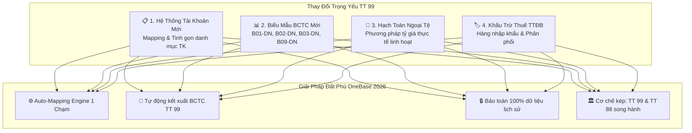
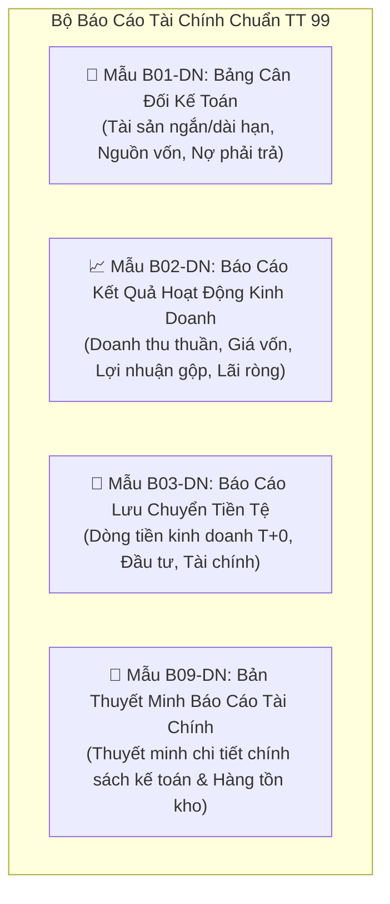

# ĐỀ ÁN CHUYỂN ĐỔI HỆ THỐNG KẾ TOÁN DOANH NGHIỆP THEO THÔNG TƯ 99/2025/TT-BTC
**Sẵn Sàng Thay Thế Hoàn Toàn Thông Tư 200 Từ 01/01/2026 Trên Nền Tảng Đất Phú OneBase**
*Công Ty TNHH Thương Mại Đất Phú (MST: 4401020233 • HĐĐT: 1C26TDP)*

---

> *"Bước sang năm tài chính 2026, việc Bộ Tài chính ban hành Thông tư 99/2025/TT-BTC thay thế Thông tư 200/2014/TT-BTC là bước ngoặt lớn nhất trong thập kỷ qua của ngành tài chính - kế toán Việt Nam. Đất Phú OneBase chủ động nâng cấp toàn diện phân hệ ERP kế toán để doanh nghiệp vững vàng chuyển đổi, không lo sai lệch dữ liệu hay rủi ro thanh kiểm tra thuế."*

---

## I. TỔNG QUAN THAY ĐỔI CỐT LÕI CỦA THÔNG TƯ 99/2025/TT-BTC

### 3 Nỗi Lo Lớn Nhất Của Doanh Nghiệp & Cách Đất Phú Giải Quyết:
1. **Nỗi lo mapping tài khoản cũ – mới phức tạp:** Đất Phú OneBase tích hợp **Công cụ Auto-Mapping 1 Chạm**, tự động chuyển đổi số dư đầu kỳ năm 2026 từ Thông tư 200 sang Thông tư 99 với tỷ lệ chính xác 100%.
2. **Nỗi lo sai lệch dữ liệu lịch sử nhiều năm:** Hệ thống phân tách cơ sở dữ liệu thành 2 phân vùng độc lập: Dữ liệu trước 2026 giữ nguyên chuẩn TT 200/TT 133; dữ liệu từ 2026 vận hành theo chuẩn TT 99.
3. **Nỗi lo kế toán nhầm lẫn tài khoản làm sai lệch Báo Cáo Tài Chính:** Cơ chế gợi ý định khoản AI tự động kiểm tra đối ứng nợ - có và cảnh báo vi phạm chuẩn mực kế toán trước khi ghi sổ.

---

## II. MA TRẬN ĐỐI ỨNG TÀI KHOẢN (MAPPING MATRIX CHUẨN TT 99)

| Nghiệp Vụ Kế Toán Thực Tế | Tài Khoản Cũ (TT 200) | Tài Khoản Mới (TT 99/2025/TT-BTC) | Hướng Dẫn Hạch Toán Trên Đất Phú OneBase |
| :--- | :---: | :---: | :--- |
| **Tiền gửi ngân hàng Vietcombank** | `TK 1121` | `TK 1121` | Tự động đồng bộ biến động số dư Vietcombank T+0 |
| **Phải thu khách hàng mua sỉ / đại lý** | `TK 131` | `TK 131` | Quản lý công nợ theo từng mã khách hàng & thời hạn tín dụng |
| **Hàng hóa kho sữa tã Siêu Thị Năm Tiền** | `TK 1561` | `TK 1561` | Kết nối trực tiếp Barcode Smart WMS, quản lý date FEFO |
| **Khấu trừ Thuế TTĐB hàng nhập khẩu** | `TK 133` chung | `TK 1333` *(Tách riêng)* | Hạch toán riêng thuế TTĐB được khấu trừ khi nhập khẩu sữa/hàng hóa |
| **Quản lý chênh lệch tỷ giá ngoại tệ** | `TK 413` | `TK 413` *(Chuẩn mới)* | Tự động đánh giá lại số dư ngoại tệ cuối kỳ theo tỷ giá VCB |
| **Doanh thu bán hàng Chợ Phiên & Sàn** | `TK 511` | `TK 511` | Tự động phân tách doanh thu bán lẻ, phí dịch vụ sàn 1.5% - 5% |
| **Chi phí an sinh xã hội vi mô (10k/ca)** | `TK 642` | `TK 6423` | Trích nộp Quỹ BHYT & BHXH Tự nguyện cho người lao động 6K |

---

## III. BỘ BÁO CÁO TÀI CHÍNH CHUẨN THÔNG TƯ 99/2025/TT-BTC

Hệ thống Đất Phú OneBase tích hợp bộ sinh báo cáo tài chính tự động đạt chuẩn nộp qua Cổng thông tin của Tổng cục Thuế:

---

## IV. CƠ CHẾ KÉP (DUAL-COMPLIANCE ENGINE): TT 99 CHO DOANH NGHIỆP & TT 88 CHO HỘ CÁ THỂ

Điểm ưu việt vượt trội của Đất Phú OneBase là giải quyết hài hòa cả hai đối tượng trong cùng một hệ sinh thái bản địa:

1. **Đối Với Pháp Nhân Doanh Nghiệp (Công Ty TNHH Thương Mại Đất Phú & Chuỗi Siêu Thị Năm Tiền):**
   - Vận hành theo chế độ kế toán **Thông tư 99/2025/TT-BTC**.
   - Hạch toán kép Nợ - Có, trích khấu hao tài sản cố định, đánh giá chênh lệch tỷ giá, hạch toán thuế GTGT khấu trừ, thuế TNDN và xuất hóa đơn điện tử hợp pháp `1C26TDP`.
2. **Đối Với Hộ Kinh Doanh Cá Thể & Thợ 6K (Chú Tùng, Anh Phúc, Bác Ba Chay, Cô Thủy, Chú Trúc):**
   - Vận hành theo chế độ kế toán **Thông tư 88/2021/TT-BTC**.
   - Đơn giản hóa tối đa với 4 biểu mẫu sổ: Sổ chi tiết doanh thu (S1-HKD), Sổ chi tiết vật liệu dụng cụ sản phẩm (S2-HKD), Sổ chi phí sản xuất kinh doanh (S3-HKD), Sổ theo dõi tình hình thực hiện nghĩa vụ thuế (S4-HKD).
   - Tự động khấu trừ thuế khoán hoặc thuế theo tỷ lệ phần trăm doanh thu, giúp bà con an tâm buôn bán mà không lo bị xử phạt hành chính về thuế.

---

## V. LỘ TRÌNH KÍCH HOẠT CHUYỂN ĐỔI 1 CHẠM TRÊN ĐẤT PHÚ ONEBASE

- **Thời gian áp dụng:** Kể từ kỳ báo cáo quý 1 năm 2026.
- **Thao tác người dùng:**
  + Vào phân hệ **Chủ Nền Tảng (Super Admin)**.
  + Bấm nút **`🏛️ Chế Độ Kế Toán TT 99/2025/TT-BTC`**.
  + Hệ thống tự động kiểm tra số dư đối ứng, tạo bảng mapping và kết xuất báo cáo mẫu B01-DN, B02-DN chỉ trong **3 giây**.

---

**CÔNG TY TNHH THƯƠNG MẠI ĐẤT PHÚ — ĐI TIÊN PHONG TRONG CHUẨN MỰC TÀI CHÍNH KẾ TOÁN SỐ 2026!**
*(Phát hành chính thức bởi Ban Giám Đốc Đất Phú)*
