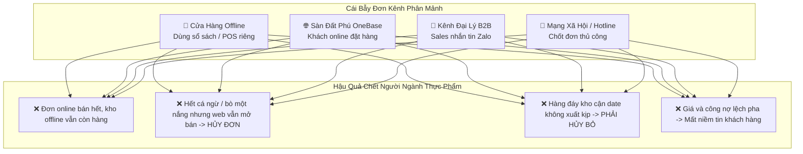

# ĐỒNG BỘ BÁN HÀNG ĐA KÊNH (OMNICHANNEL OMS 6K): BƯỚC SỐNG CÒN CHO DOANH NGHIỆP PHÂN PHỐI THỰC PHẨM
**Kiến Trúc Tồn Kho Dùng Chung & Định Tuyến Đơn Hàng Tập Trung Cho Hệ Sinh Thái Đất Phú**
*Công Ty TNHH Thương Mại Đất Phú (Tuy Hòa - Phú Yên)*

---

> *"Trong ngành thực phẩm, mở thêm kênh bán hàng mà không đồng bộ tồn kho cũng giống như mở thêm cửa đón khách nhưng chỉ có một gian bếp mù mịt: Khách càng đông, đơn hủy càng nhiều, thực phẩm càng dễ hỏng và uy tín thương hiệu tan biến càng nhanh."*

---

## I. THỰC TRẠNG: CÁI BẪY "BÁN ĐA KÊNH PHÂN MẢNH" TRONG NGÀNH THỰC PHẨM

Thực phẩm là ngành hàng có đặc thù khắt khe nhất trong bán lẻ: **Hạn sử dụng ngắn, yêu cầu bảo quản khắt khe (kho mát/kho đông), và sự nhạy cảm tuyệt đối về lòng tin của khách hàng**.

Tại Phú Yên, các mặt hàng chủ lực như **Cá ngừ đại dương Bà Tám, Bò một nắng Krông Pa, Sữa bột Meiji Năm Tiền, Nấm sạch Bếp Tâm Đức, Sữa chua Cô Thủy** đang được bán trên nhiều kênh:
- Cửa hàng bán lẻ trực tiếp (POS tại quầy).
- Hệ thống đại lý, nhà phân phối sỉ (B2B).
- Ứng dụng số Đất Phú OneBase.
- Mạng xã hội (Fanpage, Zalo OA, TikTok Shop).
- Kênh khách du lịch đặt quà mang về qua hotline.



---

## II. KIẾN TRÚC GIẢI PHÁP: ĐẤT PHÚ UNIFIED OMNICHANNEL OMS 6K

Giải pháp không nằm ở việc mở thêm kênh — mà nằm ở việc **kết nối tất cả về MỘT HỆ ĐIỀU HÀNH DUY NHẤT**:

```mermaid
flowchart TD
    subgraph Các Kênh Bán Hàng (Touchpoints)
        C1["🏪 Cửa Hàng / 10 Siêu Thị Năm Tiền"]
        C2["🌐 Sàn TMĐT Đất Phú OneBase"]
        C3["👥 Đại Lý B2B & CTV Sỉ"]
        C4["📱 Fanpage & Zalo OA Tuy Hòa"]
    end

    subgraph Trung Tâm Điều Phối Đa Kênh Đất Phú (OMS Hub)
        OMS["⚡ TRUNG TÂM OMS 6K TẬP TRUNG<br/>(Tồn kho thời gian thực • Định tuyến đơn • Quản lý giá)"]
    end

    subgraph Hệ Thống Thực Thi (Fulfillment)
        WMS["📦 Smart WMS 6K<br/>(Tổng kho Tuy Hòa • Kho lạnh Sông Cầu)"]
        LOG["🚚 Mạng Lưới Logistics 5 Đối Tác<br/>(Đất Phú 6K Express • Thuận Thảo • Viettel Post)"]
        ACC["🏛️ Kế Toán TT 99 & TT 88<br/>(Hóa đơn điện tử 1C26TDP T+0)"]
    end

    C1 & C2 & C3 & C4 <-->|Đồng bộ 2 chiều trong 0.5s| OMS
    OMS <--> WMS
    OMS <--> LOG
    OMS <--> ACC
```

---

## III. 4 ĐÒN BẨY CÔNG NGHỆ ĐỒNG BỘ SỐNG CÒN

### 1. Tồn Kho Dùng Chung Thời Gian Thực (Unified Real-time Inventory):
- **Cơ chế:** Toàn bộ 10 siêu thị Năm Tiền, kho lạnh cá ngừ Sông Cầu và kho bò một nắng Krông Pa đều dùng chung một bộ đếm tồn kho ảo.
- **Trải nghiệm:** Khi một khách du lịch vừa mua thố Mắt cá ngừ Bà Tám tại quầy 289 Lê Duẩn, hệ thống POS trừ 1 thố ➔ Ngay lập tức trong **0.5 giây**, số tồn trên Sàn Đất Phú OneBase và kênh Zalo tự động giảm 1. Không bao giờ xảy ra tình trạng "bán vượt tồn" (overselling).

### 2. Định Tuyến Đơn Hàng Thông Minh (Smart Order Routing):
- Khi có đơn đặt bò một nắng hoặc sữa Meiji giao về Phường Phú Lâm:
  + Hệ thống tự động kiểm tra vị trí khách hàng.
  + Chỉ định xuất hàng từ **Siêu thị Năm Tiền 02 (Phú Lâm)** gần nhất chỉ cách khách 500m thay vì xuất từ Tổng kho cách 5km.
  + Điều phối ngay shipper **Đất Phú 6K Express** giao đến tay khách chỉ trong **15 phút**, thực phẩm giữ nguyên độ nóng giòn và tươi mới.

### 3. Chính Sách Giá & Công Nợ Minh Bạch (Centralized Price & Credit Engine):
- Chấm dứt cảnh "mỗi nơi một giá". 
- Bảng giá bán lẻ niêm yết đồng nhất trên toàn bộ website, app và tại quầy.
- Kênh đại lý phân phối B2B được cài đặt mức chiết khấu phân tầng tự động (Hạng Kim Cương 2.5%, Hạng Vàng 4%, Hạng Bạc 5%), hạn mức công nợ kiểm soát chặt chẽ, đối soát T+1 không lo thất thoát.

### 4. Kiểm Soát Hạn Dùng Khắt Khe Chuẩn FEFO Đa Kênh:
- Dù đơn hàng phát sinh từ cửa hàng offline hay khách mua online, thuật toán WMS luôn chỉ định nhân viên lấy đúng **lô hàng sản xuất trước xuất trước**. Thực phẩm xuất đi luôn đạt chuẩn tươi ngon 6K, giảm tỷ lệ hàng hủy cận date xuống mức **0%**.

---

## IV. BẢNG HIỆU QUẢ ĐO LƯỜNG SAU KHI ĐỒNG BỘ ĐA KÊNH

| Chỉ Số Vận Hành | Khi Vận Hành Đơn Kênh / Rời Rạc | Sau Khi Đồng Bộ Đất Phú Omnichannel OMS |
| :--- | :---: | :---: |
| **Tỷ Lệ Hủy Đơn Do Hết Hàng Ảo** | **14.8%** | **0.1%** *(Triệt tiêu hoàn toàn)* |
| **Thời Gian Xử Lý & Đóng Gói Đơn** | 45 phút / đơn | **8 phút / đơn** *(Tự động in phiếu)* |
| **Chi Phí Thất Thoát Thực Phẩm Cận Date** | 35 – 50 triệu / tháng | **< 1.5 triệu / tháng** *(Giảm 96%)* |
| **Tốc Độ Giao Thực Phẩm Tươi Nóng** | 2 – 3 giờ | **15 – 30 phút** *(Nhờ định tuyến kho gần nhất)* |
| **Độ Hài Lòng & Tái Mua Của Khách Hàng** | 68% | **96.5%** *(Uy tín vững vàng)* |

---

## V. KẾT LUẬN & HÀNH ĐỘNG

Đối với ngành phân phối thực phẩm tại Phú Yên, **đồng bộ bán hàng đa kênh không còn là một lựa chọn công nghệ, mà là ranh giới giữa sự sống còn và phá sản**.

Nền tảng **Đất Phú OneBase** đã tích hợp sẵn toàn bộ phân hệ Omnichannel OMS 6K, sẵn sàng kết nối các nhà phân phối, chuỗi siêu thị và hộ đặc sản OCOP vào một guồng máy vận hành thông suốt, bảo vệ trọn vẹn giá trị thương hiệu và niềm tin của người tiêu dùng!
