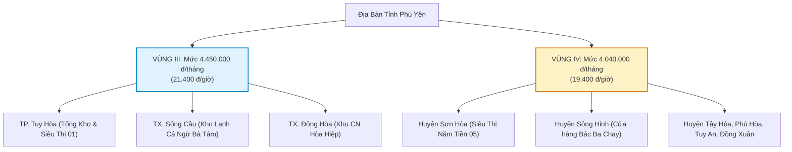

# 📊 DỰ THẢO LƯƠNG TỐI THIỂU VÙNG NĂM 2027 DỰ KIẾN TĂNG BAO NHIÊU? BẢNG SO SÁNH 4 VÙNG & TÁC ĐỘNG DOANH NGHIỆP

> **CÔNG TY TNHH THƯƠNG MẠI ĐẤT PHÚ (ĐẤT PHÚ ONEBASE)**  
> *Báo cáo Phân tích Chính sách Lao động & Kế hoạch Tài chính Quỹ Lương 2026 - 2027*  
> *Áp dụng cho: Chuỗi Siêu thị Sữa Tã Mẹ & Bé Năm Tiền, Tổng Kho Tuy Hòa, Kho Lạnh Sông Cầu & Đối Tác Thợ 6K*

---

## 1. TỔNG QUAN DỰ THẢO LƯƠNG TỐI THIỂU VÙNG NĂM 2027

Theo hồ sơ dự thảo Nghị định quy định mức lương tối thiểu đối với người lao động làm việc theo hợp đồng lao động (do Bộ LĐ-TB&XH / Bộ Nội vụ chủ trì xây dựng dựa trên khuyến nghị chính thức của Hội đồng Tiền lương Quốc gia):
- 📈 **Mức tăng bình quân:** Dự kiến tăng **~7,8%** trên cả 4 vùng.
- ⏱️ **Thời điểm áp dụng dự kiến:** Từ ngày **01/01/2027**.
- 🎯 **Mục tiêu điều chỉnh:** Bù đắp trượt giá (lạm phát dự kiến giai đoạn 2025–2026) và cao hơn khoảng **3,7%** so với mức sống tối thiểu của người lao động để cải thiện đời sống thực tế.
- ⚠️ **Lưu ý pháp lý quan trọng:** Đây hiện tại là **Bản dự thảo đang lấy ý kiến rộng rãi**, chưa phải văn bản Nghị định chính thức có hiệu lực thi hành. Doanh nghiệp cần theo dõi sát sao thời điểm ban hành chính thức của Chính phủ.

---

## 2. BẢNG SO SÁNH CHI TIẾT 4 VÙNG LƯƠNG TỐI THIỂU NĂM 2027

### 2.1. Mức lương tối thiểu theo tháng

| Vùng áp dụng | Mức hiện hành (2026) | Dự thảo đề xuất (Từ 01/01/2027) | Mức tăng tuyệt đối | Tỷ lệ tăng (%) |
| :--- | :---: | :---: | :---: | :---: |
| **VÙNG I** *(Hà Nội, TP.HCM, Hải Phòng, Quảng Ninh, Bình Dương, Đồng Nai,...)* | 5.310.000 đ | **5.700.000 đ** | +390.000 đ | ~7,3% |
| **VÙNG II** *(Đà Nẵng, Cần Thơ, Nha Trang, Hải Dương, Bắc Ninh, Long An,...)* | 4.730.000 đ | **5.080.000 đ** | +350.000 đ | ~7,4% |
| **VÙNG III** *(TP. Tuy Hòa, TX. Sông Cầu, TX. Đông Hòa, Pleiku, Buôn Ma Thuột,...)* | 4.140.000 đ | **4.450.000 đ** | +310.000 đ | ~7,5% |
| **VÙNG IV** *(Các huyện còn lại của Phú Yên: Sông Hinh, Sơn Hòa, Tây Hòa, Đồng Xuân,...)* | 3.700.000 đ | **4.040.000 đ** | +340.000 đ | **~9,2%** |

> [!NOTE]
> **Nhận xét trọng tâm:**
> - **Vùng I** có số tiền tăng tuyệt đối lớn nhất (+390.000 đ/tháng).
> - **Vùng IV** có tỷ lệ phần trăm tăng cao nhất (+9,2%), giúp thu hẹp khoảng cách thu nhập giữa nông thôn, miền núi với đô thị.

---

### 2.2. Mức lương tối thiểu theo giờ (Quy đổi)

| Vùng áp dụng | Mức hiện hành (2026) | Dự thảo đề xuất (Từ 01/01/2027) | Mức tăng thêm |
| :--- | :---: | :---: | :---: |
| **VÙNG I** | 25.500 đ/giờ | **27.400 đ/giờ** | +1.900 đ/giờ |
| **VÙNG II** | 22.700 đ/giờ | **24.400 đ/giờ** | +1.700 đ/giờ |
| **VÙNG III** *(Tuy Hòa, Sông Cầu, Đông Hòa)* | 19.900 đ/giờ | **21.400 đ/giờ** | +1.500 đ/giờ |
| **VÙNG IV** *(Sơn Hòa, Sông Hinh, Tây Hòa,...)* | 17.800 đ/giờ | **19.400 đ/giờ** | +1.600 đ/giờ |

---

## 3. PHÂN VÙNG CỤ THỂ TẠI ĐỊA BÀN TỈNH PHÚ YÊN

Đối với hệ thống chi nhánh và chuỗi cung ứng của **Công ty TNHH Thương mại Đất Phú**:

---

## 4. TÁC ĐỘNG TÀI CHÍNH & PHÁP LÝ ĐỐI VỚI DOANH NGHIỆP

### 4.1. Chi phí trích đóng Bảo hiểm Xã hội (BHXH, BHYT, BHTN) bắt buộc
Mức lương tối thiểu vùng là căn cứ để tính mức sàn đóng BHXH bắt buộc cho người lao động làm công việc giản đơn nhất:
- **Tỷ lệ trích đóng tổng cộng là 32%:**
  - 🏢 **Doanh nghiệp đóng 21,5%:** 14% Hưu trí – tử tuất + 3% Ốm đau – thai sản + 0,5% Tai nạn LĐ – Bệnh nghề nghiệp + 3% BHYT + 1% BHTN.
  - 👤 **Người lao động đóng 10,5%:** 8% Hưu trí – tử tuất + 1,5% BHYT + 1% BHTN.

**Ví dụ tính toán tại Chi nhánh Tuy Hòa (Vùng III):**
- Mức đóng BHXH tối thiểu hiện hành: $4.140.000 \times 32\% = 1.324.800\text{ đ/tháng}$ (Doanh nghiệp chịu $890.100\text{ đ}$, NLĐ chịu $434.700\text{ đ}$).
- Mức đóng BHXH tối thiểu dự thảo 2027: $4.450.000 \times 32\% = 1.424.000\text{ đ/tháng}$ (Doanh nghiệp chịu $956.750\text{ đ}$, NLĐ chịu $467.250\text{ đ}$).
- ➔ **Chi phí BHXH doanh nghiệp phải trả tăng thêm: ~66.650 đ/nhân sự/tháng.**

### 4.2. Giới hạn đóng Bảo hiểm Thất nghiệp (BHTN) tối đa
Theo Luật Việc làm, mức tiền lương tháng đóng BHTN tối đa không quá 20 lần mức lương tối thiểu vùng:
- Vùng I: $5.700.000 \times 20 = 114.000.000\text{ đ}$.
- Vùng III (Phú Yên): $4.450.000 \times 20 = 89.000.000\text{ đ}$.

### 4.3. Các quyền lợi khác của người lao động tăng theo
1. **Tiền lương ngừng việc:** Không được thấp hơn mức lương tối thiểu vùng.
2. **Tiền lương làm thêm giờ ban đêm, ngày nghỉ, ngày lễ:** Đơn giá giờ tối thiểu được nâng lên ($21.400\text{ đ/giờ}$ tại Vùng III, $19.400\text{ đ/giờ}$ tại Vùng IV).
3. **Mức hưởng trợ cấp thất nghiệp tối đa:** Tăng lên mức $5 \times 20 = 100$ lần mức lương tối thiểu vùng quy định.

---

## 5. KẾ HOẠCH HÀNH ĐỘNG DÀNH CHO CÔNG TY TNHH THƯƠNG MẠI ĐẤT PHÚ & ĐỐI TÁC

1. **Rà soát lại toàn bộ thang bảng lương nội bộ:**
   - Đảm bảo 100% nhân viên kho, tài xế xe tải (Chú Trúc), nhân viên siêu thị Năm Tiền có mức lương cơ bản ghi trên HĐLĐ không thấp hơn mức lương tối thiểu vùng dự kiến ($4.450.000\text{ đ}$ tại Tuy Hòa / Sông Cầu và $4.040.000\text{ đ}$ tại các huyện).
2. **Hạch toán chi phí lương chuẩn Thông tư 99/2025/TT-BTC:**
   - Tự động cập nhật công thức tính trích nộp các khoản theo lương (TK 3383, 3384, 3386) tương ứng trên hệ thống ERP Omni-Cockpit.
3. **Đẩy mạnh chính sách Thợ 6K & BHYT Vi Mô Hộ Kinh Doanh:**
   - Khuyến khích mô hình việc làm kinh tế nền tảng (Thợ 6K Anh Vinh, Anh Hoàng, Cô Thủy sữa chua, Bạn Châu bánh kem) tham gia gói an sinh vi mô, tối ưu chi phí vận hành cho cả đối tác và khách hàng.
