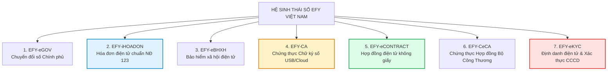

# 🍀 HỆ SINH THÁI CHUYỂN ĐỔI SỐ TOÀN DIỆN EFY VIỆT NAM & ỨNG DỤNG TÍCH HỢP ĐẤT PHÚ ONEBASE

> **Báo cáo Chiến lược Công nghệ & Dịch vụ Tin Cậy Số (Trust Services)**  
> *Đơn vị phát triển: EFY Việt Nam (Nhà cung cấp giải pháp CNTT, Hóa đơn điện tử iHOADON, Chữ ký số EFY-CA, BHXH điện tử eBHXH)*  
> *Ứng dụng tại: Công ty TNHH Thương mại Đất Phú (OneBase), Chuỗi Siêu thị Sữa Tã Năm Tiền & Mạng lưới Thợ 6K*

---

## 1. TỔNG QUAN 7 TRỤ CỘT CHUYỂN ĐỔI SỐ CỦA EFY VIỆT NAM

EFY Việt Nam là một trong những đơn vị tiên phong hàng đầu tại Việt Nam cung cấp giải pháp trọn gói từ Khối Chính phủ (eGOV) đến khối Doanh nghiệp tập đoàn, SME và Hộ kinh doanh:



---

## 2. MA TRẬN PHÂN TÍCH CHI TIẾT 7 DỊCH VỤ SỐ EFY

| STT | Dịch Vụ Số EFY | Bản Chất & Tính Năng Trọng Tâm | Giá Trị Cốt Lõi Cho Doanh Nghiệp |
| :---: | :--- | :--- | :--- |
| **1** | **eGOV (Nền tảng Chính phủ số)** | Cổng dịch vụ công trực tuyến, một cửa điện tử liên thông, quản trị văn bản điều hành cho các Sở, Ban, Ngành và UBND các cấp. | Giúp cơ quan Nhà nước phục vụ người dân minh bạch, giảm 80% thời gian xử lý thủ tục hành chính. |
| **2** | **EFY-iHOADON** | Phần mềm khởi tạo, phát hành, lưu trữ và truyền nhận hóa đơn điện tử có mã/không mã của Cơ quan Thuế; kết nối máy tính tiền (POS). | Tự động xuất hóa đơn khi chốt đơn, đồng bộ số liệu lên Tổng cục Thuế tức thời, triệt tiêu rủi ro hóa đơn giả. |
| **3** | **EFY-eBHXH** | Phần mềm kê khai bảo hiểm xã hội điện tử chính thức được BHXH Việt Nam kết nối trực tiếp (I-VAN). | Tự động nộp hồ sơ tăng/giảm lao động, thai sản, ốm đau, đối chiếu mã C12-TS trực tiếp không cần đến cơ quan BHXH. |
| **4** | **EFY-CA** | Dịch vụ chứng thực chữ ký số công cộng (Token USB và Chữ ký số từ xa Cloud HSM). | Ký hóa đơn điện tử, ký tờ khai thuế, nộp BHXH, ký hải quan, giao dịch ngân hàng an toàn tuyệt đối với giá trị pháp lý tương đương con dấu đỏ. |
| **5** | **EFY-eCONTRACT** | Nền tảng tạo lập, đàm phán, ký kết và lưu trữ hợp đồng trực tuyến giữa doanh nghiệp với đối tác, khách hàng và người lao động. | Ký hợp đồng trong 30 giây qua Smartphone, tiết kiệm 90% chi phí in ấn, chuyển phát nhanh và lưu kho hồ sơ giấy. |
| **6** | **EFY-CeCA** | Dịch vụ chứng thực hợp đồng điện tử được **Bộ Công Thương cấp giấy phép**, gắn dấu thời gian Timestamp và con dấu chứng thực CeCA. | Đảm bảo tính chống chối bỏ, là bằng chứng pháp lý vững chắc trước Tòa án và Trọng tài thương mại. |
| **7** | **EFY-eKYC** | Giải pháp xác thực danh tính khách hàng bằng AI: Đọc chip CCCD, đối soát khuôn mặt (Facial Match), kiểm tra thực thể sống (Liveness Detection). | Ngăn chặn mạo danh tài khoản, tự động trích xuất thông tin khách hàng lên hợp đồng chỉ trong 3 giây. |

---

## 3. MÔ HÌNH TÍCH HỢP TRỰC TIẾP VÀO ĐẤT PHÚ ONEBASE

Tại **Công ty TNHH Thương mại Đất Phú (MST: 4401020233)**, sự kết hợp với hệ sinh thái EFY giải quyết triệt để bài toán vận hành 10 Siêu thị Năm Tiền, Tổng Kho Tuy Hòa và mạng lưới đối tác Thợ 6K:

```
┌────────────────────────────────────────────────────────────────────────┐
│               ĐẤT PHÚ ONEBASE OMNI-ERP & EFY GATEWAY                   │
├─────────────────────────┬─────────────────────────┬────────────────────┤
│ PHÂN HỆ ĐẤT PHÚ         │ KẾT NỐI DỊCH VỤ EFY     │ HIỆU QUẢ VẬN HÀNH  │
├─────────────────────────┼─────────────────────────┼────────────────────┤
│ 1. POS Siêu Thị Năm Tiền│ EFY-iHOADON (Máy tính   │ Xuất hóa đơn bán lẻ│
│    & Sàn Đất Phú OneBase│ tiền, ký hiệu 1C26TDP)  │ tự động trong 1s   │
├─────────────────────────┼─────────────────────────┼────────────────────┤
│ 2. Quản Trị Nhân Sự &   │ EFY-eBHXH               │ Tự động trích đóng │
│    Quỹ Lương (32%)      │ (Liên thông BHXH PY)    │ BHXH cho tài xế/kho│
├─────────────────────────┼─────────────────────────┼────────────────────┤
│ 3. Mạng Lưới Đối Tác    │ EFY-eCONTRACT &         │ Ký số hợp đồng đại │
│    (Năm Tiền, Chú Trúc, │ EFY-CeCA (Bộ Công Thương│ lý từ xa, bảo đảm  │
│    Cô Thủy, Anh Vinh)   │ chứng thực pháp lý)     │ an toàn tuyệt đối  │
├─────────────────────────┼─────────────────────────┼────────────────────┤
│ 4. Đăng Ký Thợ 6K &     │ EFY-eKYC                │ Định danh chuẩn hóa│
│    Tài Xế Mía Thạnh Phú │ (Xác thực chip CCCD)    │ 100% hồ sơ đối tác │
└─────────────────────────┴─────────────────────────┴────────────────────┘
```

---

## 4. LỢI ÍCH CHIẾN LƯỢC KHI DOANH NGHIỆP BẮT TAY CÙNG NỀN TẢNG TIN CẬY
1. 🛡️ **Tuyệt đối an toàn pháp lý:** Mọi giao dịch từ hợp đồng điện tử đến hóa đơn đều có dấu thời gian (Timestamp) và chứng thư số được Nhà nước cấp phép bảo hộ.
2. ⚡ **Tốc độ giao dịch thần tốc:** Không còn cảnh chờ gửi hợp đồng giấy từ Tuy Hòa lên Sông Hinh hay ra Sông Cầu mất 2–3 ngày; mọi thỏa thuận được ký duyệt ngay trên điện thoại trong 1 phút.
3. 📉 **Tiết kiệm hàng trăm triệu đồng mỗi năm:** Loại bỏ chi phí in ấn, bảo quản, thuê kho lưu trữ chứng từ giấy và nhân sự đi nộp hồ sơ trực tiếp.
4. 📈 **Sẵn sàng cho kỷ nguyên số 2026 - 2030:** Doanh nghiệp vận hành tự động, số liệu thời gian thực, minh bạch tuyệt đối với cơ quan quản lý Nhà nước.
