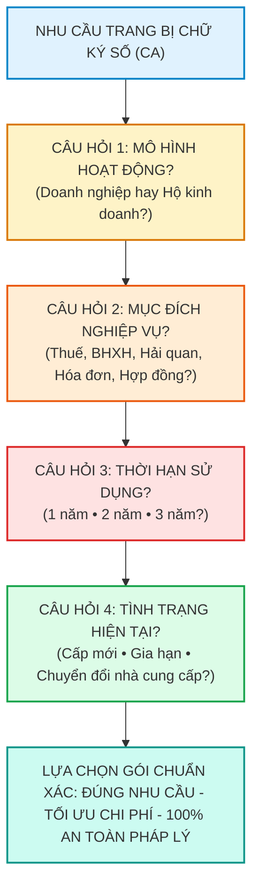

# 🔑 ĐỪNG HỎI "CHỮ KÝ SỐ BAO NHIÊU TIỀN?" TRƯỚC KHI TRẢ LỜI 4 CÂU HỎI NÀY!

> **Cẩm nang Tư vấn Dịch vụ Chứng thực Chữ ký số Doanh nghiệp & Hộ Kinh Doanh**  
> *Được biên soạn từ cẩm nang chuyên môn FastCA & Chuẩn pháp lý giao dịch điện tử Đất Phú OneBase.*  
> *Mục tiêu: Giúp chủ doanh nghiệp và hộ kinh doanh chọn đúng loại chữ ký số, tối ưu chi phí và tránh gián đoạn xuất hóa đơn, kê khai thuế.*

---

---

## 1. PHÂN TÍCH 4 CÂU HỎI CỐT TỬ TRƯỚC KHI SO GIÁ

### ❓ Câu Hỏi 1: Bạn Là Doanh Nghiệp Hay Hộ Kinh Doanh?
- **Doanh nghiệp (TNHH, Cổ phần):** Bắt buộc phải có chữ ký số mang tên tổ chức và MST của doanh nghiệp. Nhu cầu giao dịch điện tử là **bắt buộc 100%** cho nộp tờ khai thuế môn bài, thuế GTGT, BCTC, nộp tiền thuế điện tử và phát hành HĐĐT.
- **Hộ kinh doanh cá thể (HKD):** Theo Thông tư 88 và Thông tư 78, HKD nộp thuế theo phương pháp kê khai hoặc sử dụng HĐĐT khởi tạo từ máy tính tiền (như các quầy sữa Năm Tiền, tiệm bánh kem Châu, xưởng sơn Anh Vinh) chỉ cần gói chữ ký số cá nhân trong tổ chức hoặc gói CA dành riêng cho HKD với chi phí tiết kiệm hơn.

---

### ❓ Câu Hỏi 2: Bạn Cần Chữ Ký Số Để Thực Hiện Nghiệp Vụ Nào?
Mỗi nghiệp vụ đòi hỏi tính năng và độ tương thích khác nhau:
1. **Kê khai thuế & nộp thuế điện tử (eTax):** Đòi hỏi chuẩn PKI tương thích trình duyệt và cổng thuế.
2. **Kê khai Bảo hiểm Xã hội (eBHXH):** Ký số qua phần mềm BHXH điện tử.
3. **Khai báo Hải quan điện tử (VNACCS):** Yêu cầu thông tin chữ ký số phải được đăng ký và đồng bộ trên hệ thống Tổng cục Hải quan (đối với doanh nghiệp XNK).
4. **Phát hành Hóa đơn điện tử (iHOADON / 1C26TDP):** Nếu xuất hàng nghìn hóa đơn/ngày tại nhiều điểm bán, nên dùng giải pháp **Chữ ký số Server (HSM / Cloud CA)** thay vì cắm rút USB Token thủ công.
5. **Ký Hợp đồng điện tử (eContract / CeCA):** Cần ký linh hoạt trên điện thoại mà không cần cắm USB vào máy tính.

---

### ❓ Câu Hỏi 3: Bạn Muốn Sử Dụng Trong Bao Lâu (1 Năm, 2 Năm Hay 3 Năm)?
- **Gói 1 năm:** Phù hợp với doanh nghiệp mới thành lập đang trong giai đoạn thử nghiệm mô hình kinh doanh, muốn chi trả dòng tiền ban đầu thấp.
- **Gói 2 - 3 năm (Khuyên dùng):**
  - Tiết kiệm từ **30% đến 45% chi phí** so với mua lẻ từng năm.
  - **Tránh rủi ro cực lớn:** Rất nhiều doanh nghiệp bị khóa tài khoản xuất hóa đơn hoặc chậm nộp tờ khai thuế chỉ vì quên gia hạn chữ ký số khi hết hạn 1 năm.

---

### ❓ Câu Hỏi 4: Bạn Đã Có Chữ Ký Số Của Nhà Cung Cấp Nào Chưa?
- **Đăng ký mới:** Cần cấp mới thiết bị USB Token + Chứng thư số + Kích hoạt cổng thuế/BHXH.
- **Gia hạn cùng nhà cung cấp (FastCA):** Không cần mua lại thiết bị USB Token mới, kỹ thuật viên chỉ cần nạp thêm thời hạn chứng thư số từ xa qua Ultraview/AnyDesk trong 5 phút.
- **Chuyển đổi nhà cung cấp (Chuyển sang FastCA):** Thường được hưởng chính sách trợ giá hấp dẫn (cộng thêm thời hạn còn lại của nhà cung cấp cũ sang nhà cung cấp mới).

---

## 2. NÊN CHỌN USB TOKEN HAY CHỮ KÝ SỐ TỪ XA (SMART CA / CLOUD CA)?

| Tiêu Chí So Sánh | USB Token Truyền Thống (FastCA USB) | Chữ Ký Số Từ Xa (Cloud CA / HSM) |
| :--- | :--- | :--- |
| **Thiết bị phần cứng** | Bắt buộc phải có USB Token cắm vào cổng USB máy tính. | Không cần USB Token; lưu khóa bí mật trên hạ tầng đám mây HSM bảo mật. |
| **Thiết bị ký** | Chỉ ký được trên máy tính Windows/Mac có cài driver. | Ký trực tiếp trên Smartphone, Tablet, Laptop mọi lúc mọi nơi. |
| **Số người sử dụng** | Chỉ 1 người giữ USB mới ký được tại 1 thời điểm. | Phân quyền cho nhiều người ký đồng thời theo luồng phê duyệt. |
| **Xuất hóa đơn tự động** | Phải có máy tính cắm USB Token liên tục 24/7. | Tích hợp API tự động ký hàng loạt hàng nghìn hóa đơn trong 1 giây. |
| **Đối tượng phù hợp** | Kế toán nội bộ, công ty quy mô nhỏ, hộ kinh doanh. | Chuỗi cửa hàng bán lẻ (Năm Tiền), sàn TMĐT (OneBase), sếp hay đi công tác. |

---

## 3. CHECKLIST 4 BƯỚC THỰC THI CHO HỆ SINH THÁI ĐẤT PHÚ
1. **Công ty TNHH Thương Mại Đất Phú (Tổng kho & Trụ sở):** Duy trì chữ ký số doanh nghiệp 3 năm để ký BCTC, hóa đơn điện tử `1C26TDP` và tờ khai thuế Quý.
2. **Chuỗi 10 Siêu Thị Năm Tiền:** Ứng dụng ký số điện tử tập trung để máy tính tiền POS xuất hóa đơn tức thời cho khách mua sữa bỉm.
3. **Mạng lưới đối tác (Chú Trúc chở mía, Thợ 6K Anh Vinh):** Sử dụng Chữ ký số cá nhân / Cloud CA để ký hợp đồng dịch vụ vận tải và biên bản giao nhận hàng hóa trên điện thoại.
