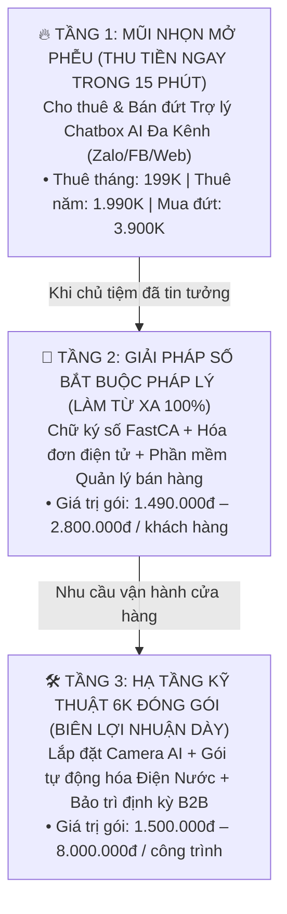

# BẢN KẾ HOẠCH KINH DOANH CÔNG NGHỆ (TECH BUSINESS PLAN 2026 – 2027)
**Pháp nhân triển khai:** CÔNG TY TNHH THƯƠNG MẠI ĐẤT PHÚ (MST: `4401020233`)  
**Người đại diện pháp luật:** Phạm Thanh Hân – Giám đốc  
**Tài khoản nhận thanh toán VietQR:** Vietcombank (VCB) – `0751000025858`  
**Triết lý cốt lõi:** *“Duy Tuệ Thị Nghiệp • Nhẹ Vốn Tối Đa (Asset-Light) • Thu Tiền Trước 100% • Chốt Chặn Rủi Ro Kín Kẽ”*

---

## 1. CẤU TRÚC THÁP SẢN PHẨM 3 TẦNG (PRODUCT LADDER)

Thay vì dàn trải nguồn lực, Đất Phú sử dụng **Chatbox AI** làm mũi nhọn mở cửa từng hộ kinh doanh, sau đó bán chéo (Cross-sell) các giải pháp số pháp lý và hạ tầng kỹ thuật:

---

## 2. CHÂN DUNG 5 NHÓM KHÁCH HÀNG MỤC TIÊU DỄ CHỐT NHẤT (PHÚ YÊN & ĐẮK LẮK)

| Nhóm khách hàng | Nỗi đau thực tế của chủ tiệm | Gói sản phẩm Đất Phú chào bán | Tỷ lệ chốt dự kiến |
| :--- | :--- | :--- | :--- |
| **1. Đặc sản OCOP, Hải sản, Nông sản** *(Bò 1 nắng, mắm, sầu riêng, cà phê)* | Khách nhắn hỏi giá sỉ/lẻ ban đêm hoặc lúc đang đóng hàng không kịp trả lời; sợ nhân viên báo nhầm giá. | **Gói Năm 1.990K** (Tự báo giá + Xuất VietQR thẳng về TK chủ vựa) | **Rất cao (40%)** |
| **2. Siêu thị Mẹ & Bé, Tạp hóa lớn, Vật tư** | Nhiều mặt hàng (sữa, tã, phụ kiện), khách hỏi liên tục xem còn hàng không và giao tận nhà không. | **Gói Năm 1.990K** hoặc **Mua đứt 3.900K** + Hóa đơn điện tử | **Cao (35%)** |
| **3. Nha khoa, Spa, Phòng khám, Homestay** | Cần trực tư vấn bảng giá dịch vụ, giữ chân khách để lại SĐT đặt lịch hẹn 24/7. | **Gói Năm 1.990K** + Bảng Mica QR đặt quầy lễ tân | **Cao (35%)** |
| **4. Quán ăn, Bếp chay, Tiệm bánh kem** | Khách cần xem thực đơn nhanh, đặt mâm cỗ/bánh sinh nhật và chuyển khoản cọc ngay qua QR. | **Gói Tháng 199K** ➔ Nâng cấp **Gói Năm 1.990K** | **Trung bình - Cao (30%)** |
| **5. Doanh nghiệp mới mở & Hộ kinh doanh** | Bắt buộc phải có Chữ ký số, Hóa đơn điện tử theo luật Thuế mới ngay khi có GPKD. | **Combo Khởi Sự 1.490K** (Chữ ký số + HĐĐT) + Tặng 1 tháng Bot AI | **Rất cao (50%)** |

---

## 3. CHIẾN LƯỢC BÁN HÀNG "KHÔNG LƯƠNG CỨNG" (MẠNG LƯỚI CỘNG TÁC VIÊN B2B)

Tuyệt đối không thuê nhân viên sales cố định ngồi văn phòng gây áp lực chi phí hàng tháng. Áp dụng cơ chế **Chia sẻ doanh thu tức thì (30% – 40%)** cho 4 nhóm đối tác có sẵn tệp chủ shop:

1. **Chuyên viên Ngân hàng (VCB, MB, BIDV, VietinBank):** Khi họ đi mở tài khoản thanh toán/mã QR cho cửa hàng, họ giới thiệu luôn Gói Chatbox AI xuất VietQR của Đất Phú ➔ Nhận ngay **400.000đ – 700.000đ/hợp đồng**.
2. **Kế toán dịch vụ tự do (Freelance Accountants):** Mỗi kế toán đang giữ sổ sách cho 10–30 công ty/hộ kinh doanh ➔ Đại lý phân phối Chữ ký số, HĐĐT và Bot AI.
3. **Nhân viên tiếp thị (Sale thị trường Sữa, Bia, Vật tư xây dựng):** Ngày nào cũng đi gặp 20–30 chủ tiệm tạp hóa, đại lý điện nước.
4. **Anh em thợ IT, Camera, In ấn bảng hiệu:** Khi lắp camera hoặc làm bảng hiệu cho tiệm mới mở, bán kèm luôn gói Bot AI + Bảng Mica QR.

---

## 4. BẢNG DỰ TOÁN TÀI CHÍNH & DÒNG TIỀN 6 THÁNG ĐẦU TIÊN

### 4.1. Chi phí vận hành cố định hàng tháng (Fixed OpEx)
* Hạ tầng Supabase + Vercel Web App PWA: **0đ** (Gói miễn phí).
* Máy chủ VPS chạy Docker n8n + Tên miền: **~150.000đ / tháng**.
* Chi phí API Google Gemini 2.5 Flash: **~50.000đ – 100.000đ / tháng**.
* 👉 **Tổng chi phí cố định:** **~250.000đ / tháng** *(Chỉ cần chốt **02 khách thuê gói tháng 199K** là đã vượt điểm hòa vốn!)*.

### 4.2. Lộ trình tăng trưởng doanh thu 6 tháng

| Tháng | Số Shop Thuê Tháng (Lũy kế × 199K) | Số Hợp Đồng Năm Mới (× 1.990K) | Số Bộ Mua Đứt / CKS+HĐĐT (× 2.500K TB) | Tổng Doanh Thu Tháng | Chi Phí (Hạ tầng + Hoa hồng CTV 30%) | **Lợi Nhuận Ròng Đút Túi** |
| :--- | :--- | :--- | :--- | :--- | :--- | :--- |
| **Tháng 1** | 10 shop (1.990K) | 3 HĐ (5.970K) | 2 bộ (5.000K) | **12.960.000đ** | 2.800.000đ | **+10.160.000đ** |
| **Tháng 2** | 22 shop (4.378K) | 5 HĐ (9.950K) | 3 bộ (7.500K) | **21.828.000đ** | 4.800.000đ | **+17.028.000đ** |
| **Tháng 3** | 38 shop (7.562K) | 7 HĐ (13.930K) | 5 bộ (12.500K) | **33.992.000đ** | 7.500.000đ | **+26.492.000đ** |
| **Tháng 4** | 55 shop (10.945K) | 8 HĐ (15.920K) | 6 bộ (15.000K) | **41.865.000đ** | 9.200.000đ | **+32.665.000đ** |
| **Tháng 5** | 75 shop (14.925K) | 10 HĐ (19.900K) | 8 bộ (20.000K) | **54.825.000đ** | 12.100.000đ | **+42.725.000đ** |
| **Tháng 6** | 100 shop (19.900K) | 12 HĐ (23.880K) | 10 bộ (25.000K) | **68.780.000đ** | 15.200.000đ | **+53.580.000đ** |

*(Lưu ý: Đến Tháng thứ 6, riêng khoản thu định kỳ từ 100 shop thuê hàng tháng đã mang về **~20.000.000đ/tháng dòng tiền thụ động** ngay từ ngày mùng 1 đầu tháng!)*

---

## 5. QUY TRÌNH VẬN HÀNH TINH GỌN (1 NGƯỜI QUẢN LÝ 100+ CỬA HÀNG)

Để không bị ngập trong việc hỗ trợ khách hàng, áp dụng **Kỷ luật Tự động hóa 3 Không**:
1. **Không tự gõ code lại cho từng khách:** Dùng tính năng **`+ Mở Tiệm Thuê Mới (3 Bước)`** trên [`zalo_ai_chat.html`](file:///e:/datphu-onebase/zalo_ai_chat.html) để tạo Bot mới trong 60 giây.
2. **Không giữ tiền hộ khách hàng (Zero-Float):** Mã VietQR trong khung chat của tiệm nào thì tiền chảy thẳng về tài khoản ngân hàng của chủ tiệm đó. Đất Phú chỉ thu tiền thuê phần mềm về tài khoản VCB `0751000025858`.
3. **Không để khách quên gia hạn:** Hệ thống n8n tự động gửi **Báo cáo doanh thu tối Chủ Nhật** qua Zalo cho chủ tiệm và tự động gửi mã VietQR nhắc gia hạn trước khi hết hạn 5 ngày.
