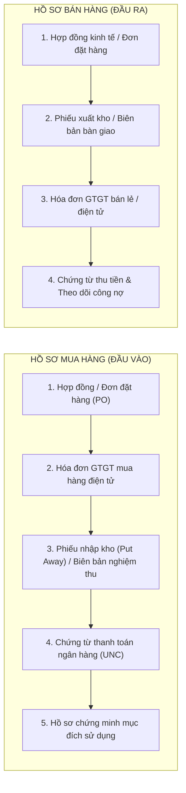

# 📚 TẤT TẦN TẬT KIẾN THỨC KẾ TOÁN CHO NGƯỜI MỚI BẮT ĐẦU: TỪ CON SỐ 0 ĐẾN THÀNH THẠO

> **Tài liệu đào tạo kế toán nội bộ:**  
> *Được biên soạn & chuẩn hóa từ cẩm nang chuyên môn iHOADON và hệ thống quản trị Đất Phú OneBase.*  
> *Dành cho: Sinh viên mới ra trường, người chuyển ngành, nhân sự kế toán mới tại chuỗi Siêu thị Năm Tiền & các chi nhánh Đất Phú.*

---

## 1. NẮM VỮNG HỆ THỐNG TÀI KHOẢN KẾ TOÁN (LOẠI 1 ĐẾN LOẠI 9)

Hệ thống tài khoản kế toán doanh nghiệp được phân thành 9 loại cốt lõi:

| Loại TK | Tên Nhóm Tài Khoản | Nội Dung Phản Ánh Cụ Thể | Ví Dụ Điển Hình |
| :---: | :--- | :--- | :--- |
| **Loại 1, 2** | **TÀI SẢN** *(Assets)* | Toàn bộ nguồn lực kinh tế thuộc quyền kiểm soát của DN (tiền, hàng, nợ phải thu, nhà xưởng, máy móc...) | TK 111 (Tiền mặt), 112 (Tiền gửi NH), 131 (Phải thu KH), 152, 156 (Hàng hóa), 211 (TSCĐ)... |
| **Loại 3** | **NỢ PHẢI TRẢ** *(Liabilities)* | Nghĩa vụ nợ hiện tại DN phải thanh toán bằng nguồn lực của mình | TK 331 (Phải trả NCC), 334 (Phải trả người LĐ), 338 (BHXH, BHYT), 333 (Thuế phải nộp Nhà nước)... |
| **Loại 4** | **VỐN CHỦ SỞ HỮU** *(Equity)* | Nguồn vốn do chủ sở hữu góp và lợi nhuận tích lũy giữ lại | TK 411 (Vốn đầu tư của CSH), 421 (Lợi nhuận sau thuế chưa phân phối)... |
| **Loại 5, 7** | **DOANH THU & THU NHẬP** *(Revenue)* | Các dòng tiền thu được từ bán hàng, cung cấp dịch vụ hoặc thu nhập bất thường | TK 511 (Doanh thu bán hàng), 515 (Doanh thu tài chính), 711 (Thu nhập khác)... |
| **Loại 6, 8** | **CHI PHÍ** *(Expenses)* | Toàn bộ phí tổn phát sinh để tạo ra doanh thu trong kỳ | TK 632 (Giá vốn hàng bán), 641 (CP bán hàng), 642 (CP QLDN), 635 (CP tài chính), 811 (CP khác)... |
| **Loại 9** | **XÁC ĐỊNH KẾT QUẢ KINH DOANH** | Tài khoản trung gian tập hợp doanh thu và chi phí để tính LÃI hoặc LỖ | TK 911 (Xác định KQKD) |

---

## 2. NGUYÊN TẮC VÀNG: GHI NỢ - GHI CÓ

Đây là nền tảng cốt lõi của phương pháp ghi sổ kép (Double-entry bookkeeping). Nắm chắc bảng này, bạn sẽ không bao giờ định khoản sai:

```
         TÀI SẢN (Loại 1, 2) & CHI PHÍ (Loại 6, 8)
    ┌───────────────────────────┬───────────────────────────┐
    │       BÊN NỢ (+)          │        BÊN CÓ (-)         │
    │   PHÁT SINH TĂNG          │      PHÁT SINH GIẢM       │
    └───────────────────────────┴───────────────────────────┘

    NỢ PHẢI TRẢ (Loại 3), VỐN CHỦ (Loại 4) & DOANH THU (Loại 5, 7)
    ┌───────────────────────────┬───────────────────────────┐
    │       BÊN NỢ (-)          │        BÊN CÓ (+)         │
    │     PHÁT SINH GIẢM        │      PHÁT SINH TĂNG       │
    └───────────────────────────┴───────────────────────────┘
```

| Nhóm Tài Khoản | Phát Sinh TĂNG | Phát Sinh GIẢM | Số Dư Cuối Kỳ |
| :--- | :---: | :---: | :---: |
| **Tài sản (Loại 1, 2)** | **Ghi NỢ** | **Ghi CÓ** | **Thường có Dư NỢ** |
| **Nợ phải trả (Loại 3)** | **Ghi CÓ** | **Ghi NỢ** | **Thường có Dư CÓ** |
| **Vốn chủ sở hữu (Loại 4)** | **Ghi CÓ** | **Ghi NỢ** | **Thường có Dư CÓ** |
| **Doanh thu, thu nhập (Loại 5, 7)** | **Ghi CÓ** | **Ghi NỢ** | **KHÔNG CÓ SỐ DƯ** *(kết chuyển sang 911)* |
| **Chi phí (Loại 6, 8)** | **Ghi NỢ** | **Ghi CÓ** | **KHÔNG CÓ SỐ DƯ** *(kết chuyển sang 911)* |
| **Xác định KQKD (Loại 9)** | Chỉ dùng để kết chuyển | Chỉ dùng để kết chuyển | **KHÔNG CÓ SỐ DƯ** |

---

## 3. BỘ HỒ SƠ CHỨNG TỪ BẮT BUỘC ĐẦU VÀO – ĐẦU RA

Mỗi nghiệp vụ kinh tế chỉ được hạch toán khi có bộ hồ sơ chứng minh tính hợp pháp, hợp lệ:



---

## 4. 6 PHẦN HÀNH KẾ TOÁN THỰC TẾ CẦN THÀNH THẠO

1. **Kế toán Tiền mặt & Tiền gửi Ngân hàng:**
   - Lập và kiểm soát phiếu thu, phiếu chi, ủy nhiệm chi (UNC).
   - Kiểm tra sổ phụ ngân hàng hàng ngày, đối chiếu chênh lệch giữa số dư sổ sách và số dư thực tế.
2. **Kế toán Mua hàng & Công nợ:**
   - Theo dõi công nợ phải thu (TK 131) và phải trả (TK 331).
   - Lập biên bản đối chiếu công nợ định kỳ, kiểm soát tuổi nợ và hạn thanh toán để cảnh báo rủi ro nợ xấu.
3. **Kế toán Kho & Hàng tồn kho:**
   - Theo dõi xuất – nhập – tồn kho (TK 152, 156) theo thời gian thực.
   - Tính giá xuất kho theo phương pháp lựa chọn (Bình quân gia quyền, FIFO). Tham gia kiểm kê định kỳ.
4. **Kế toán Tài sản cố định (TSCĐ) & CCDC:**
   - Lập thẻ TSCĐ, hồ sơ bàn giao, điều chuyển (TK 211, 242).
   - Trích khấu hao TSCĐ hàng tháng theo Thông tư 45/2013/TT-BTC, phân bổ CCDC vào chi phí kinh doanh.
5. **Kế toán Tiền lương & Bảo hiểm:**
   - Tổng hợp bảng chấm công, tính lương net/gross, hoa hồng và các khoản phụ cấp.
   - Trích nộp các khoản BHXH, BHYT, BHTN (tổng 32%) và tính thuế TNCN tạm nộp.
6. **Kế toán Chi phí & Giá thành:**
   - Tập hợp chi phí nguyên vật liệu trực tiếp (621), nhân công (622), sản xuất chung (627).
   - Đánh giá sản phẩm dở dang (TK 154) và tính giá thành đơn vị thành phẩm hoàn thành.

---

## 5. ĐỌC HIỂU 4 BIỂU MẪU BÁO CÁO TÀI CHÍNH (BCTC)

| Báo Cáo | Ý Nghĩa Cốt Lõi | Các Thành Phần Chính | Câu Hỏi Doanh Nghiệp Cần Trả Lời |
| :--- | :--- | :--- | :--- |
| **1. Bảng Cân Đối Kế Toán** | Chụp lại bức tranh tài chính tại một thời điểm nhất định (31/12). | Tài sản = Nợ phải trả + Vốn chủ sở hữu. | *"Doanh nghiệp hiện đang có những gì và tài sản đó được hình thành từ nguồn tiền nào?"* |
| **2. Báo Cáo Kết Quả HĐKD** | Đo lường hiệu quả kinh doanh trong một thời kỳ (Tháng, Quý, Năm). | Doanh thu - Giá vốn - Chi phí = Lợi nhuận ròng. | *"Kinh doanh trong kỳ lời hay lỗ, mảng nào đem lại nhiều lợi nhuận nhất?"* |
| **3. Báo Cáo Lưu Chuyển Tiền Tệ** | Theo dõi dòng tiền thực thu và thực chi bằng tiền mặt/tiền gửi. | Dòng tiền HĐ Kinh doanh, HĐ Đầu tư và HĐ Tài chính. | *"Tiền từ đâu chảy về và đã thực sự chi tiêu cho những hoạt động gì?"* |
| **4. Thuyết Minh BCTC** | Thuyết minh chi tiết các chính sách kế toán và chỉ tiêu trên BCTC. | Chế độ kế toán, phương pháp khấu hao, số liệu chi tiết các khoản nợ... | *"Bối cảnh, phương pháp tính và các rủi ro tài chính tiềm ẩn là gì?"* |

---

## 6. LỊCH TRÌNH CÔNG VIỆC KẾ TOÁN THEO THÁNG – QUÝ – NĂM

### 🗓️ Hàng Tháng
1. Thu thập, kiểm tra tính hợp pháp của hóa đơn chứng từ đầu vào, đầu ra.
2. Hạch toán các bút toán phát sinh trong tháng vào phần mềm kế toán.
3. Lấy sổ phụ ngân hàng, đối chiếu số dư tiền gửi và tiền mặt tại quỹ.
4. Lập bảng chấm công, bảng thanh toán tiền lương và trích BHXH.
5. Nộp tờ khai thuế GTGT, TNCN (nếu thuộc diện kê khai theo tháng - hạn ngày 20).

### 🗓️ Hàng Quý
1. Rà soát, đối chiếu toàn bộ công nợ khách hàng (131) và nhà cung cấp (331).
2. Lập và nộp **Tờ khai thuế GTGT Quý** (Mẫu 01/GTGT mới theo TT 89/2026/TT-BTC) - hạn ngày cuối cùng tháng đầu quý sau.
3. Lập và nộp **Tờ khai thuế TNCN Quý** (Mẫu 05/KK-TNCN).
4. Tính toán và tạm nộp tiền **Thuế TNDN tạm tính quý** (đảm bảo tạm nộp 4 quý tối thiểu 80% số thuế quyết toán năm).

### 🗓️ Cuối Năm (Kỳ Lập BCTC)
1. Tiến hành kiểm kê thực tế: Tiền mặt quỹ, hàng tồn kho và tài sản cố định.
2. Lập biên bản đối chiếu công nợ có xác nhận đóng dấu của 100% đối tác.
3. Rà soát chi phí trích trước, phân bổ CCDC (242) và trích khấu hao TSCĐ.
4. Lập bộ BCTC hoàn chỉnh (B01-DN, B02-DN, B03-DN, B09-DN theo TT 99/2025/TT-BTC hoặc TT 133).
5. Nộp hồ sơ Quyết toán thuế TNDN (03/TNDN) và Quyết toán thuế TNCN (05/QTT-TNCN) trước ngày 31/03 năm sau.

---

## 7. TRÌNH TỰ 7 BƯỚC HỌC VÀ LÀM NGHỀ CHUẨN MỰC

```
[1. Hiểu Nghiệp Vụ] ➔ [2. Kiểm Tra Chứng Từ] ➔ [3. Định Khoản Nợ/Có]
                          │
                          ▼
[4. Hạch Toán Phần Mềm] ➔ [5. Đối Chiếu Sổ Sách] ➔ [6. Lập BCTC] ➔ [7. Soát Xét Thuế]
```

### 💡 6 Mẹo Vàng Cho Người Mới Bắt Đầu:
1. **Hiểu bản chất trước khi học bấm phần mềm:** Đừng phụ thuộc vào máy tính. Hãy hiểu vì sao tài khoản này tăng, tài khoản kia giảm trên giấy nháp trước.
2. **Thực hành trên chứng từ sống:** Tự tay đọc một tờ hóa đơn GTGT, một biên bản nghiệm thu, một giấy báo Có ngân hàng.
3. **Thành thạo Excel:** Rèn luyện các hàm bắt buộc: `VLOOKUP`, `XLOOKUP`, `SUMIFS`, `INDEX/MATCH`, `PivotTable`.
4. **Luôn giữ nguyên tắc hoài nghi chuyên nghiệp:** Thấy chứng từ thiếu chữ ký, hóa đơn không có mã thuế, thanh toán tiền mặt trên 5 triệu... phải hỏi ngay, không làm liều.
5. **Cập nhật chính sách liên tục:** Đọc văn bản gốc (Luật Quản lý thuế, Thông tư 80, Thông tư 89, Thông tư 99).
6. **Không ngại hỏi:** Một câu hỏi đúng lúc có thể cứu doanh nghiệp khỏi một án phạt thuế hàng chục triệu đồng sau này!
