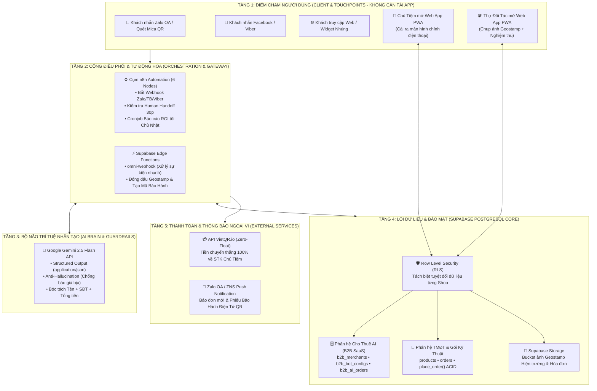

# KIẾN TRÚC TỔNG THỂ HỆ THỐNG ĐẤT PHÚ ONEBASE (GEN 4 - ASSET-LIGHT ARCHITECTURE)
**Đơn vị chủ quản:** CÔNG TY TNHH THƯƠNG MẠI ĐẤT PHÚ  
**Định hướng cốt lõi:** Web-First (PWA) • Cho thuê AI Đa Kênh (B2B SaaS) • VietQR Zero-Float • Chốt chặn rủi ro kỹ thuật 100%

---

## 1. SƠ ĐỒ KIẾN TRÚC 5 TẦNG (5-LAYER SYSTEM ARCHITECTURE)

---

## 2. THIẾT KẾ CHI TIẾT 4 PHÂN HỆ NGHIỆP VỤ CỐT LÕI

### Phân hệ A: Hệ thống Cho Thuê Chatbox AI Đa Kênh (B2B SaaS Engine)
* **Quy trình Onboarding 15 phút (3 bước trên Web App PWA):**
  1. Điền mã ngân hàng & STK nhận tiền (`bank_code`, `bank_account_number`).
  2. Nhập 5–10 sản phẩm/dịch vụ chính kèm giá chuẩn vào `items_catalog`.
  3. Bấm Kích hoạt ➔ Sinh mã nhúng `<script>` và in **Bảng Mica QR Đặt Quầy**.
* **Luồng xử lý 6 Node trên n8n:**
  1. **Node 1 (Webhook):** Nhận tin nhắn từ Zalo OA / Fanpage / Viber.
  2. **Node 2 (Supabase Query):** Lấy `items_catalog`, `ai_system_prompt` và STK ngân hàng của đúng cửa hàng. Nếu đang trong thời gian `human_handoff_until > NOW()` thì dừng để chủ tiệm tự chat.
  3. **Node 3 (Gemini Structured JSON):** Ép đầu ra `application/json` gồm `{ reply_text, is_order_confirmed, customer_phone, order_amount, need_human }`. Chặn tuyệt đối việc báo giá món ngoài danh mục.
  4. **Node 4 (VietQR Generator):** Sinh ảnh QR chứa đúng `order_amount` và mã đơn chuyển thẳng vào STK chủ tiệm (**Zero-Float**: Đất Phú không giữ tiền hộ).
  5. **Node 5 (Supabase Insert):** Ghi đơn vào `b2b_ai_orders` và trừ 1 lượt tin nhắn trong gói thuê (`increment_bot_usage`).
  6. **Node 6 (Send API):** Trả lời khách kèm ảnh mã VietQR ngay trong khung chat Zalo/Facebook.

---

### Phân hệ B: Chốt Chặn Kiểm Soát Rủi Ro Gói Kỹ Thuật & Điện Nước
* **Chốt chặn đầu vào (AI Sàng lọc):** Không nhận ca sửa vặt 50k–100k. AI tự động điều hướng khách sang **4 Gói Giải Pháp Đồng Bộ** (VD: *Gói tự động hóa nước máy - nước giếng 1.650k*, *Gói an toàn điện nước phòng tắm 1.150k*).
* **Chốt chặn hiện trường (Web App dành cho Thợ):**
  * **Bước 1 (Check-in):** Chụp ảnh hiện trạng ren cũ/thiết bị mục trực tiếp qua camera Web App (tự động đóng dấu tọa độ GPS + Thời gian thực lên ảnh và lưu vào Supabase Storage).
  * **Bước 2 (Digital Sign-off):** Nếu thiết bị cũ có nguy cơ gãy ngầm, bấm nút gửi thông báo xác nhận miễn trừ rủi ro qua Zalo cho chủ nhà trước khi chạm cờ-lê.
  * **Bước 3 (Check-out & Bảo hành QR):** Nghiệm thu xong ➔ Xuất mã VietQR động ➔ Khách thanh toán xong tự động kích hoạt **Tem Bảo Hành Điện Tử QR 90 ngày** (triệt tiêu hoàn toàn nạn thợ và khách "đi đêm").

---

### Phân hệ C: Sàn TMĐT Đặc Sản & Giải Pháp Số B2B (Chữ ký số, HĐĐT)
* Quản lý đa gian hàng (`products`, `product_variants`, `orders`).
* Xử lý đặt hàng và trừ tồn kho nguyên tử bằng hàm PostgreSQL `place_order()` có khóa dòng `FOR UPDATE` chống bán lố tồn kho.

---

### Phân hệ D: Quản Trị Gia Hạn Thuê Bao & Báo Cáo ROI Tự Động
* **Cronjob Tối Chủ Nhật (Weekly ROI Report):** Quét View `v_b2b_weekly_roi_report` trên Supabase và tự động nhắn Zalo cho từng chủ tiệm: *"Tuần qua AI đã trực 168 giờ, chốt X đơn, mang về Y đồng qua VietQR"*.
* **Quản lý Đại lý (Cựu nhân viên ngân hàng):** Ghi nhận mã `referred_by_agent` trong bảng `b2b_merchants` để tự động tính chiết khấu 30%–50% tháng đầu.

---

## 3. BẢN ĐỒ CƠ SỞ DỮ LIỆU SUPABASE (8 FILE MIGRATION ĐÃ KHỞI TẠO)

| Thứ tự File Migration | Các bảng & Hàm chính | Vai trò trong kiến trúc |
| :--- | :--- | :--- |
| `01_extensions_and_enums.sql` | `uuid-ossp`, `pg_trgm`, `user_role`, `order_status` | Nền tảng kiểu dữ liệu & tìm kiếm tiếng Việt |
| `02_tables_and_indexes.sql` | `profiles`, `categories`, `products`, `orders` | Lõi Thương mại điện tử đa gian hàng |
| `03_row_level_security.sql` | Policies RLS cho toàn bộ bảng TMĐT | Tường lửa bảo mật phân quyền theo từng dòng |
| `04_functions_and_triggers.sql` | `place_order()`, `cancel_order()`, `handle_new_user()` | Xử lý giao dịch ACID & trừ kho nguyên tử |
| `05_seed_data.sql` | Dữ liệu mẫu Đặc sản Phú Yên, Bếp chay, Camera | Phục vụ chạy thử & trình diễn bán hàng |
| `06_ai_chatbot_saas.sql` | `ai_tenants`, `ai_knowledge_items`, `ai_leads` | Quản lý khách thuê Chatbox AI & đếm Quota |
| `07_omnichannel_webhooks.sql` | `ai_channel_connections` (Zalo, FB, Viber, Web) | Định tuyến tin nhắn đa kênh theo từng Shop |
| `08_b2b_gen4_vietqr_n8n.sql` | `b2b_merchants`, `b2b_bot_configs`, `b2b_ai_orders` | Tích hợp trực tiếp 6 Node n8n & VietQR Zero-Float |

---

## 4. CHI PHÍ VẬN HÀNH HẠ TẦNG (ASSET-LIGHT TECH STACK)

| Thành phần | Nền tảng sử dụng | Chi phí (Khi chạy 1 - 50 Shop đầu tiên) |
| :--- | :--- | :--- |
| **Giao diện Web App PWA** | Vercel / Cloudflare Pages / Github Pages | **0đ (Miễn phí trọn đời)** |
| **Cơ sở dữ liệu & Auth & RLS** | Supabase Cloud (`ckyydvyzucvcdunvedmg`) | **0đ (Gói Free hỗ trợ 500MB DB ~ 50.000 đơn)** |
| **Bộ điều phối n8n** | Tự cài Docker trên VPS Ubuntu (4–5$/tháng) | **~120.000đ/tháng** (Chạy không giới hạn workflow) |
| **Bộ não AI (LLM)** | Google Gemini 2.5 Flash API | **0đ – 50.000đ/tháng** (Cực rẻ, có hạn mức miễn phí) |
| **Tạo mã thanh toán QR** | API VietQR.io | **0đ (Miễn phí)** |
| **TỔNG CHI PHÍ CỐ ĐỊNH** | **Phục vụ 50 cửa hàng (Doanh thu ~10–20 triệu/tháng)** | **Chỉ ~120.000đ – 170.000đ/tháng (Biên lãi > 95%)** |
