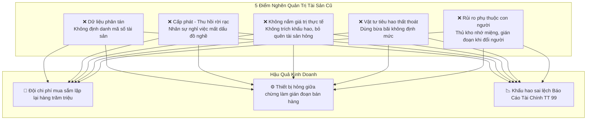
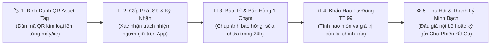

# CHIẾN LƯỢC QUẢN LÝ TÀI SẢN & KHO VẬT TƯ TINH GỌN – MINH BẠCH – BỀN VỮNG
**Số Hóa Vòng Đời Thiết Bị & Kiểm Soát Định Mức Tiêu Hao Cho Chuỗi 10 Siêu Thị Năm Tiền & Đội Thợ 6K**
*Công Ty TNHH Thương Mại Đất Phú (Tuy Hòa - Phú Yên)*

---

> *"Quản trị tài sản không đơn thuần là ghi chép xem công ty có bao nhiêu cái máy, cái xe, mà là bảo đảm từng đồng vốn bỏ ra mua sắm công cụ dụng cụ đều tạo ra giá trị, không bị lãng quên ở góc kho, không bị thất thoát và luôn sẵn sàng vận hành với hiệu suất cao nhất."*

---

## I. THỰC TRẠNG: NHỮNG "LỖ THỦNG LỚN" TRONG QUẢN LÝ TÀI SẢN & VẬT TƯ NỘI BỘ

Khi vận hành một hệ sinh thái bán lẻ và dịch vụ trải dài như **Chuỗi 10 Siêu Thị Năm Tiền**, các vựa thực phẩm và **mạng lưới Thợ Kỹ Thuật 6K**, khối lượng tài sản và công cụ dụng cụ là cực kỳ lớn:
- Máy tính POS, máy in hóa đơn, máy quét mã vạch tại 10 điểm bán.
- Hệ thống tủ đông, tủ mát trưng bày sữa tã, hải sản, bò một nắng.
- Bộ đồ nghề chuyên dụng đắt tiền: Máy hàn nhiệt PPR (Chú Tùng), Máy hàn cáp quang (Anh Phúc), Máy phun sơn công nghiệp (Anh Vinh), Xe tải ben 3.5 tấn (Chú Trúc), Xe 7 chỗ Xpander (Bác Tài Tấn Dũng), Bếp khè và bát đĩa sành mâm cỗ chay (Bếp Tâm Đức).
- Hàng nghìn loại vật tư tiêu hao: Aptomat, dây cáp, đầu jack, keo dán, tem QR, hộp xốp, bao bì...

---

## II. KIẾN TRÚC GIẢI PHÁP: ĐẤT PHÚ LEAN ASSET & TOOLING 6K

Đất Phú OneBase triển khai mô hình quản trị tài sản tinh gọn khép kín:

---

## III. 5 ĐÒN BẨY SỐ HÓA VÒNG ĐỜI TÀI SẢN & KHO VẬT TƯ

### 1. Định Danh 100% Tài Sản Bằng Mã "QR Asset Tag" Độc Bản:
- Mọi tài sản từ máy POS, tủ đông siêu thị đến máy hàn cáp quang đều được cấp một mã số duy nhất theo định dạng: `ASSET-DP-xxx`.
- **Trải nghiệm kiểm kê:** Ban Giám đốc hoặc Trưởng siêu thị chỉ cần cầm điện thoại quét mã QR dán trên thân máy là hiển thị ngay:
  + Tên tài sản & Nhà sản xuất.
  + Ngày đưa vào sử dụng, nguyên giá mua ban đầu.
  + Người đang chịu trách nhiệm quản lý trực tiếp.
  + Lịch sử bảo trì, thay thế linh kiện lần gần nhất.
  + Giá trị khấu hao còn lại theo chuẩn **Thông tư 99/2025/TT-BTC**.

### 2. Tự Động Hóa Quy Trình Cấp Phát — Điều Chuyển — Thu Hồi:
- Chấm dứt hoàn toàn biên bản giấy dễ rách nát, thất lạc.
- Khi điều chuyển 1 máy POS hoặc 1 chiếc tủ mát từ Siêu thị Tuy Hòa lên Siêu thị Sông Hinh: Người giao và người nhận đều thao tác quét mã xác nhận trên điện thoại ➔ Dữ liệu tự động cập nhật vị trí mới trên hệ thống, không thể thất thoát.

### 3. Thiết Lập Định Mức Vật Tư Tiêu Hao Cho Từng Bộ Phận:
- **Chuỗi Siêu thị Năm Tiền:** Định mức cuộn giấy in bill, túi đựng hàng sinh học, tem nhãn Barcode tính theo số lượng đơn bán hàng thực tế.
- **Đội Thợ 6K (Điện nước, Sơn, IT):** Định mức dây điện, cút nối ống, kìm bấm, đầu mạng theo từng ca sửa chữa. Hệ thống tự động cảnh báo khi một chi nhánh hoặc thợ sử dụng vượt định mức 15%, giúp ngăn chặn lãng phí và tuồn vật tư ra ngoài.

### 4. Báo Hỏng & Đề Xuất Sửa Chữa Tại Hiện Trường 1 Chạm (Mobile Inspection):
- Khi tủ mát siêu thị bị chảy nước hoặc máy tính POS bị kẹt nguồn, nhân viên chỉ cần:
  + Mở ứng dụng ➔ Bấm nút **`Báo Hỏng Thiết Bị`** ➔ Chụp ảnh hiện trường ➔ Gửi yêu cầu.
  + Hệ thống tự động điều phối ngay **Kỹ sư Trần Quốc Hưng (Điện lạnh)** hoặc **Anh Lê Thành Phúc (IT)** có mặt xử lý trong vòng 15–30 phút, tránh làm hư hỏng hàng thực phẩm tươi sống.

### 5. Tự Động Tính Khấu Hao Theo Thông Tư 99/2025/TT-BTC:
- Hệ thống tự động trích khấu hao hàng tháng theo phương pháp đường thẳng vào chi phí doanh nghiệp (`TK 214`, `TK 642`), giúp Báo Cáo Tài Chính (Mẫu B01-DN, B02-DN) luôn phản ánh chính xác giá trị tài sản ròng của doanh nghiệp trước cơ quan thuế.

---

## IV. BẢNG DANH MỤC TÀI SẢN TIÊU BIỂU TRÊN HỆ THỐNG ĐẤT PHÚ 6K

| Mã Tài Sản | Tên Tài Sản / Công Cụ | Đơn Vị / Người Sử Dụng | Nguyên Giá (VNĐ) | Khấu Hao Còn Lại | Trạng Thái Vận Hành |
| :---: | :--- | :--- | :---: | :---: | :---: |
| `ASSET-DP-01` | Bộ Máy Tính POS & Quét Barcode 24" | Siêu Thị Năm Tiền 01 (Tuy Hòa) | 8,500,000 | 6,800,000 | 🟢 Hoạt động tốt |
| `ASSET-DP-02` | Tủ Đông Trưng Bày Đứng Sanden 1000L | Siêu Thị Năm Tiền 02 (Phú Lâm) | 22,000,000 | 17,600,000 | 🟢 Đã bảo dưỡng định kỳ |
| `ASSET-DP-03` | Máy Hàn Nhiệt Ống PPR & Dò Rò Rỉ | Chú Tùng (Điện Nước 6K P.7) | 4,200,000 | 3,150,000 | 🟢 Sẵn sàng trực chiến |
| `ASSET-DP-04` | Máy Hàn Cáp Quang & Đo Suy Hao OTDR | Anh Lê Thành Phúc (IT 156 Lê Lợi) | 18,500,000 | 14,800,000 | 🟢 Chuẩn kiểm định 6K |
| `ASSET-DP-05` | Máy Phun Sơn Công Nghiệp Áp Lực Cao | Anh Vinh (Thợ Sơn Phường 9) | 7,800,000 | 5,850,000 | 🟢 Hoạt động tốt |
| `ASSET-DP-06` | Bộ Nồi Hầm Inox & Bát Đĩa Mâm Cỗ Chay | Bếp Chay Tâm Đức (Bác Ba Thiện) | 12,000,000 | 9,600,000 | 🟢 Vệ sinh an toàn 100% |
| `ASSET-DP-07` | Xe Tải Ben Chở Mía 3.5 Tấn (Có Bạt Nóc) | Chú Trúc (Thạnh Phú, Tuy An) | 280,000,000 | 210,000,000 | 🟢 Đạt đăng kiểm an toàn |

---

## V. HIỆU QUẢ KINH TẾ MANG LẠI

- **Giảm 35% chi phí mua sắm lặp lại:** Chấm dứt tình trạng mua mới thiết bị trong khi máy cũ vẫn còn nằm quên ở kho chi nhánh khác.
- **Tiết kiệm 20% chi phí vật tư tiêu hao:** Nhờ áp dụng định mức chuẩn cho từng ca làm việc.
- **Tăng 100% tính minh bạch:** Bàn giao tài sản có bằng chứng số, chữ ký điện tử trên điện thoại, triệt tiêu rủi ro tranh chấp khi nhân sự nghỉ việc.

---

**ĐẤT PHÚ ONEBASE — NỀN TẢNG QUẢN TRỊ TÀI SẢN TINH GỌN, MINH BẠCH & BỀN VỮNG CHO DOANH NGHIỆP XỨ NẪU!**
*(Phát hành chính thức bởi Ban Giám Đốc Công Ty TNHH Thương Mại Đất Phú)*
