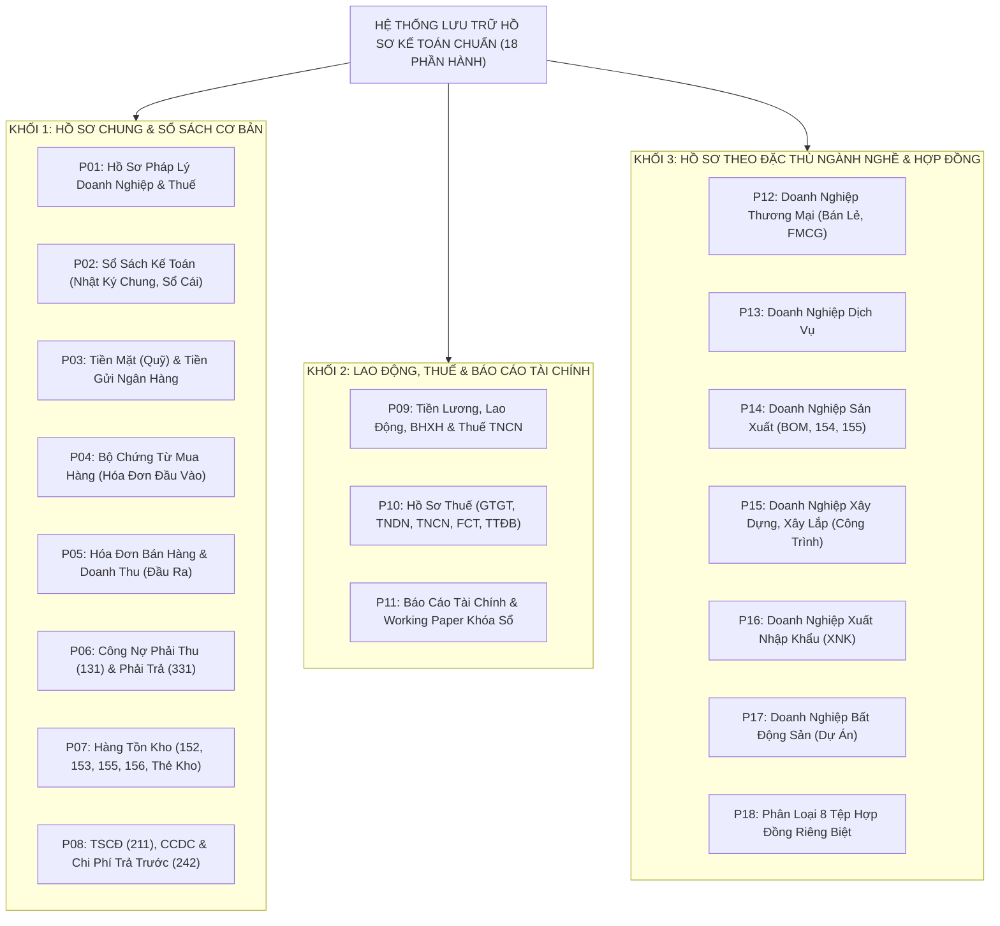

# 🗄️ ĐẠI CẨM NANG TOÀN DIỆN 18 PHẦN HÀNH: QUY TRÌNH LƯU TRỮ HỒ SƠ – CHỨNG TỪ – SỔ SÁCH KẾ TOÁN 2026 MỚI NHẤT (TỪ 01/07/2026)

> **BỘ TIÊU CHUẨN LƯU TRỮ HỒ SƠ KẾ TOÁN & BẢO VỆ DOANH NGHIỆP TRƯỚC THANH TRA THUẾ**  
> *Được chuẩn hóa từ cẩm nang chuyên môn iHOADON và áp dụng tại Công ty TNHH Thương mại Đất Phú (OneBase).*  
> *Mục tiêu: Đảm bảo 100% hồ sơ vững chắc như bàn thạch, giải trình minh bạch sau 5–10 năm, triệt tiêu mọi rủi ro bóc tách chi phí và phạt thuế.*

---



---

## 📌 PHẦN 01 ĐẾN PHẦN 08: KHỐI HỒ SƠ CHUNG & SỔ SÁCH TÀI CHÍNH CƠ BẢN

*(Đã chuẩn hóa chi tiết ở phần trước: Hồ sơ pháp lý ĐKKD, Sổ nhật ký chung, Sổ cái, Đối chiếu quỹ tiền mặt 111, Sổ phụ 112 theo từng ngân hàng, Bộ chứng từ mua hàng PO-Kho-Hóa đơn-UNC, Doanh thu đối chiếu chéo 4 bên, Khớp công nợ 131/331 và hồ sơ trọn đời của TSCĐ 211).*

---

## 📌 PHẦN 09: TIỀN LƯƠNG, LAO ĐỘNG, BHXH VÀ THUẾ TNCN
*Đây là bộ hồ sơ có tính rủi ro thanh tra rất cao, bắt buộc phải tách riêng thành 3 nhóm kẹp hồ sơ:*

1. **Hồ sơ từng người lao động (Lưu theo từng nhân sự):**
   - Hợp đồng lao động (HĐLĐ) và các Phụ lục HĐLĐ ký kết qua các thời kỳ.
   - Hồ sơ cá nhân: Sơ yếu lý lịch, CCCD công chứng, văn bằng chứng chỉ.
   - Quyết định tuyển dụng, quyết định tăng/giảm lương, quyết định bổ nhiệm chức vụ.
   - Hồ sơ nghỉ việc, biên bản bàn giao công việc, thỏa thuận chấm dứt HĐLĐ.
   - Hồ sơ đăng ký người phụ thuộc giảm trừ gia cảnh (kèm giấy khai sinh/xác nhận sinh viên).
   - Cam kết thuế (Mẫu 08/CK-TNCN) đối với lao động thời vụ dưới 3 tháng nếu thuộc diện áp dụng.
2. **Hồ sơ hàng tháng (Chuỗi liên hoàn khép kín):**
   $$\mathbf{\text{Chấm công}} \longrightarrow \mathbf{\text{KPI / Sản lượng}} \longrightarrow \mathbf{\text{Bảng lương duyệt}} \longrightarrow \mathbf{\text{Trích BHXH 32\%}} \longrightarrow \mathbf{\text{Khấu trừ TNCN}} \longrightarrow \mathbf{\text{UNC chuyển lương}}$$
   - Bảng chấm công gốc có chữ ký quản lý trực tiếp; Bảng tính giờ làm thêm OT.
   - Bảng thanh toán lương tổng hợp và Phiếu lương chi tiết gửi từng người.
   - Thông báo kết quả đóng BHXH mẫu C12-TS của cơ quan bảo hiểm hàng tháng.
3. **Hồ sơ quyết toán cuối năm:**
   - Tờ khai Quyết toán thuế TNCN (Mẫu 05/QTT-TNCN) kèm các bảng kê 05-1, 05-2, 05-3.
   - Bản gốc Giấy ủy quyền quyết toán thay (Mẫu 08/UQ-QTT-TNCN).
   - Chứng từ khấu trừ thuế TNCN cấp cho lao động vãng lai hoặc người đã nghỉ việc.
   - Bảng đối chiếu tổng thu nhập cả năm từng người lao động: $\text{Lương sổ sách TK 334} = \text{Tổng thu nhập trên QTT TNCN}$.

---

## 📌 PHẦN 10: HỒ SƠ THUẾ (CHIA THEO TỪNG SẮC THUẾ)

1. **Thuế GTGT:**
   - Tờ khai chính thức từng kỳ (Tháng/Quý theo Thông tư 89/2026/TT-BTC mẫu mới).
   - Bảng kê chi tiết mua vào - bán ra; Giấy nộp tiền vào NSNN (tiểu mục 1701).
   - Hồ sơ khai bổ sung Mẫu 01/KHBS, bản giải trình 01-1/KHBS và hồ sơ hoàn thuế (nếu có).
2. **Thuế TNDN:**
   - Bảng tính tạm nộp thuế TNDN 4 quý (đảm bảo tạm nộp tối thiểu 80% cả năm).
   - Tờ khai Quyết toán thuế TNDN (Mẫu 03/TNDN) kèm BCTC và các phụ lục chuyển lỗ, ưu đãi.
   - Bảng rà soát chi phí không được trừ (Chỉ tiêu B4) và bảng chênh lệch kế toán - thuế.
3. **Thuế TNCN:** Tờ khai khấu trừ định kỳ, tờ khai quyết toán năm và chứng từ nộp thuế (tiểu mục 1001).
4. **Thuế Nhà Thầu (FCT):**
   - Hợp đồng dịch vụ nước ngoài (Google, Meta, chuyên gia nước ngoài).
   - Commercial Invoice, bản dịch công chứng, tài liệu xác định bản chất dịch vụ.
   - Bảng tính Gross-up thuế nhà thầu (Net sang Gross), tờ khai mẫu 01/NTNN và giấy nộp tiền.
5. **Các sắc thuế khác:** Thuế TTĐB, Thuế tài nguyên, Thuế XNK, Thuế/tiền thuê đất, Lệ phí môn bài...

---

## 📌 PHẦN 11: BÁO CÁO TÀI CHÍNH VÀ "WORKING PAPER KHÓA SỔ"

Lập một cặp hồ sơ riêng biệt cho từng năm tài chính:
1. Bộ BCTC hoàn chỉnh: Bảng CĐKT (B01-DN), Báo cáo KQHĐKD (B02-DN), Báo cáo LCTT (B03-DN), Bản Thuyết minh BCTC (B09-DN) và Bảng cân đối phát sinh tài khoản.
2. Thông báo chấp nhận nộp BCTC qua mạng của Tổng cục Thuế.
3. Báo cáo kiểm toán độc lập (nếu thuộc diện bắt buộc).
4. ⭐ **BỘ WORKING PAPER KHÓA SỔ (VŨ KHÍ TỐI THƯỢNG):**  
   Lưu toàn bộ bảng đối chiếu chi tiết số dư tại thời điểm 31/12 của tất cả các tài khoản:
   - TK 111 (Biên bản kiểm kê quỹ tiền mặt).
   - TK 112 (Sổ phụ và xác nhận số dư tất cả ngân hàng).
   - TK 131, 331 (100% biên bản đối chiếu công nợ có xác nhận 2 bên).
   - TK 152-156 (Biên bản kiểm kê kho thực tế và xử lý chênh lệch).
   - TK 211, 214, 242 (Bảng trích khấu hao và phân bổ CCDC).
   - TK 333 (Bảng đối chiếu nghĩa vụ thuế trên eTax của Cục Thuế).
   - TK 334, 338 (Đối chiếu bảng lương tháng 12 và thông báo C12 bảo hiểm).
   - TK 341, 411, 421, 511, 632...  
   *(Khi đoàn thanh tra vào kiểm tra sau 5 năm, mở bộ Working Paper này ra là giải trình được ngay lập tức từng con số).*

---

## 📌 PHẦN 12 ĐẾN PHẦN 17: QUY TRÌNH HỒ SƠ THEO 6 ĐẶC THÙ NGÀNH NGHỀ

### 🏪 Phần 12: Doanh Nghiệp Thương Mại & Phân Phối Bán Lẻ (FMCG, Chuỗi Năm Tiền)
- Quản lý chặt dòng chảy: $\mathbf{\text{Mua hàng}} \rightarrow \mathbf{\text{Nhập kho}} \rightarrow \mathbf{\text{Tồn kho}} \rightarrow \mathbf{\text{Xuất bán}} \rightarrow \mathbf{\text{Doanh thu}} \rightarrow \mathbf{\text{Giá vốn}}$.
- Công thức kiểm soát cân bằng số lượng:
  $$\mathbf{\text{Tồn đầu}} + \mathbf{\text{Nhập trong kỳ}} - \mathbf{\text{Xuất trong kỳ}} = \mathbf{\text{Tồn cuối}}$$
- Kiểm tra tính logic tài khoản: $\mathbf{156 \longrightarrow 632 \longrightarrow 511}$.
- Quản lý riêng cặp hồ sơ: Khuyến mại đăng ký Sở Công Thương, hàng biếu tặng, hàng mẫu, hàng khách trả lại, chiết khấu thương mại và hàng gửi bán đại lý.

### 💼 Phần 13: Doanh Nghiệp Dịch Vụ
- Không có kho hàng lớn, rủi ro lớn nhất là bị cơ quan thuế nghi ngờ **dịch vụ ảo / khống**.
- Mỗi dịch vụ bắt buộc phải chứng minh được **5 câu hỏi vàng**:
  1. *Dịch vụ là gì?* ➔ Hợp đồng kinh tế và Bản mô tả công việc (SOW).
  2. *Ai thực hiện?* ➔ Bảng phân công nhân sự, chấm công chuyên gia.
  3. *Thực hiện khi nào?* ➔ Kế hoạch tiến độ và nhật ký thực hiện.
  4. *Kết quả bàn giao là gì?* ➔ Báo cáo kết quả, sản phẩm bàn giao, biên bản nghiệm thu.
  5. *Chi phí nào tạo ra doanh thu đó?* ➔ Bảng kê chi phí trực tiếp tương ứng.

### 🏭 Phần 14: Doanh Nghiệp Sản Xuất
- Chuỗi hồ sơ bắt buộc:
  $$\mathbf{\text{NVL (152)}} \rightarrow \mathbf{\text{Định mức (BOM)}} \rightarrow \mathbf{\text{Lệnh sản xuất}} \rightarrow \mathbf{\text{Phiếu xuất NVL}} \rightarrow \mathbf{\text{Chi phí (621, 622, 627)}} \rightarrow \mathbf{\text{Dở dang (154)}} \rightarrow \mathbf{\text{Thành phẩm (155)}} \rightarrow \mathbf{\text{Giá vốn (632)}}$$
- Hồ sơ kỹ thuật: Bảng định mức tiêu hao nguyên vật liệu (BOM) được Giám đốc phê duyệt; Lệnh sản xuất theo từng lô/mẻ; Báo cáo sản lượng hoàn thành; Bảng tính giá thành đơn vị sản phẩm; Bảng đánh giá giá trị sản phẩm dở dang cuối kỳ.

### 🏗️ Phần 15: Doanh Nghiệp Xây Dựng, Xây Lắp
- **Nguyên tắc cốt tử:** Mỗi công trình / hạng mục lập **01 mã công trình** và đóng **01 bộ hồ sơ riêng biệt**:
  - *Hồ sơ pháp lý:* Hợp đồng thầu, phụ lục phát sinh, bản vẽ thiết kế, dự toán dự thầu được duyệt, hợp đồng thầu phụ.
  - *Hồ sơ thi công:* Nhật ký thi công công trình, biên bản nghiệm thu vật liệu đầu vào, bảng chấm công thợ tại công trường, bảng điều động máy thi công.
  - *Hồ sơ nghiệm thu & Quyết toán:* Biên bản nghiệm thu khối lượng hoàn thành theo giai đoạn, biên bản nghiệm thu bàn giao đưa vào sử dụng, hồ sơ hoàn công, bản quyết toán giá trị công trình A-B.
  - *Giá thành theo công trình:* Tập hợp chi phí $621, 622, 623, 627 \rightarrow 154$ chi tiết cho từng công trình. Tuyệt đối không để chung một tài khoản 154 tổng mà không bóc tách được công trình.

### 🚢 Phần 16: Doanh Nghiệp Xuất Nhập Khẩu (XNK)
- Mỗi lô hàng tạo 01 bộ hồ sơ XNK riêng:
  - *Hàng Nhập khẩu:* `Hợp đồng ngoại (Contract) ➔ Đơn đặt hàng (PO) ➔ Commercial Invoice ➔ Packing List ➔ Vận đơn (Bill of Lading / Airway Bill) ➔ Tờ khai hải quan thông quan ➔ Biên lai nộp thuế NK & thuế GTGT hàng NK ➔ Hóa đơn cước vận chuyển/logistics ➔ Phiếu nhập kho ➔ Điện chuyển tiền T/T hoặc L/C`.
  - *Hàng Xuất khẩu:* Hợp đồng xuất khẩu, Invoice, Packing List, Tờ khai xuất khẩu thông quan, Vận đơn đường biển/hàng không, Chứng từ thanh toán quốc tế qua ngân hàng, Hồ sơ hoàn thuế GTGT 0%.
  - *Hồ sơ chuyên ngành kèm theo:* Giấy chứng nhận xuất xứ hàng hóa (C/O), Chứng nhận chất lượng (C/Q), Chứng thư giám định kiểm dịch, Bảng tính chênh lệch tỷ giá phát sinh.
  - ⚠️ **Kiểm tra truy ngược:** Mã nguyên vật liệu/hàng hóa nhập về kho phải truy vết ngược được chính xác về số tờ khai hải quan nhập khẩu tương ứng.

### 🏢 Phần 17: Doanh Nghiệp Bất Động Sản
- Quản lý theo từng dự án ➔ từng phân khu ➔ từng block / căn hộ / sản phẩm đất nền:
  $$\mathbf{\text{Giá vốn khi bán}} = \mathbf{\text{Giá đất}} + \mathbf{\text{Chi phí hạ tầng kỹ thuật}} + \mathbf{\text{Chi phí xây lắp}} + \mathbf{\text{Chi phí chung phân bổ}}$$
- Lưu trữ: Hồ sơ pháp lý dự án (Chấp thuận đầu tư, quy hoạch 1/500, giấy phép xây dựng, giấy chứng nhận quyền sử dụng đất); Hợp đồng tổng thầu thi công; Hồ sơ nghiệm thu hạ tầng kỹ thuật; Tiêu thức và bảng phân bổ chi phí hạ tầng cho từng m2 diện tích thương phẩm; Bảng tính giá thành chi tiết từng căn hộ/sản phẩm; Hợp đồng mua bán ký với khách hàng; Biên bản bàn giao nhà/đất; Hóa đơn GTGT và chứng từ thu tiền theo tiến độ.
- ⚠️ *Cảnh báo sai lầm:* Tránh tình trạng tài khoản 154 dở dang đã chứa chi phí hạ tầng nhưng kế toán lại cộng thêm 1 lần nữa vào tài khoản 632 khi bán hàng (dẫn đến giá vốn bị nhân đôi).

---

## 📌 PHẦN 18: BẢN ĐỒ 8 TỆP HỢP ĐỒNG ĐỘC LẬP
*Tuyệt đối không gom tất cả các loại hợp đồng vào chung một cặp bìa.* Doanh nghiệp chuẩn hóa chia thành **8 bìa còng chuyên dụng**:

```
┌────────────────────────────────────────────────────────────────────────┐
│                   8 TỆP HỢP ĐỒNG KINH TẾ ĐỘC LẬP                       │
├────┬─────────────────────────────┬────┬───────────────────────────────┤
│ 01 │ Hợp đồng mua vào (Nhà CC)   │ 05 │ Hợp đồng thuê tài sản / mặt bằ│
├────┼─────────────────────────────┼────┼───────────────────────────────┤
│ 02 │ Hợp đồng bán ra (Khách hàng)│ 06 │ Hợp đồng dịch vụ tư vấn/thuê n│
├────┼─────────────────────────────┼────┼───────────────────────────────┤
│ 03 │ Hợp đồng lao động nhân sự   │ 07 │ Hợp đồng nước ngoài (FCT / XNK│
├────┼─────────────────────────────┼────┼───────────────────────────────┤
│ 04 │ Hợp đồng tín dụng, vay vốn  │ 08 │ Hợp đồng thầu phụ, giao khoán │
└────┴─────────────────────────────┴────┴───────────────────────────────┘
```
*(Mỗi hợp đồng bắt buộc đánh mã số định danh thống nhất để liên kết trực tiếp với số hiệu chứng từ kế toán trên phần mềm).*
