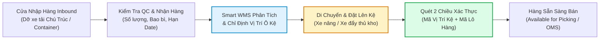
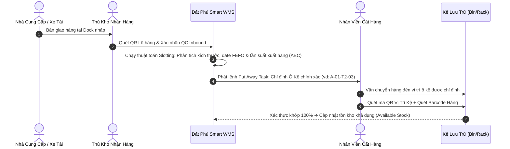

# 📥 PUT AWAY LÀ GÌ? QUY TRÌNH CẤT HÀNG QUYẾT ĐỊNH HIỆU QUẢ VẬN HÀNH KHO & GIẢI PHÁP ĐẤT PHÚ SMART WMS 6K

> **CÔNG TY TNHH THƯƠNG MẠI ĐẤT PHÚ**  
> *Hệ thống Quản trị Chuỗi Cung ứng & Kho Vận Bán Lẻ Đất Phú OneBase*  
> *Đơn vị vận hành: Chuỗi Siêu thị Sữa Tã Mẹ & Bé Năm Tiền, Tổng Kho Trung Tâm Tuy Hòa & Kho Lạnh Hải Sản Sông Cầu*

---

## 1. TỔNG QUAN: PUT AWAY LÀ GÌ & TẠI SAO PUT AWAY LÀ "GỐC RỄ" CỦA NHÀ KHO?

### 1.1. Định nghĩa chuẩn ngành Quản lý Kho Vận (WMS)
**Put Away (Cất hàng vào vị trí lưu trữ)** là quá trình tiếp nhận hàng hóa sau khi hoàn tất kiểm tra chất lượng (QC / Inbound Receiving) tại cửa nhập, sau đó vận chuyển và sắp xếp chúng vào đúng vị trí ô kệ (Rack, Bin, Shelf, Pallet location) phù hợp nhất trong nhà kho.



### 1.2. Chân lý vận hành: "Put Away chuẩn thì Picking mới nhanh, kho mới không vỡ"
Nhiều doanh nghiệp phân phối và bán lẻ thường chỉ tập trung vào khâu **Xuất hàng (Picking/Shipping)** mà xem nhẹ khâu **Cất hàng (Put Away)**. Nhân viên nhận hàng xong thường tiện đâu để đó, để dưới sàn đi lại, hoặc nhét đại vào bất kỳ ô kệ nào còn trống.

Hậu quả tai hại của việc làm ẩu khâu Put Away:
1. 🔍 **Thất lạc hàng hóa ngay trong chính kho của mình:** Hệ thống báo còn tồn kho nhưng thủ kho tìm toát mồ hôi không thấy.
2. 🚶 **Gấp đôi thời gian Picking:** Nhân viên nhặt hàng phải đi lòng vòng, trèo lên trèo xuống tìm kiếm vì hàng không nằm ở vị trí quy định.
3. 📉 **Lãng phí 30% - 40% thể tích kho:** Các ô kệ ở vị trí đắc địa bị chiếm dụng bởi hàng ế ẩm (Dead stock), trong khi hàng bán chạy lại bị nhét sâu tít trong góc.
4. ❌ **Hỏng hóc và hết date (FEFO vỡ vụn):** Hàng mới nhập đè lên hàng cũ nhập trước, dẫn đến các thùng hàng dưới đáy bị hết hạn sử dụng mà không ai hay biết.

---

## 2. QUY TRÌNH PUT AWAY CHUẨN 5 BƯỚC TRONG HỆ THỐNG SMART WMS 6K



### Bước 1: Tiếp nhận & Kiểm tra chất lượng (Receiving & QC)
- Hàng hóa từ xe tải (ví dụ xe tải Chú Trúc chở mía bó, hoặc xe tải thùng chở sữa Meiji từ cảng) được dỡ xuống khu tập kết Inbound Dock.
- Thủ kho kiểm tra quy cách đóng gói, đối chiếu hóa đơn, kiểm tra nhiệt độ (đối với cá ngừ đông lạnh phải đảm bảo $\le -18^\circ\text{C}$).

### Bước 2: Định danh số hóa Barcode / QR Code & Nhập Date
- Dán tem nhãn định danh cho từng Pallet / Thùng hàng chứa mã EAN-13, số Lô sản xuất (Lot No) và Ngày hết hạn (Expiry Date).

### Bước 3: Thuật toán Smart WMS tự động đề xuất vị trí lưu trữ (Slotting Optimization)
Thay vì con người tự phán đoán, thuật toán **Smart Slotting Engine** của WMS sẽ tính toán vị trí lưu trữ tối ưu dựa trên:
- **Kích thước & Trọng tải:** Hàng nặng (thùng sữa bột 24 lon) xếp tầng dưới; hàng nhẹ (bỉm tã) xếp tầng trên cao.
- **Phân loại ABC (Tần suất xuất hàng):** Hàng bán chạy nhóm A đặt ở đầu dãy, gần lối đi chính và tầm với từ 0.8m – 1.6m; hàng bán chậm nhóm C đặt ở tầng cao hoặc góc xa.
- **Yêu cầu nhiệt độ & môi trường:** Kho khô thoáng mát cho bỉm sữa, kho lạnh âm sâu cho cá ngừ đại dương Sông Cầu.

### Bước 4: Vận chuyển & Xếp hàng vào ô kệ chỉ định
- Nhân viên kho nhận nhiệm vụ (Put Away Task) trên điện thoại / máy quét cầm tay PDA. Ứng dụng chỉ rõ: **"Đưa 20 thùng Meiji 0 đến Kệ A - Dãy 1 - Tầng 2 - Ô 03"**.
- Nhân viên di chuyển theo lộ trình ngắn nhất được WMS vẽ sẵn.

### Bước 5: Quét xác nhận 2 chiều (Double-Scan Verification)
- Khi đưa hàng vào kệ, nhân viên phải quét:
  1. Mã QR của **Vị trí ô kệ** (`LOC-A01-T2-03`).
  2. Mã Barcode của **Thùng hàng** (`SKU-MEIJI-0`).
- Nếu quét đúng: Đèn báo xanh, hệ thống mở khóa trạng thái hàng hóa từ `[PENDING PUT AWAY]` sang `[AVAILABLE FOR SALE]`.
- Nếu quét nhầm kệ: Hệ thống hú còi cảnh báo ngay lập tức, chặn đứng 100% rủi ro để nhầm chỗ.

---

## 3. SO SÁNH 3 CHIẾN LƯỢC PUT AWAY PHỔ BIẾN

| Chiến Lược | 1. Fixed Location Put Away (Cố định) | 2. Dynamic Put Away (Linh hoạt / Tối ưu không gian) | 3. Direct Put Away (Đưa thẳng / Cross-Docking) |
| :--- | :--- | :--- | :--- |
| **Bản chất** | Mỗi SKU có một vị trí cố định muôn đời (vd: Kệ B1 chỉ được để Bỉm Moony). | Hàng được xếp vào bất kỳ ô kệ nào đang trống phù hợp nhất do WMS chỉ định. | Hàng từ cửa nhập được chuyển thẳng ra cửa xuất hoặc đưa ngay vào khu Picking đang cạn. |
| **Tận dụng diện tích** | ⚠️ Thấp (nếu hết hàng Bỉm, ô Kệ B1 bị bỏ trống lãng phí). | 🚀 **Tối đa 95% - 98% dung tích kho**, không bao giờ để ô kệ trống vô ích. | ⚡ Tiết kiệm 100% chi phí lưu kho trung gian. |
| **Yêu cầu công nghệ** | Thấp, thủ kho nhớ bằng đầu hoặc dán nhãn giấy. | **Bắt buộc phải có phần mềm WMS** và mã vạch quản lý vị trí ô kệ (Bin/Location). | Hệ thống OMS + WMS đồng bộ thời gian thực để khớp đơn hàng đang chờ giao. |
| **Độ phức tạp** | Rất đơn giản, phù hợp cửa hàng nhỏ lẻ. | Cao hơn, đòi hỏi quy trình quét mã chuẩn mực. | Đòi hỏi điều phối lịch xe tải và đơn hàng chính xác từng phút. |
| **Ứng dụng tại Đất Phú** | Quầy kệ trưng bày bán lẻ tại **10 Siêu Thị Năm Tiền**. | **Tổng Kho Trung Tâm Tuy Hòa** (hàng nghìn SKU mẹ & bé và nông sản). | **Mía tươi Chú Trúc** & **Cá Ngừ Bà Tám** giao sỉ ngay cho chành xe đi Đắk Lắk. |

---

## 4. MA TRẬN ỨNG DỤNG PUT AWAY TẠI HỆ THỐNG ĐẤT PHÚ ONEBASE

```
┌────────────────────────────────────────────────────────────────────────┐
│               PHÂN LOẠI HÀNG HÓA & CHIẾN LƯỢC PUT AWAY                 │
├──────────────────┬─────────────────┬─────────────────┬─────────────────┤
│ NHÓM MẶT HÀNG    │ PHÂN KHU LƯU TRỮ│ CHIẾN LƯỢC      │ QUY TẮC AN TOÀN │
├──────────────────┼─────────────────┼─────────────────┼─────────────────┤
│ Sữa bột Meiji,   │ Zone A - Kho Khô│ Dynamic Put Away│ Tầng 1-2: Nặng  │
│ Nan Optipro      │ Pallet Racking  │ Chuẩn FEFO      │ Tránh ẩm, ẩm <65%│
├──────────────────┼─────────────────┼─────────────────┼─────────────────┤
│ Tã Bỉm Moony,    │ Zone A - Kệ Cao │ Dynamic Put Away│ Tầng 3-4: Nhẹ   │
│ Merries, Bobby   │ Thể tích lớn    │ Theo kích thước │ Cấm lửa 100%    │
├──────────────────┼─────────────────┼─────────────────┼─────────────────┤
│ Cá Ngừ Bà Tám,   │ Zone C - Kho    │ Fixed Location  │ Âm sâu -18°C    │
│ Tôm Sông Cầu     │ Lạnh Âm Sâu     │ Kiểm soát lạnh  │ Quét trước khi vào│
├──────────────────┼─────────────────┼─────────────────┼─────────────────┤
│ Sơn Kova, Dụng   │ Zone D - Kho Cơ │ Fixed Location  │ Tránh va đập    │
│ Cụ Thợ 6K        │ Khí Kim Khí     │ Tự động bổ sung │ Độc lập với F&B │
└──────────────────┴─────────────────┴─────────────────┴─────────────────┘
```

---

## 5. MỐI QUAN HỆ TƯƠNG HỖ: PUT AWAY ➔ REPLENISHMENT ➔ PICKING

Một hệ thống WMS thông minh không coi Put Away là một khâu cô lập, mà là mắt xích liên hoàn trong chuỗi vận hành:
1. **Put Away (Cất hàng):** Đưa hàng khối lượng lớn lên các tầng kệ lưu trữ dự trữ (Reserve Storage).
2. **Replenishment (Bổ sung hàng tự động):** Khi khu vực lấy hàng nhặt lẻ (Picking Bin) của Siêu thị Năm Tiền tụt xuống dưới mức an toàn (ví dụ chỉ còn dưới 5 lon sữa), WMS tự động phát lệnh điều chuyển nhân viên hạ 1 pallet từ Reserve Storage xuống Picking Bin.
3. **Picking (Nhặt hàng):** Nhân viên lấy hàng luôn có sẵn hàng hóa ở tầm với thuận tiện nhất để đóng gói giao ngay.

---

## 6. LỢI ÍCH ĐO LƯỜNG ĐƯỢC SAU KHI TRIỂN KHAI PUT AWAY VỚI ĐẤT PHÚ SMART WMS 6K
- 📦 **Tận dụng thêm 35% dung tích kho** mà không cần thuê thêm mặt bằng mới.
- ⚡ **Rút ngắn 70% thời gian cất hàng** từ 45 phút/pallet xuống còn 12 phút/pallet nhờ hệ thống chỉ đường chính xác đến từng ô kệ.
- 🎯 **Triệt tiêu 100% tình trạng thất lạc hàng hóa** trong nhà kho nhờ quét mã xác thực 2 chiều.
- 🔄 **Tăng 40% tốc độ nhặt hàng (Picking)** vì mọi mặt hàng đều được đặt tại vị trí tối ưu theo nguyên tắc ABC và FEFO.
- 🤝 **Bảo đảm chất lượng tuyệt đối** cho đặc sản Phú Yên (Mắt cá ngừ Bà Tám -18°C) và an toàn tuyệt đối cho thực phẩm mẹ và bé.
