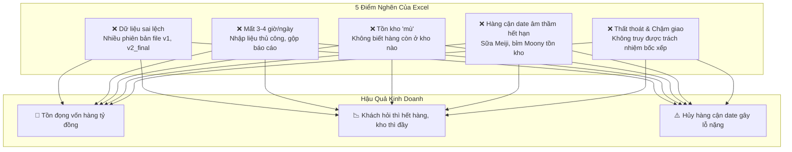
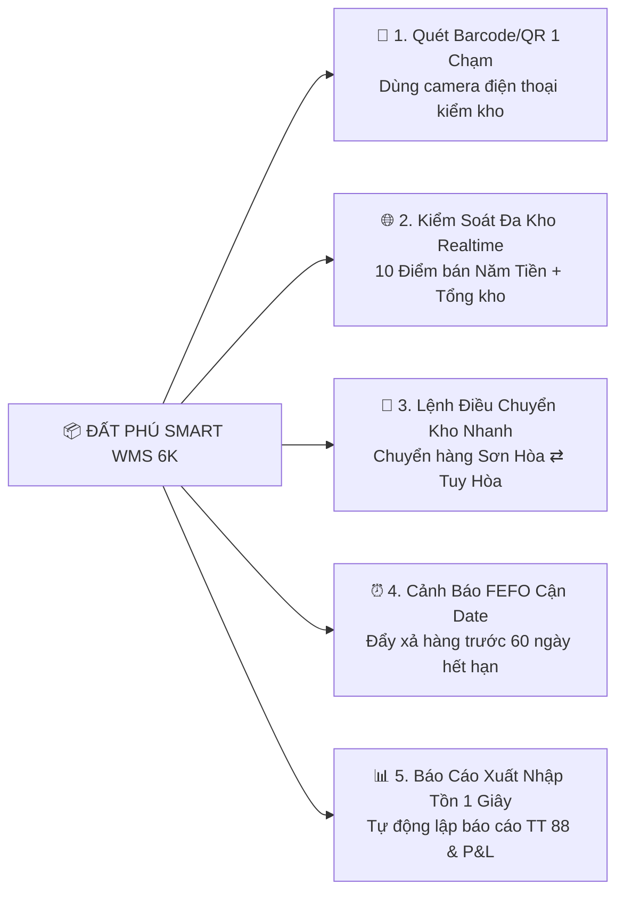

# GIẢI MÃ "ĐIỂM NGHẼN EXCEL" & TRIỂN KHAI HỆ THỐNG SMART WMS 6K
**Chuyển Đổi Số Quản Lý Kho Tập Trung Cho Chuỗi 10 Siêu Thị Năm Tiền & Đối Tác Đất Phú**
*Công Ty TNHH Thương Mại Đất Phú (Tuy Hòa - Phú Yên)*

---

> *"Excel là công cụ tuyệt vời khi bạn chỉ có một tiệm tạp hóa nhỏ. Nhưng khi chuỗi bán lẻ mở rộng lên 10 siêu thị và hàng trăm mặt hàng ký gửi, Excel sẽ trở thành 'chiếc phanh hãm' nguy hiểm nhất, âm thầm nuốt chửng lợi nhuận của doanh nghiệp."*

---

## I. THỰC TRẠNG: KHI EXCEL TRỞ THÀNH "KẺ ĐÁNH CẮP LỢI NHUẬN" TẠI PHÚ YÊN

Trong quá trình vận hành thực tế tại Phú Yên, đặc biệt với **Chuỗi 10 Siêu thị Sữa Tã Mẹ & Bé của Ông Năm Tiền** và các vựa ký gửi nông hải sản Đất Phú, việc lạm dụng bảng tính Excel dẫn đến 5 "căn bệnh trầm kha":

### Chi Tiết 5 Điểm Nghẽn Thực Tế:
1. **Dữ Liệu Tồn Kho Thường Xuyên Lệch Pha:** 
   - Nhân viên bán tại Siêu thị Sông Hinh gõ nhầm một ô trên Excel, đến cuối tháng kiểm kho thực tế lệch hàng trăm lon sữa Meiji, không thể tìm ra nguyên nhân do bán mất, thất thoát hay sai công thức tính `SUM`.
2. **Mất Nhiều Giờ Tổng Hợp Báo Cáo Thủ Công:**
   - Ông Năm Tiền muốn biết hôm nay toàn hệ thống 10 cửa hàng bán được bao nhiêu bịch tã Moony, nhân viên kế toán phải đợi 10 cửa hàng gửi 10 file Excel qua Zalo, copy-paste gộp lại đến 23h đêm mới có số liệu.
3. **Bế Tắc Trong Điều Chuyển Hàng Giữa Các Chi Nhánh:**
   - Siêu thị Phường 7 cháy hàng sữa số 0, khách đứng chờ mua; trong khi Siêu thị Sơn Hòa lại đang ế ẩm 50 hộp sắp hết hạn. Do không có hệ thống xem tồn kho realtime liên kho, cơ hội bán hàng bị bỏ lỡ.
4. **Hiểm Họa Cận Date Đối Với Ngành Hàng Tiêu Dùng & Thực Phẩm:**
   - Sữa bột, thực phẩm ăn dặm, bò một nắng và cá ngừ đại dương có hạn sử dụng nghiêm ngặt. Excel không thể tự động kích hoạt nguyên tắc **FEFO (First Expired, First Out - Hàng hết hạn trước xuất trước)**, dẫn đến tình trạng xuất hàng mới nhập, để quên hàng cũ ở đáy kho.
5. **Phụ Thuộc Con Người & Rủi Ro Mất Dữ Liệu:**
   - Máy tính kế toán bị virus hoặc hỏng ổ cứng, toàn bộ lịch sử xuất nhập kho 2 năm biến mất trong tích tắc.

---

## II. SO SÁNH TRỰC DIỆN: EXCEL THỦ CÔNG VS ĐẤT PHÚ SMART WMS 6K

| Tiêu Chí So Sánh | Quản Lý Bằng File Excel | Đất Phú Smart WMS Cloud 6K |
| :--- | :--- | :--- |
| **Cập Nhật Tồn Kho** | Thủ công cuối ngày, chậm trễ, hay sai lệch | **Thời gian thực (Real-time T+0)** ngay khi quét mã |
| **Thao Tác Nhập - Xuất** | Gõ tay bàn phím từng mã hàng, dễ nhầm lẫn | **Quét Barcode / QR Code bằng Camera điện thoại (1 giây/mã)** |
| **Quản Lý Đa Kho** | Phân mảnh từng file, không kết nối được | **Tập trung 10 Siêu thị Năm Tiền + Tổng kho trên 1 màn hình** |
| **Cảnh Báo Hạn Sử Dụng (Date)** | Nhìn bằng mắt thường, thường xuyên quên | **Tự động cảnh báo đỏ hàng cận date trước 60 ngày (Chuẩn FEFO)** |
| **Điều Chuyển Nội Bộ** | Gọi điện, nhắn tin Zalo dễ thất lạc | **Tạo phiếu điều chuyển 1 chạm, tự động trừ kho xuất/cộng kho nhập** |
| **Bảo Mật & Sao Lưu** | Dễ mất file, dễ bị sửa số liệu gian lận | **Cloud tự động sao lưu 4 tầng, phân quyền RBAC Zero-Trust** |
| **Chi Phí Đầu Tư** | Miễn phí nhưng làm mất hàng trăm triệu thất thoát | **Tích hợp sẵn trong nền tảng Đất Phú OneBase (0 VNĐ thêm)** |

---

## III. 5 ĐÒN BẨY CÔNG NGHỆ WMS GIẢI CỨU CHUỖI 10 SIÊU THỊ NĂM TIỀN

### 1. Quét Mã Vạch Barcode / QR Bằng Điện Thoại Di Động:
- Không cần đầu tư máy quét mã đắt đỏ. Mọi nhân viên tại 10 siêu thị chỉ cần dùng ứng dụng **Đất Phú OneBase** mở camera quét mã vạch trên hộp sữa Meiji, gói bỉm Moony hay tem kiểm định OCOP. Hệ thống tự động nhận diện tên sản phẩm, lô sản xuất, số lượng và trừ kho ngay lập tức.

### 2. Bản Đồ Tồn Kho Liên Chi Nhánh (Multi-Location Matrix):
- Ông Năm Tiền chỉ cần mở điện thoại:
  + Kho Phường 7: Còn 12 lon Meiji 0-1 tuổi (Đang thiếu 8 lon) ➔ Hiển thị Cảnh báo Vàng.
  + Kho Sông Hinh: Còn 35 lon ➔ Hệ thống gợi ý: *"Tạo lệnh điều chuyển 15 lon từ Sông Hinh về Phường 7"* ➔ Kết nối ngay đội xe 6K của Chú Trúc hoặc Bác Tài Tấn Dũng vận chuyển trong ngày.

### 3. Tự Động Hóa Quản Lý Hạn Dùng Theo Chuẩn FEFO:
- Mọi lô hàng nhập kho đều gắn với ngày sản xuất và hạn sử dụng.
- Khi nhân viên xuất bán hoặc đóng hàng giao ship COD, hệ thống hiển thị chỉ định chính xác: *"Lấy lô số 04 tại Kệ A2 (hết hạn ngày 15/12/2026) trước lô số 09 tại Kệ B1"*. Giảm 100% tỷ lệ hàng sữa bột cận date phải đổ bỏ.

### 4. Báo Cáo Xuất - Nhập - Tồn Minh Bạch Theo Thông Tư 88:
- Hệ thống tự động kết xuất Sổ chi tiết vật liệu, dụng cụ, sản phẩm, hàng hóa (Mẫu số S1-HKD) và Bảng kê nhập xuất tồn hợp pháp, kết nối đồng bộ sang hệ thống hóa đơn điện tử `1C26TDP` của Chi cục Thuế Phú Yên.

---

## IV. LỘ TRÌNH TRIỂN KHAI 3 BƯỚC CHO DOANH NGHIỆP ĐẤT PHÚ

1. **Bước 1 — Chuẩn Hóa Danh Mục & Mã SKU (1 Ngày):** Đồng bộ mã Barcode chuẩn EAN-13 của toàn bộ sữa bột, bỉm tã, đặc sản OCOP và phụ tùng 6K lên cơ sở dữ liệu OneBase.
2. **Bước 2 — Phân Quyền Nhân Sự & Gán Kho (1 Ngày):** Phân quyền cho 10 trưởng cửa hàng siêu thị Năm Tiền, thủ kho tổng Tuy Hòa và kho lạnh hải sản Sông Cầu.
3. **Bước 3 — "Khai Tử" Sổ Sách Excel & Kích Hoạt WMS Cloud:** Nhân viên thực hiện 100% thao tác quét mã trên điện thoại, theo dõi dòng tiền T+0 và đối soát realtime.

---

**KẾT LUẬN:**  
Đừng để Excel trở thành chiếc lồng giam giữ sự lớn mạnh của doanh nghiệp. Đất Phú OneBase mang lại hệ thống Smart WMS hiện đại, tinh gọn và hoàn toàn miễn phí duy trì cho mọi đối tác bản địa Phú Yên!
