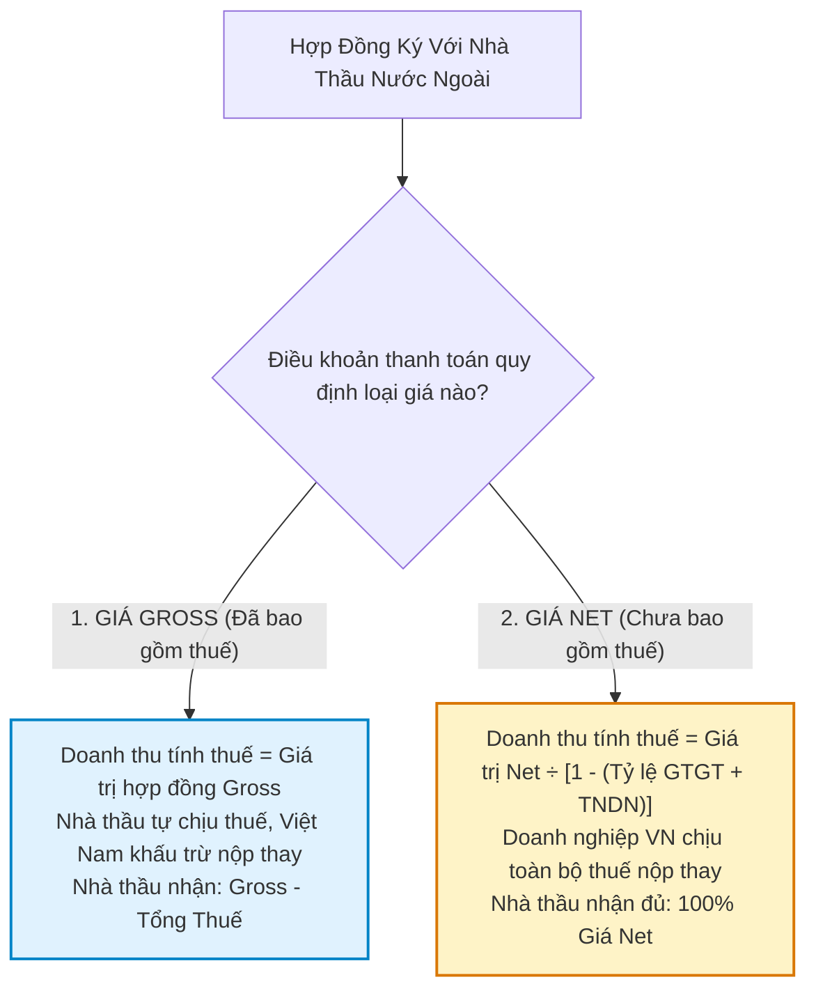

# 🌐 CẨM NANG THUẾ NHÀ THẦU 2026 (HỢP ĐỒNG NET & GROSS) & HƯỚNG DẪN GIẢM TRỪ GIA CẢNH TNCN

> **Tài liệu nghiệp vụ chuyên sâu cập nhật theo:**  
> - **Nghị định 181/2025/NĐ-CP & Nghị định 320/2025/NĐ-CP:** Biểu tỷ lệ % thuế GTGT và TNDN nhà thầu nước ngoài (FCT) năm 2026.  
> - **Công văn số 7401/CT-QLNT ngày 06/10/2026 của Cục Thuế:** Thời điểm kết thúc giảm trừ gia cảnh thuế TNCN đối với con tốt nghiệp đại học.  
> - **Nguồn tham chiếu:** iHOADON & Thư viện Pháp luật / LuậtVietnam.

---

## PHẦN 1: PHÂN BIỆT & CÁCH TÍNH THUẾ NHÀ THẦU (NET VS GROSS)

---

### 1. Hợp Đồng Gross (Giá đã bao gồm toàn bộ thuế)
* **Bản chất:** Nhà thầu nước ngoài chịu toàn bộ nghĩa vụ thuế phát sinh tại Việt Nam. Doanh nghiệp Việt Nam chỉ có trách nhiệm **khấu trừ và nộp thay** vào Ngân sách Nhà nước trước khi chuyển tiền ra nước ngoài.
* **Công thức tính trực tiếp:**
  $$\text{Doanh thu tính thuế GTGT} = \text{Giá trị hợp đồng Gross}$$
  $$\text{Doanh thu tính thuế TNDN} = \text{Giá trị hợp đồng Gross}$$
  $$\text{Thuế GTGT phải nộp} = \text{Doanh thu tính thuế} \times \text{Tỷ lệ \% GTGT}$$
  $$\text{Thuế TNDN phải nộp} = \text{Doanh thu tính thuế} \times \text{Tỷ lệ \% TNDN}$$
  $$\text{Số tiền thực chuyển cho nhà thầu} = \text{Gross} - (\text{Thuế GTGT} + \text{Thuế TNDN})$$

---

### 2. Hợp Đồng Net (Giá chưa bao gồm thuế - Bên Việt Nam chịu thay)
* **Bản chất:** Nhà thầu nước ngoài nhận đủ 100% số tiền thỏa thuận trong hợp đồng. Doanh nghiệp Việt Nam tự chịu toàn bộ khoản thuế GTGT và TNDN nhà thầu.
* **Công thức quy đổi (Gross-up):**
  $$\mathbf{\text{Doanh thu tính thuế}} = \frac{\text{Giá trị hợp đồng Net}}{1 - (\text{Tỷ lệ \% GTGT} + \text{Tỷ lệ \% TNDN})}$$
  $$\text{Thuế GTGT phải nộp} = \text{Doanh thu tính thuế} \times \text{Tỷ lệ \% GTGT}$$
  $$\text{Thuế TNDN phải nộp} = \text{Doanh thu tính thuế} \times \text{Tỷ lệ \% TNDN}$$
  $$\mathbf{\text{Tổng chi phí thực tế DN Việt Nam phải chi}} = \text{Giá Net} + \text{Tổng thuế nộp thay} = \text{Doanh thu tính thuế}$$

> [!IMPORTANT]
> **Điều kiện để khoản Thuế TNDN nhà thầu nộp thay được tính vào chi phí hợp lý:**  
> Trong hợp đồng dịch vụ phải ghi rõ: *"Giá trị thanh toán cho nhà thầu là giá Net, chưa bao gồm các khoản thuế phát sinh tại Việt Nam; bên Việt Nam có nghĩa vụ nộp thay toàn bộ các khoản thuế này"*. Khi đó, tiền thuế TNDN nhà thầu nộp thay được tính vào chi phí được trừ khi xác định thuế TNDN của bên Việt Nam.

---

### 3. Bảng Biểu Tỷ Lệ Thuế Nhà Thầu 2026 (14 Ngành Nghề)
*(Căn cứ Nghị định 181/2025/NĐ-CP và Nghị định 320/2025/NĐ-CP)*

| STT | Ngành Nghề Kinh Doanh Thực Tế | Tỷ lệ % Thuế GTGT (NĐ 181/2025) | Tỷ lệ % Thuế TNDN (NĐ 320/2025) | Tổng Tỷ Lệ Thuế (Giá Gross) |
| :---: | :--- | :---: | :---: | :---: |
| **1** | **Dịch vụ thông thường** *(Quảng cáo Meta/Google, tư vấn pháp lý, tư vấn kỹ thuật)* | **5%** | **5%** | **10%** |
| **2** | **Dịch vụ quản lý nhà hàng, khách sạn, casino** | **5%** | **10%** | **15%** |
| **3** | **Dịch vụ số xuyên biên giới** *(Kinh doanh qua sàn thương mại điện tử)* | **10%** | **5%** | **15%** |
| **4** | **Cho thuê máy móc, thiết bị, giàn khoan, phương tiện vận tải** | **5%** | **5%** | **10%** |
| **5** | **Cho thuê máy bay, trực thăng, tàu lặn, tàu biển** | **5%** | **2%** | **7%** |
| **6** | **Tiền bản quyền (Royalty), quyền sở hữu trí tuệ** | **Miễn thuế GTGT** | **10%** | **10%** |
| **7** | **Lãi tiền vay từ nước ngoài** | **Miễn thuế GTGT** | **5%** | **5%** |
| **8** | **Xây dựng, lắp đặt không bao thầu nguyên vật liệu** | **5%** | **2%** | **7%** |
| **9** | **Xây dựng, lắp đặt có bao thầu nguyên vật liệu** | **3%** | **2%** | **5%** |
| **10** | **Vận tải quốc tế** *(Hàng không, đường biển)* | **3%** | **2%** | **5%** |
| **11** | **Dịch vụ tài chính phái sinh** | **Miễn thuế GTGT** | **2%** | **2%** |
| **12** | **Phân phối, cung cấp hàng hóa tại VN** *(Incoterms giao tại nội địa)* | **1%** | **1%** | **2%** |
| **13** | **Chuyển nhượng chứng khoán, tái bảo hiểm** | **Miễn thuế GTGT** | **0,1%** | **0,1%** |
| **14** | **Chuyển nhượng vốn vào doanh nghiệp Việt Nam** | **Miễn thuế GTGT** | **2%** | **2%** |

---

## PHẦN 2: HƯỚNG DẪN THỜI ĐIỂM KẾT THÚC GIẢM TRỪ GIA CẢNH THUẾ TNCN (CÔNG VĂN 7401/CT-QLNT)

### 1. Nội dung vụ việc & Vướng mắc thực tế
Người nộp thuế (ông Ngô Xuân Thế) có con đang học đại học được đăng ký giảm trừ gia cảnh. Ngày **14/08/2026**, người con tốt nghiệp đại học và được cấp bằng tốt nghiệp. Người nộp thuế băn khoăn: **Thời điểm kết thúc tính giảm trừ gia cảnh là tháng 08/2026 hay tháng 09/2026?**

### 2. Căn cứ pháp lý & Nguyên tắc áp dụng
- **Điểm b khoản 4 Điều 10 Luật Thuế TNCN** & **Điểm c khoản 2 Điều 47 Nghị định 253/2026/NĐ-CP:** Con đang học đại học, cao đẳng, trung cấp chuyên nghiệp, học nghề không có thu nhập hoặc có thu nhập bình quân tháng trong năm không vượt quá mức quy định được tính là người phụ thuộc.
- **Điểm b Điều 48 Nghị định 253/2026/NĐ-CP:** *Người nộp thuế được tạm tính giảm trừ gia cảnh trong năm kể từ khi đăng ký người phụ thuộc và **được tính đủ theo tháng**.*

### 3. Kết luận chính thức của Cục Thuế:
- Do con tốt nghiệp và được cấp bằng ngày **14/08/2026**, tháng 8 vẫn đang trong thời gian học/chờ bằng và nguyên tắc tính giảm trừ là tính trọn vẹn cả tháng.
- Vì vậy, người nộp thuế **được tính giảm trừ gia cảnh hết tháng 08/2026**.
- **Thời điểm kết thúc tính giảm trừ gia cảnh** khai trên **Mẫu số 41/UQ-ĐKT** (Phụ lục II Thông tư 90/2026/TT-BTC) là: **THÁNG 09/2026** *(tức từ tháng 09/2026 trở đi không còn được tính giảm trừ cho người phụ thuộc này)*.
