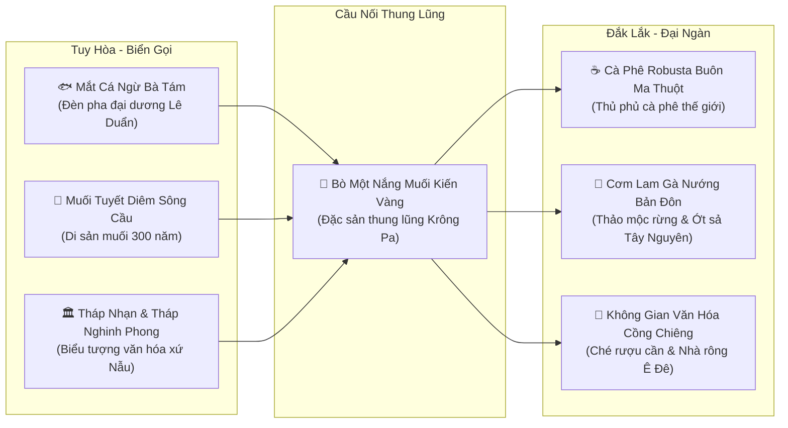

# TINH HOA ẨM THỰC • VĂN HÓA • DU LỊCH LIÊN TUYẾN TUY HÒA (PHÚ YÊN) ⇄ ĐẮK LẮK
**Hành Trình "Biển Xanh Xứ Nẫu — Rừng Xanh Đại Ngàn" • Công Ty TNHH Thương Mại Đất Phú**

---

> *"Buổi sớm ngắm bình minh trên Tháp Nghinh Phong lộng gió, nếm trọn thố mắt cá ngừ đại dương Bà Tám bốc khói; chiều vượt đèo gió ngút ngàn qua thung lũng Krông Pa xé miếng bò một nắng chấm muối kiến vàng, rồi tối quây quần bên ché rượu cần, lắng nghe tiếng cồng chiêng ngân vang giữa đại ngàn Buôn Ma Thuột."*

---

## I. TẦNG NHÌN LIÊN KẾT VÙNG: TRỤC DU LỊCH "RỪNG VÀNG — BIỂN BẠC"

Trục liên kết **Tuy Hòa (Phú Yên) ⇄ Đắk Lắk** qua Quốc Lộ 29 và Quốc Lộ 25 là một trong những hành trình du lịch độc đáo và giàu cảm xúc nhất Việt Nam:
- **Tuy Hòa:** Thủ phủ cá ngừ đại dương của cả nước, bãi biển dài hoang sơ, làng muối di sản Tuyết Diêm 300 năm, hải sản tươi rói.
- **Đắk Lắk:** Thủ phủ cà phê thế giới, không gian văn hóa cồng chiêng Tây Nguyên (Di sản UNESCO), cơm lam gà nướng Bản Đôn, bơ sáp trĩu cành đất đỏ bazan.

---

## II. ĐẠI DIỆN TINH HOA ẨM THỰC NỔI BẬT NHẤT

### 1. Mắt Cá Ngừ Đại Dương Bà Tám (289 Lê Duẩn, TP. Tuy Hòa)
- **Danh xưng:** *"Đèn Pha Đại Dương Xứ Nẫu"* — Món ăn làm rạng danh ẩm thực Tuy Hòa trên bản đồ du lịch quốc tế.
- **Bí quyết chế biến:** Mắt cá ngừ đại dương tươi rói vừa cập bến cảng cá Đông Tác, làm sạch rồi hầm trong thố đất nung cùng thuốc bắc (kỷ tử, táo tàu, thục địa, đẳng sâm, gừng già, ớt hiểm xanh).
- **Cách thưởng thức:** Thố đất sôi sùng sục bốc khói ngào ngạt, rắc thêm lá tía tô thái chỉ, húp muỗng nước dùng ngọt thanh đậm vị thuốc bắc, cắn miếng mắt cá béo ngậy tan trên đầu lưỡi, xua tan mọi mệt mỏi sau chuyến đi xa.
- **Địa chỉ huyền thoại:** Quán Bà Tám — Số 289–293 Lê Duẩn, P. 7, TP. Tuy Hòa.

### 2. Bò Một Nắng Muối Kiến Vàng (Vùng Ranh Giới Krông Pa — Phú Yên)
- **Nguyên liệu độc bản:** Thịt bò cỏ chăn thả tự nhiên trên những đồi cỏ thung lũng Krông Pa, thịt săn chắc, ngọt đậm.
- **Kỹ thuật phơi:** Chọn phần thăn và bắp tươi, ướp ớt xiêm, sả củ, tỏi băm, chỉ phơi đúng **"một nắng hai sương"** để ngoài se khô mà bên trong vẫn giữ nguyên độ mọng nước ngọt mềm.
- **Gia vị linh hồn — Muối Kiến Vàng:** Bắt những tổ kiến vàng rừng nguyên con còn trứng, rang chín giã chung với muối hột Tuyết Diêm, ớt xiêm rừng và lá then len. Vị chua thanh tự nhiên của axit formic trong bụng kiến quyện cùng vị béo ngậy của trứng kiến và vị cay nồng của ớt xiêm rừng tạo nên thức chấm có một không hai.

### 3. Muối Hột & Muối Tuyết Diêm Sông Cầu (Làng Muối Di Sản 300 Năm)
- **Vị thế:** Nằm bên vịnh Xuân Đài (TX. Sông Cầu), làng muối Tuyết Diêm hình thành từ thời chúa Nguyễn (thế kỷ 18), là một trong những vựa muối cổ truyền ngon nhất Việt Nam.
- **Đặc trưng:** Hạt muối to, trắng tinh khiết như tuyết, vị mặn mà không gắt, hậu vị ngọt thanh dịu nhờ nguồn nước biển sâu giàu khoáng chất. Muối Tuyết Diêm là "linh hồn" dùng để ướp cá ngừ, làm mắm Gành Đỏ và tạo nên các loại muối chấm trứ danh.

### 4. Cơm Lam Gà Nướng Bản Đôn & Cà Phê Robusta (Đắk Lắk)
- **Gà nướng Bản Đôn:** Gà thả rẫy chạy đồi chỉ khoảng 1.2kg, ướp mật ong rừng, sả băm, lá é và hạt kơ-nia, nướng vàng ươm trên than củi tre nứa, da giòn rụm thịt ngọt lịm.
- **Cơm lam ống tre:** Gạo nếp nương thơm dẻo ngâm nước suối rừng, nút lá chuối nướng chín đều, bóc lớp vỏ cháy thơm nức mùi tre non.
- **Cà phê Robusta Buôn Ma Thuột:** Cốc cà phê phin phập phồng nhỏ từng giọt đen sánh, đậm đà đắng ngọt trên vùng đất đỏ bazan màu mỡ.

---

## III. TOUR TRẢI NGHIỆM LIÊN TUYẾN: "TỪ ĐÈN PHA ĐẠI DƯƠNG ĐẾN ĐẠI NGÀN TÂY NGUYÊN"

### Lộ trình 3 Ngày 2 Đêm (Xe 7 Chỗ 6K Bác Tài Tấn Dũng Đón Trả Tận Nơi):
- **Ngày 1 (Biển Tuy Hòa):**
  + Sáng: Đón khách sân bay Tuy Hòa — Check-in Tháp Nghinh Phong, Bãi Xép "Hoa vàng trên cỏ xanh".
  + Trưa: Thưởng thức **Mắt cá ngừ đại dương Bà Tám** và gỏi cá ngừ mù tạt.
  + Chiều: Thăm Làng muối di sản Tuyết Diêm Sông Cầu — Vãn cảnh Chùa San Hô Thanh Lương.
  + Tối: Dạo biển Tuy Hòa, thưởng thức bánh canh hẹ và kem bơ sáp.
- **Ngày 2 (Vượt Đèo Lên Tây Nguyên — Thung Lũng Krông Pa):**
  + Sáng: Khởi hành theo QL25 qua Tây Hòa, vượt đèo ngắm rừng cao su và rẫy mía bạt ngàn của Chú Trúc.
  + Trưa: Dừng chân Krông Pa thưởng thức **Đại tiệc Bò Một Nắng nướng than hồng chấm Muối Kiến Vàng**.
  + Chiều: Đến TP. Buôn Ma Thuột — Check-in Bảo Tàng Thế Giới Cà Phê, Làng Cà Phê Trung Nguyên.
  + Tối: Giao lưu văn hóa Cồng chiêng Ê Đê, uống rượu cần bên bếp lửa buôn Akô Dhông.
- **Ngày 3 (Khám Phá Đại Ngàn & Mua Quà Đặc Sản):**
  + Sáng: Thăm Cụm thác Dray Nur kỳ vĩ — Trải nghiệm chèo thuyền vượt thác.
  + Trưa: Ăn trưa Cơm lam gà nướng Bản Đôn tại buôn làng.
  + Chiều: Ghé vựa chọn mua cà phê Robusta rang mộc, bơ sáp Booth, muối kiến vàng đóng hộp chuẩn OCOP Đất Phú đưa khách về lại Tuy Hòa hoặc tiễn sân bay Buôn Ma Thuột.

---

## IV. CƠ CHẾ ĐẤT PHÚ ONEBASE KẾT NỐI CHUỖI CUNG ỨNG

1. **Chuẩn Hóa OCOP & Kiểm Định 6K:** Mọi mẻ Bò một nắng Krông Pa, hũ Muối Tuyết Diêm, hộp Cá ngừ Bà Tám đóng chân không đều được dán tem truy xuất nguồn gốc QR Code của Đất Phú, đảm bảo ATTP tuyệt đối.
2. **Logistics T+1 Liên Tuyến Tuy Hòa ⇄ Đắk Lắk:** Mạng lưới xe khách Thuận Thảo, Cúc Tư và Đất Phú 6K Express chuyển phát đặc sản tươi sống đóng thùng xốp đá gel giao hỏa tốc giữa Tuy Hòa và Buôn Ma Thuột chỉ trong 3–4 giờ.
3. **Thanh Toán Tiện Lợi & Quyết Toán Minh Bạch:** Quét mã VietQR 1 chạm, hỗ trợ xuất hóa đơn điện tử cho du khách và đoàn công tác theo Thông tư 88.

---

**ĐẤT PHÚ ONEBASE — CẦU NỐI KẾT TINH BIỂN XANH TUY HÒA & ĐẠI NGÀN ĐẮK LẮK!**
*(Phát hành chính thức bởi Công ty TNHH Thương Mại Đất Phú)*
