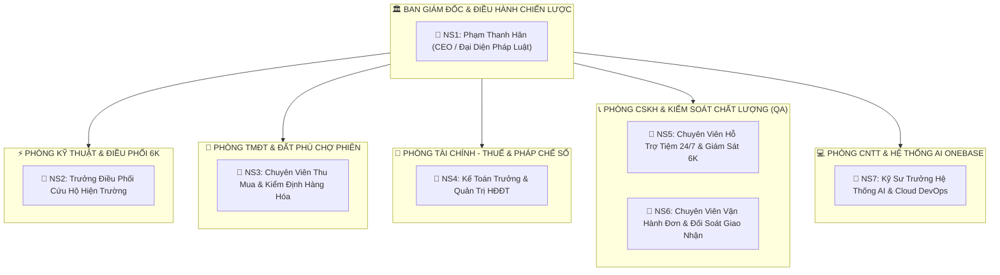

# CƠ CẤU VẬN HÀNH DOANH NGHIỆP SỐ BẢN ĐỊA
## CÔNG TY TNHH THƯƠNG MẠI ĐẤT PHÚ (MST: 4401020233)
*Mô hình: Asset-Light • Zero-Trust • AI-Driven Operations (Kín Kẽ OS™ Gen 4)*

---

## 1. SƠ ĐỒ TỔNG THỂ: 6 PHÒNG BAN – 7 NHÂN SỰ – 13 CÔNG CỤ AI



---

## 2. CHI TIẾT 6 PHÒNG BAN & 7 NHÂN SỰ NÒNG CỐT

| STT | Phòng Ban | Nhân Sự Phụ Trách | Nhiệm Vụ Trọng Tâm |
| :---: | :--- | :--- | :--- |
| **1** | **Ban Giám Đốc & Điều Hành** | **NS1: Phạm Thanh Hân** *(Giám Đốc / Đại Diện Pháp Luật)* | Hoạch định chiến lược kinh doanh bản địa, ký kết hợp đồng CeCA, chịu trách nhiệm pháp lý thuế và thương hiệu Đất Phú. |
| **2** | **Kỹ Thuật & Điều Phối Thợ 6K** | **NS2: Trưởng Điều Phối Kỹ Thuật** | Giám sát 5 tổ thợ thực địa (Chú Tùng, Quốc Hưng, Văn Long, Hoàng Tuấn, Đình Hải), điều phối ca cứu hộ khẩn 15-20 phút. |
| **3** | **TMĐT & Đất Phú Chợ Phiên** | **NS3: Chuyên Viên Kiểm Định & Thu Mua** | Thẩm định chất lượng sách cũ, thiết bị điện thanh lý test 6K, camera Imou/Ezviz và nguồn hàng đặc sản xứ Nẫu chuẩn OCOP. |
| **4** | **Tài Chính - Thuế & Pháp Chế Số** | **NS4: Kế Toán Trưởng & Pháp Chế** | Quản trị phát hành Hóa đơn điện tử có mã CQT (**1C26TDP**), chữ ký số EFY-CA, báo cáo thuế Cục Thuế tỉnh Đắk Lắk/Phú Yên. |
| **5** | **CSKH & Kiểm Soát Chất Lượng** | **NS5: Chuyên Viên Hỗ Trợ Tiệm 24/7**<br/>**NS6: Chuyên Viên Vận Hành & Giao Nhận** | • Trực tổng đài tiếp nhận sự cố tiệm tóc, tiệm cafe, giải quyết khiếu nại.<br/>• Đối soát đơn hàng Chợ Phiên, theo dõi đóng gói và điều phối shipper Tuy Hòa. |
| **6** | **CNTT & Hệ Thống AI OneBase** | **NS7: Kỹ Sư Trưởng AI & Cloud DevOps** | Quản trị hạ tầng Cloud Supabase, GitHub, Vercel, bảo mật API, tinh chỉnh prompt và duy trì 13 trợ lý AI hoạt động 24/7. |

---

## 3. DANH MỤC 13 CÔNG CỤ AI VẬN HÀNH DOANH NGHIỆP

Nhờ 13 công cụ AI tự động hóa hơn 80% khối lượng tác vụ lặp lại, đội ngũ 7 nhân sự của Đất Phú có thể vận hành khối lượng công việc tương đương một công ty 50 nhân viên:

| STT | Tên Công Cụ AI | Phân Hệ Ứng Dụng | Chức Năng Vận Hành Cụ Thể |
| :---: | :--- | :--- | :--- |
| **AI-01** | **Antigravity AI (Google DeepMind)** | Toàn hệ thống | Trợ lý kiến trúc sư lập trình, tự động phát triển, debug mã nguồn và kiểm thử hệ thống Đất Phú OneBase. |
| **AI-02** | **AI PostGIS Dispatcher** | Phòng Kỹ Thuật | Tự động tính toán tọa độ GPS khách hàng, đo mật độ giao thông Tuy Hòa và tự động gán thợ gần nhất (ETA 15-20p). |
| **AI-03** | **AI Image Inspection 6K** | Phòng Kỹ Thuật & QA | Tự động phân tích ảnh chụp sự cố hiện trường (K3) để phát hiện hư hỏng dây điện, rò rỉ nước, bo mạch cháy trước khi thợ báo giá. |
| **AI-04** | **AI Dynamic Pricing & Valuation** | Phòng TMĐT | Thuật toán định giá sách cũ quý, đồ thanh lý và phụ tùng thay thế dựa trên tuổi thọ và độ hao mòn thực tế. |
| **AI-05** | **AI Product Content Studio** | Phòng TMĐT | Tự động tạo tiêu đề, mô tả hấp dẫn, xuất xứ và hướng dẫn sử dụng cho sách cổ và đặc sản xứ Nẫu (chuẩn SEO bản địa). |
| **AI-06** | **AI VietQR Matcher & Anti-Fraud** | Phòng Tài Chính | Đối soát tự động biến động số dư Napas 247 với mã đơn `DATPHU DPxxxx`, ngăn chặn bill chuyển khoản giả mạo. |
| **AI-07** | **AI E-Invoice Auto-Issuer** | Phòng Tài Chính | Tự động bóc tách tiền công lao động và tiền linh kiện khi phiếu thợ đạt mốc K5 để ký phát hành HĐĐT **1C26TDP** qua EFY. |
| **AI-08** | **AI EFY-eKYC & OCR Scanner** | Phòng Pháp Chế | Tự động đọc và đối chiếu CCCD, giấy phép đăng ký hộ kinh doanh của các tiệm/shop và hồ sơ lý lịch tư pháp của thợ 6K. |
| **AI-09** | **AI Legal & Contract Assistant** | Ban Giám Đốc | Tự động soạn thảo, soát xét các điều khoản biên bản nghiệm thu và hợp đồng đại lý thương mại điện tử CeCA Bộ Công Thương. |
| **AI-10** | **AI Voice Bot Hotline Cứu Hộ** | Phòng CSKH | Tiếp nhận tự động cuộc gọi khẩn cấp khi chủ tiệm gọi đến vào ban đêm hoặc giờ cao điểm, chuyển giọng nói thành phiếu K1. |
| **AI-11** | **AI Sentiment & Review Analyzer** | Phòng CSKH | Quét thời gian thực đánh giá và bình luận 1-5 sao của khách hàng, cảnh báo ngay lập tức nếu thợ bị chấm dưới 4 sao. |
| **AI-12** | **AI Inventory Forecaster** | Phòng Kỹ Thuật & Kho | Dự báo trước số lượng vật tư cần nhập vào cốp xe thợ (gas máy lạnh, cầu dao, khóa cửa cuốn, camera Imou/Ezviz) theo tuần. |
| **AI-13** | **AI 6K KPI & Audit Auditor** | Ban Giám Đốc | Tự động kiểm toán tiến trình K1 -> K6 của từng ca thợ, chấm điểm mức độ tuân thủ quy chuẩn để tính hoa hồng minh bạch. |

---

## 4. HIỆU QUẢ CỦA MÔ HÌNH VẬN HÀNH TINH GỌN

```
         [ 7 Nhân Sự Cốt Lõi ] 
                  ➕
         [ 13 Công Cụ AI Tự Động ]
                  ⬇️
┌───────────────────────────────────────┐
│ • Tiết kiệm 75% chi phí vận hành cố định│
│ • Không lo sai sót kế toán & thuế     │
│ • Phản hồi cứu hộ tiệm dưới 15 phút   │
│ • Vận hành 24/7 không gián đoạn       │
└───────────────────────────────────────┘
```
