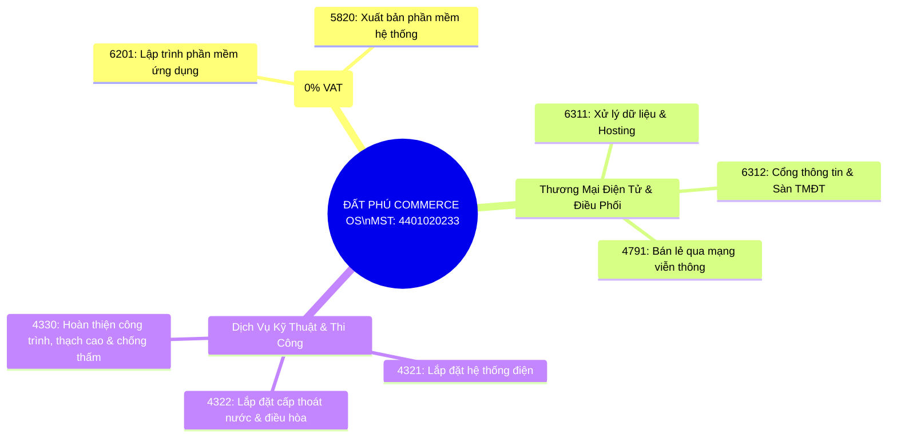

# HỒ SƠ PHÁP LÝ & HỆ THỐNG VẬN HÀNH CHÍNH THỨC
## CÔNG TY TNHH THƯƠNG MẠI ĐẤT PHÚ

---

### 1. Thông Tin Định Danh Pháp Nhân & Đăng Ký Thuế
| Mục thông tin | Chi tiết chính thức |
| :--- | :--- |
| **Tên doanh nghiệp** | **CÔNG TY TNHH THƯƠNG MẠI ĐẤT PHÚ** |
| **Mã số thuế (MST)** | **`4401020233`** |
| **Địa chỉ trụ sở chính** | **21/146 Ngô Gia Tự, Khu Phố Phú Đông 2, Phường Phú Yên, Tỉnh Đắk Lắk** |
| **Hình thức doanh nghiệp** | Công ty Trách nhiệm Hữu hạn Thương mại |
| **Đại diện pháp luật** | **Phạm Thanh Hân** |
| **Tài khoản ngân hàng chính thức** | **0751000025858** tại **Ngân hàng TMCP Ngoại Thương Việt Nam (Vietcombank - CN Phú Yên)** |
| **Chủ tài khoản** | **CÔNG TY TNHH THƯƠNG MẠI ĐẤT PHÚ** |
| **Phương thức thanh toán số** | VietQR Napas 247 khớp biến động số dư tự động |
| **Định danh điện tử** | VNeID Doanh nghiệp & Chữ ký số Token hợp pháp |
| **Hệ thống Hóa đơn điện tử** | Áp dụng ký hiệu hóa đơn có mã CQT: `1C26TDP` theo NĐ 70/2025/NĐ-CP & TT 32/2025/TT-BTC |

---

### 2. Cấu Trúc Mã Ngành Kinh Doanh (VSIC) Đăng Ký

---

### 3. Đồng Bộ Hóa Hệ Thống Số (OneBase Engine)
Toàn bộ hệ thống kỹ thuật và giao dịch đã được đồng bộ với thông tin pháp lý mới:

1. **Hóa Đơn Điện Tử (E-Invoice):**
   * Tên đơn vị bán: **CÔNG TY TNHH THƯƠNG MẠI ĐẤT PHÚ**
   * MST người bán: **`4401020233`**
   * Địa chỉ: **21/146 Ngô Gia Tự, KP. Phú Đông 2, Phường Phú Yên, Tỉnh Đắk Lắk**
   * Cơ chế bóc tách:
     * Dịch vụ phần mềm bản quyền (SW001–SW003): Thuế suất **KCT (0%)**.
     * Dịch vụ sàn TMĐT / Phí kết nối: Thuế suất **10% VAT**.
     * Hạng mục thi công, sửa chữa dân dụng: Thuế suất theo quy định hiện hành.

2. **Cổng Thanh Toán VietQR Napas 247 Khớp Đơn Tự Động:**
   * **Ngân hàng thụ hưởng:** Vietcombank (Ngoại thương Việt Nam) - CN Phú Yên
   * **Số tài khoản:** **`0751000025858`**
   * **Chủ tài khoản:** **CONG TY TNHH THUONG MAI DAT PHU**
   * **Cú pháp nội dung:** `DATPHU [Mã Đơn]` (Ví dụ: `DATPHU DP2418`)
   * **Webhook đối soát:** AI VietQR Matcher tự động đối chiếu số dư biến động thời gian thực.

3. **Quy Trình Kiểm Toán Đơn & Phiếu Thợ 6K (Kín Kẽ OS):**
   * **K1 - Định vị:** Tiếp nhận đơn sửa chữa, xác định tọa độ khách hàng.
   * **K2 - Điều phối thợ:** Phân bổ thợ trong bán kính gần nhất, gửi thông báo ETA.
   * **K3 - Khảo sát hiện trạng:** Chụp ảnh ghi nhận sự cố ban đầu trước khi sửa chữa.
   * **K4 - Báo giá niêm yết:** Bóc tách tiền công lao động và tiền linh kiện cốp xe.
   * **K5 - Nghiệm thu hoàn thiện:** Xác nhận khách hàng hài lòng, chụp ảnh lưu trữ.
   * **K6 - Bảo hành số:** Kích hoạt hóa đơn điện tử và bảo hành số 30 ngày qua Zalo OA.

---

### 4. Đội Thợ & Trạm Cứu Trợ Cộng Đồng Liên Kết
* **Mạng lưới thợ nòng cốt:** Đội ngũ thợ lành nghề (Điện nước, Điện lạnh, Sửa khóa, Đèn năng lượng mặt trời, Xây dựng hoàn thiện & Chống thấm).
* **Trạm thiện nguyện CT-01:** "Chung tay khôi phục điện nước & mái nhà cho bà con khó khăn", sẵn sàng trích nguồn lực và vật tư hỗ trợ cộng đồng.
