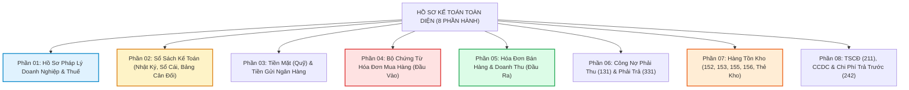

# 🗄️ QUY TRÌNH LƯU TRỮ HỒ SƠ – CHỨNG TỪ – SỔ SÁCH KẾ TOÁN NĂM 2026 (MỚI NHẤT TỪ 01/07/2026)

> **Cẩm nang Chuẩn hóa Lưu trữ Kế toán & Hồ sơ Giải trình Thuế:**  
> *Được biên soạn từ hệ thống iHOADON & chuẩn kiểm toán quản trị Công ty TNHH Thương mại Đất Phú.*  
> *Mục tiêu: Đảm bảo 100% hồ sơ sẵn sàng cho thanh tra thuế, quyết toán tài chính, không thất lạc chứng từ sau 5–10 năm.*

---

---

## PHẦN 01: HỒ SƠ PHÁP LÝ DOANH NGHIỆP

### 1. Hồ sơ đăng ký doanh nghiệp
- Giấy chứng nhận đăng ký doanh nghiệp (ĐKKD) gốc và các lần thay đổi.
- Điều lệ công ty và các biên bản họp, nghị quyết sửa đổi Điều lệ.
- Danh sách thành viên / cổ đông sáng lập.
- Hồ sơ góp vốn, Giấy chứng nhận phần vốn góp / sổ cổ đông.
- Quyết định bổ nhiệm Giám đốc/Tổng Giám đốc, Kế toán trưởng/Người phụ trách kế toán.
- Các giấy phép con theo ngành nghề (Giấy phép ATTP chuỗi Năm Tiền, giấy phép PCCC...).
- Hồ sơ pháp lý địa điểm kinh doanh, chi nhánh, văn phòng đại diện.

### 2. Hồ sơ Thuế – Ngân hàng – Chữ ký số
- Giấy chứng nhận đăng ký thuế và các thông báo của cơ quan thuế.
- Hồ sơ đăng ký tài khoản ngân hàng (thông báo mẫu 08/MST hoặc đăng ký với Sở KH&ĐT).
- Hợp đồng và chứng thư số (USB Token / Cloud HSM / EFY-CA).
- Thông báo chấp thuận đăng ký sử dụng hóa đơn điện tử (Mẫu 01/ĐKTĐ-HĐĐT).
- Các thông báo cơ quan thuế liên quan đến hóa đơn điện tử và phương pháp trích khấu hao.

---

## PHẦN 02: SỔ SÁCH KẾ TOÁN

1. **Sổ Nhật ký chung:**
   - Đóng sổ theo tháng 01 ➔ tháng 12 (DN ít nghiệp vụ có thể đóng 01 cuốn/năm; DN nhiều nghiệp vụ nên lưu theo tháng/quý để tránh quyển dày hàng nghìn trang).
   - Kèm bảng tổng hợp chứng từ/bút toán cuối kỳ, các bút toán phân bổ, trích trước và kết chuyển cuối kỳ.
2. **Sổ Cái:**
   - In và lưu sổ cái toàn bộ tài khoản thực tế phát sinh trong năm: 111, 112, 131, 133, 141, 152, 156, 211, 214, 242, 331, 333, 334, 338, 411, 421, 511, 632, 641, 642, 811, 911... *(Không cần in máy móc tài khoản không có số dư và không phát sinh).*
3. **Bộ sổ tổng hợp cuối kỳ:**
   - Bảng cân đối số phát sinh tài khoản.
   - Bảng tổng hợp công nợ (131, 331), tổng hợp hàng tồn kho, tổng hợp TSCĐ.
   - Bảng phân bổ CCDC (242), bảng tính giá thành sản phẩm, bảng tổng hợp doanh thu - chi phí.
   - *Lưu ý sống còn:* Các bảng đối chiếu chi tiết mới là bằng chứng vững chắc nhất để bảo vệ số liệu trước đoàn thanh tra.

---

## PHẦN 03: TIỀN MẶT VÀ TIỀN GỬI NGÂN HÀNG

### A. Tiền mặt (TK 111)
- **Lưu theo từng tháng:**
  - **Phiếu thu** ➔ Kèm chứng từ gốc (giấy nộp tiền, phiếu thanh toán).
  - **Phiếu chi** ➔ Kèm giấy đề nghị tạm ứng/thanh toán ➔ Chứng từ gốc ➔ Hóa đơn/Hợp đồng.
- **Hồ sơ bắt buộc đính kèm cuối năm:** Sổ quỹ tiền mặt; Biên bản kiểm kê quỹ tiền mặt chốt ngày 31/12; Hồ sơ tạm ứng và hoàn ứng; Biên bản đối chiếu số dư giữa Kế toán và Thủ quỹ.

### B. Tiền gửi ngân hàng (TK 112)
- **Lưu riêng theo từng tài khoản ngân hàng (mỗi ngân hàng 1 folder riêng chia theo 12 tháng):**
  - Sổ phụ ngân hàng / Bảng sao kê chi tiết hàng tháng.
  - Giấy báo Có (tiền về), Giấy báo Nợ (tiền đi).
  - Ủy nhiệm chi (UNC) / Lệnh chuyển tiền có chữ ký duyệt.
  - Chứng từ thu phí quản lý tài khoản, phí giao dịch.
  - Hồ sơ hợp đồng vay vốn, khế ước nhận nợ, chứng từ trả gốc và lãi vay.
  - Biên bản xác nhận số dư tài khoản ngân hàng thời điểm 31/12.

---

## PHẦN 04: BỘ CHỨNG TỪ HÓA ĐƠN ĐẦU VÀO (MUA HÀNG)

Mỗi giao dịch mua sắm quan trọng bắt buộc phải cấu thành **"Bộ chứng từ mua hàng khép kín"**:

$$\mathbf{\text{Đề nghị mua / PO}} \longrightarrow \mathbf{\text{Hợp đồng}} \longrightarrow \mathbf{\text{Biên bản giao nhận / Nhập kho}} \longrightarrow \mathbf{\text{Hóa đơn GTGT}} \longrightarrow \mathbf{\text{Chứng từ thanh toán}}$$

- **Hồ sơ bổ trợ (tùy giao dịch):** Báo giá cạnh tranh; Biên bản kiểm nghiệm chất lượng; Hồ sơ vận chuyển; Biên bản đối chiếu công nợ; Hồ sơ xử lý hóa đơn điều chỉnh/thay thế.
- ⚠️ **Kiểm soát thanh toán không dùng tiền mặt:** Lập danh sách theo dõi riêng các hóa đơn từ 5 triệu hoặc 20 triệu đồng trở lên, đảm bảo 100% có UNC thanh toán qua ngân hàng đúng tài khoản của nhà cung cấp để bảo vệ chi phí được trừ và thuế GTGT khấu trừ.

---

## PHẦN 05: HÓA ĐƠN ĐẦU RA VÀ DOANH THU

Lưu trữ theo từng tháng/quý:
- File XML + PDF Hóa đơn điện tử đầu ra (Ký hiệu `1C26TDP`).
- Bảng kê chi tiết hóa đơn bán hàng xuất trong kỳ.
- Hợp đồng kinh tế bán hàng, đơn đặt hàng của khách.
- Phiếu xuất kho, biên bản bàn giao hàng hóa có chữ ký người nhận.
- Biên bản nghiệm thu dịch vụ, biên bản thanh lý hợp đồng.
- Chứng từ thu tiền (báo Có ngân hàng hoặc phiếu thu tiền mặt).
- 🔍 **Nguyên tắc đối chiếu chéo 4 bên:**
  $$\mathbf{\text{Doanh thu sổ kế toán}} \iff \mathbf{\text{Tổng Hóa đơn}} \iff \mathbf{\text{Tờ khai 01/GTGT}} \iff \mathbf{\text{Sổ TK 131 / Tiền thu về}}$$
  *(Nếu có chênh lệch, kế toán phải lập ngay Bảng giải trình nguyên nhân: doanh thu chưa thực hiện, chiết khấu thương mại, hàng bán trả lại...).*

---

## PHẦN 06: CÔNG NỢ PHẢI THU (131) VÀ PHẢI TRẢ (331)

1. **Công nợ phải thu khách hàng (TK 131):**
   - Bảng tổng hợp công nợ 131 và sổ chi tiết công nợ từng đối tượng khách hàng.
   - Kèm: Hợp đồng, Hóa đơn, Biên bản đối chiếu công nợ có đóng dấu tròn của khách hàng.
   - Hồ sơ công nợ quá hạn: Thư nhắc nợ, biên bản làm việc, hồ sơ trích lập dự phòng nợ phải thu khó đòi.
2. **Công nợ phải trả người bán (TK 331):**
   - Chuỗi hồ sơ: `Nhà cung cấp ➔ Hợp đồng ➔ Hóa đơn ➔ Nhập kho/Nghiệm thu ➔ Công nợ ➔ Thanh toán`.
3. **Đối chiếu chốt sổ cuối năm:**
   - Tổng số dư chi tiết 131 phải khớp 100% với Sổ Cái 131.
   - Tổng số dư chi tiết 331 phải khớp 100% với Sổ Cái 331.
   - Các khoản nợ treo lâu năm, số dư ngược tính chất (dư Có 131, dư Nợ 331) phải rà soát và có giải trình riêng.

---

## PHẦN 07: HÀNG TỒN KHO (152, 153, 154, 155, 156)

Áp dụng cho doanh nghiệp thương mại, phân phối thực phẩm (Đất Phú OneBase, Siêu thị Năm Tiền):
- Phiếu nhập kho, phiếu xuất kho đánh số liên tục.
- Thẻ kho (do thủ kho ghi) và Sổ chi tiết vật tư, hàng hóa (do kế toán kho theo dõi).
- Bảng tổng hợp Nhập – Xuất – Tồn kho định kỳ tháng/quý.
- Biên bản kiểm kê hàng tồn kho thực tế cuối năm (có chữ ký Thủ kho + Kế toán + Ban Giám đốc).
- Biên bản xử lý chênh lệch thừa/thiếu khi kiểm kê; hồ sơ hủy hàng hỏng cận date theo chuẩn FEFO.
- Hồ sơ hàng xuất khuyến mại, biếu tặng nội bộ, xuất gia công ngoài.
- 🎯 **Quy tắc vàng:** $\mathbf{\text{Tồn kho sổ kế toán}} = \mathbf{\text{Sổ kho}} = \mathbf{\text{Kiểm kê thực tế}}$.

---

## PHẦN 08: TÀI SẢN CỐ ĐỊNH, CÔNG CỤ DỤNG CỤ VÀ CHI PHÍ TRẢ TRƯỚC

### 1. Tài sản cố định (TK 211, 214)
Mỗi một tài sản phải lập riêng một bộ hồ sơ trọn đời:
$$\mathbf{\text{Hợp đồng}} \longrightarrow \mathbf{\text{Hóa đơn}} \longrightarrow \mathbf{\text{UNC thanh toán}} \longrightarrow \mathbf{\text{Biên bản giao nhận/Lắp đặt}} \longrightarrow \mathbf{\text{Hồ sơ pháp lý}} \longrightarrow \mathbf{\text{Biên bản ghi tăng & Bảng trích khấu hao}}$$
- Hồ sơ bảo dưỡng, sửa chữa lớn hoặc nâng cấp làm tăng giá trị TSCĐ.
- Hồ sơ thanh lý, nhượng bán (biên bản đánh giá lại, biên bản thanh lý, hóa đơn xuất bán).
- Biên bản kiểm kê TSCĐ định kỳ cuối năm.

### 2. CCDC và Chi phí trả trước (TK 242)
- Hóa đơn, phiếu xuất dùng, biên bản bàn giao sử dụng CCDC cho các bộ phận.
- Bảng tính phân bổ chi phí trả trước (thời gian phân bổ từ 12 đến tối đa 36 tháng).
- Sổ chi tiết theo dõi TK 242.
- ⚠️ *Cảnh báo:* Không được chỉ lưu một bảng tính Excel mà không lưu chứng từ gốc hình thành ban đầu.
